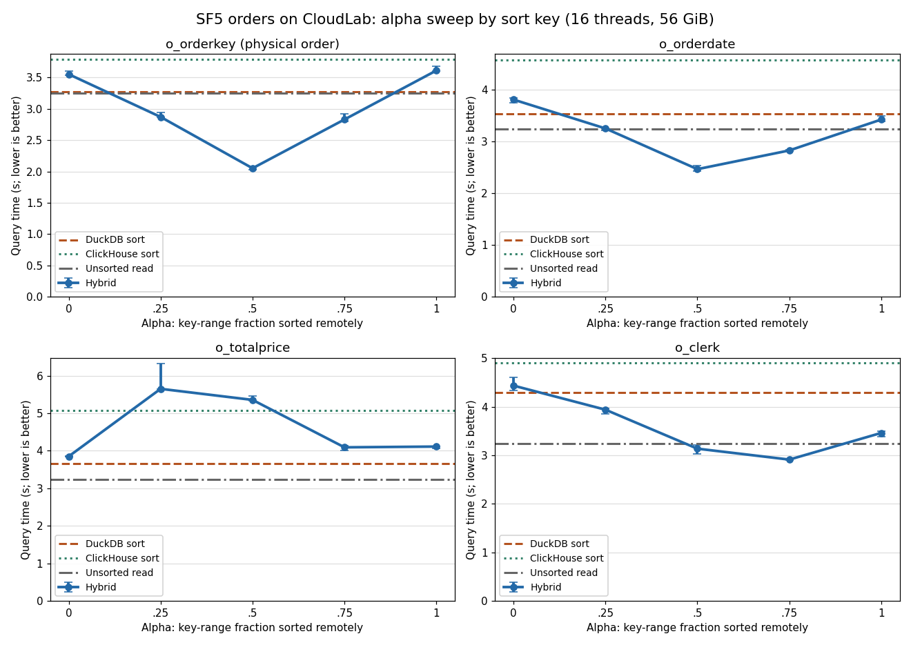
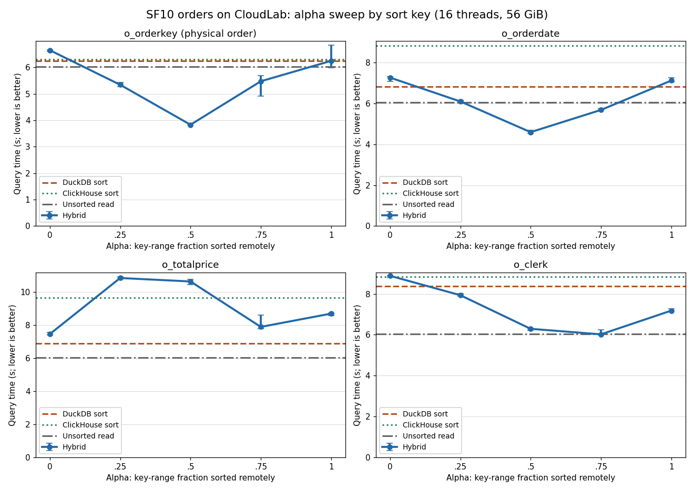
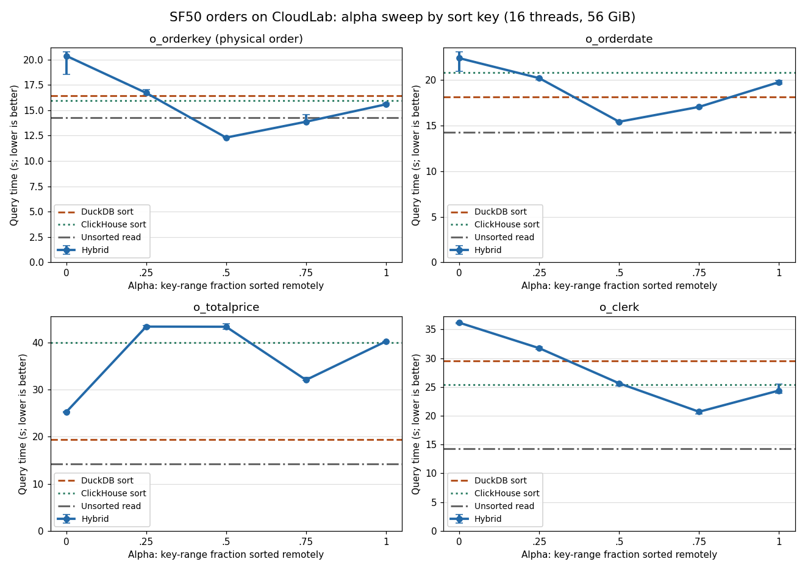
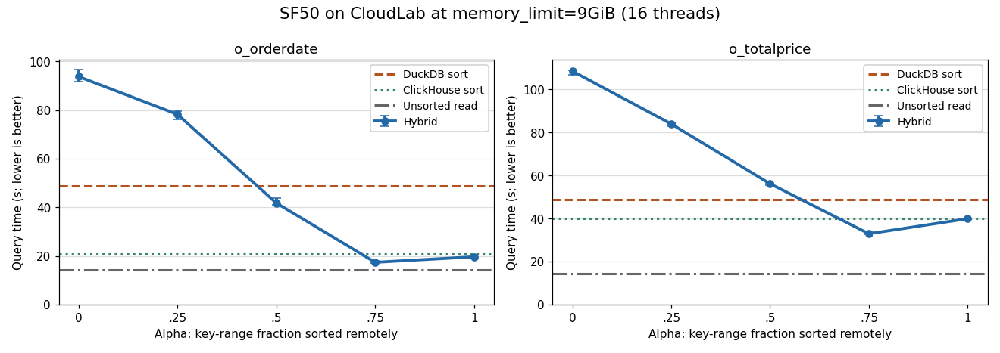
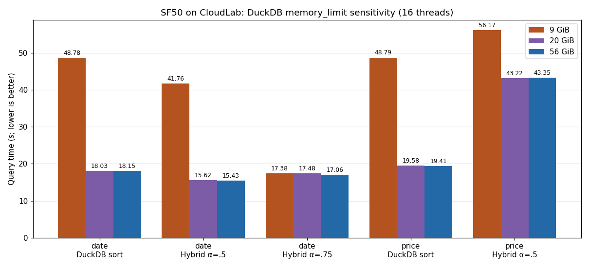
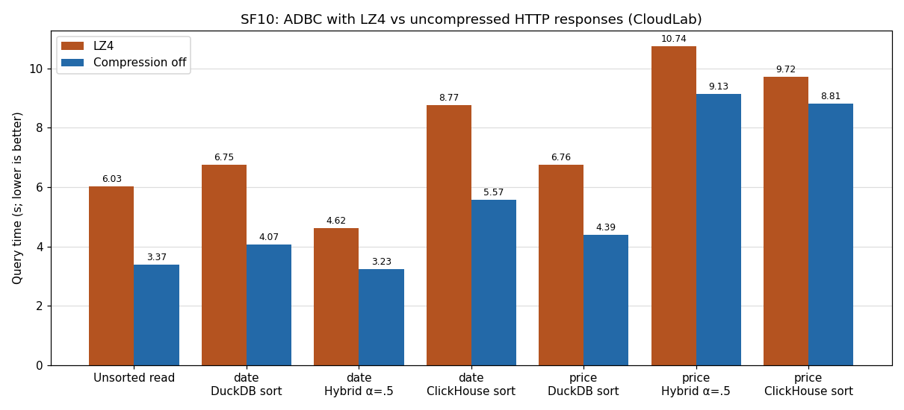

# CloudLab rerun of the SF5 / SF10 / SF50 sort reports

Measured 2026-11-10 on `c220g2-010602.wisc.cloudlab.us` (2× Xeon E5-2660 v3,
2.6 GHz Haswell, 40 logical CPUs, 157 GiB) against the workstation reports in
[sf5](../sf5/README.md), [sf10](../sf10/README.md),
[sf10 profiling](../sf10/PROFILING.md), [sf10 perf](../sf10/PERF_SCHEMA_OFF.md)
and [sf50](../sf50/README.md). Full tables are in [results.md](./results.md).

## Setup and deliberate differences

| | Workstation reports | This rerun |
|---|---|---|
| CPU per engine | 4 physical cores (affinity) | 16 logical CPUs (8 cores) per systemd slice, separate NUMA nodes, 64 GiB cap each |
| DuckDB | `threads=4`, `memory_limit=9GiB` | `threads=16`, `56GiB`; SF50 also 9 GiB and 20 GiB |
| ClickHouse | 26.10.1.1810 | 26.9.12.8 |
| Repeats | 2 (SF50: 2–3 after warmup) | warmup + 3 measured passes, alternating order |
| Alpha sweep | SF5/SF10 all keys; SF50 date/price at 9 GiB | **all four keys at every scale factor** |

DuckDB/ADBC are `main` at `cf3dd0f` (DuckDB `45ebff1561`). SF5/SF10 use the
installed dbc ClickHouse driver 0.1.1. The compression, schema-only and SF50
runs use connectors built from `adbc_clickhouse` `2c374ad` with the tracked
patches ([connector.diff](./connector.diff)). SF50 loads only `orders`, as the
report did. Times are `EXPLAIN (ANALYZE, FORMAT JSON)` `total_time`, the same as
the reports. Absolute times are about 3× slower on this older CPU, so compare
rankings and shapes rather than seconds.

## Connector fixes needed to reproduce the schema-only build

The schema-only prototype was not committed, so I rebuilt `ExecuteSchema` as
`DESCRIBE (<query>)` from the query-ID patch's context. Against ClickHouse 26.9
the connector's `DESCRIBE` type mapping disagrees with the ArrowStream it
actually receives:

- `Date` was declared `UInt16`, but ClickHouse ≥ 26.2 defaults
  `output_format_arrow_date_as_uint16 = 0` and sends `date32`.
- `Decimal(15,2)` was declared Arrow `Decimal64`, but ClickHouse sends
  `decimal128`. DuckDB bound the 8-byte layout and **silently read the 16-byte
  buffer**: `sum(o_totalprice)` over SF5 came back as 566,650,765,257.41
  instead of 1,133,439,215,246.25, with no error.

After both fixes all five drivers give identical full-row checksums for
`read_adbc` and `read_adbc_partial_sort`. **If the workstation prototype had
the same mapping, its `read_adbc` paths (DuckDB sort, ClickHouse sort,
unsorted read) in the SF50 and PERF_SCHEMA_OFF reports read wrong price values.**
The hybrid function binds via a LIMIT-1 data probe and is unaffected.

## What reproduced

- **SF5 and SF10 alpha sweeps.** The fastest path matches the report for 7 of
  8 key/SF pairs. The exception is SF10 `o_orderkey`, where the report's α=.5
  and α=.75 were tied within 7 ms and CloudLab picks α=.5. Same shapes: V-shaped curves
  for orderkey/date/clerk; price has no winning alpha and DuckDB sort is best.
- **Interleaved merge copy** is the hybrid's price bottleneck: α=.5 copies
  every output row (7.5M / 15M / 75M), and the single-thread merge loop takes
  3.1 / 6.0 / 27.4 s. Date copies 9.91M of 75M at SF50 (report: 9.9M).
- **SF50 memory sensitivity.** DuckDB's direct sort drops sharply from 9 to
  20 GiB (date 48.8 → 18.0 s; price 48.8 → 19.6 s); α=.75 does not spill and is
  flat (17.4 / 17.5 / 17.1 s). α=0 spills ~10.5 GB at 9 GiB (report 9–10 GB).
  Price α=.5 stays slow without spill (43 s), because of the merge loop.
- **SF50 9 GiB alpha shape:** a steep fall to α=.75, then a rise at α=1, for
  both keys.
- **ClickHouse price-sort hotspots** (server perf): `ColumnString::insertFrom`
  24.5%, ZSTD decompression 11.6%, Decimal `compareAt` 9.4%, Decimal `>` 8.5%
  (report: 15.8 / 12.2 / 14.3 / 9.3%). The client hybrid profiles are dominated
  by string copy/gather (`VectorStringBuffer::CopyInternal`,
  `TupleDataTemplatedGather`) and libc memmove.
- **Compression off speeds up every path**, and ArrowStream costs more than
  Native in the curl controls.

## What did not reproduce

- **Transfer on this host is relatively much slower.** The uncompressed
  unsorted SF10 read takes 3.37 s (report 0.69 s, 4.9× slower, versus ~3× for
  everything else). SF50 curl ArrowStream takes 14.6 s versus Native 8.5 s and
  Null 2.0 s (report 2.6 / 1.7 / 1.3 s); the ADBC unsorted read (14.3 s) sits on
  that ArrowStream floor. ClickHouse's Arrow output runs at about 0.66 GB/s here.
- Because the transfer floor is higher, **splitting the sort still pays off with
  compression off**: SF10 date hybrid α=.5 beats the DuckDB sort (3.23 vs 4.07 s
  and 3.22 vs 4.13 s with the schema-only connector). The reports found the DuckDB
  sort best for date with compression off.
- **SF50 winners shift toward α=.75.** At 9 GiB, α=.75 is fastest for date
  (17.4 s vs ClickHouse 20.8 s; report ClickHouse 7.48 just ahead of α=.75 7.73)
  and for price (32.9 s vs DuckDB 48.8 s, ClickHouse 40.0 s; report DuckDB 9.01
  best). DuckDB's spill penalty is larger here (9→20 GiB: 2.7× vs 1.9×),
  plausibly because 16 threads share the same 9 GiB. At 56 GiB, hybrid
  α=.5/.75 wins orderkey, date and clerk, whereas the report had ClickHouse win
  those three at 9 GiB.

## The hybrid can beat the unsorted read

At every scale factor, orderkey α=.5 finishes **faster than the plain unsorted
read** (SF5 2.05 vs 3.24 s, SF10 3.83 vs 6.04 s, SF50 12.30 vs 14.29 s; the
workstation shows the same, e.g. SF10 1.58 vs 1.97 s). The hybrid issues two
concurrent ADBC queries, one per key range, so ClickHouse produces two Arrow
output streams in parallel. When the server's Arrow output is the floor, as it
is here, that roughly halves the transfer cost. This is an interpretation of
the timings, not a separately profiled result; it matches the motivation for
`read_adbc_split_sort`.

## Charts

## Reproduce

Raw summaries, DuckDB profiles, server query logs and perf data are under
ignored `build/experiments/report-repro-20261110/` on the host. The runners are
copied here: [run_matrix.py](./run_matrix.py) (timed phases, run inside
`scripts/run_duckdb_cgroup.sh`), [perf_phase.sh](./perf_phase.sh), and
[analyze.py](./analyze.py) (`python3 analyze.py RAW_DIR OUT_DIR`; needs
matplotlib). Connector builds are on the host in `~/src/adbc_clickhouse`
(branches `exp/*`); their SHA-256 sums are in the raw directory's
`profiles/sha256.txt`. An earlier run on this host (2026-11-10 09:29–10:00 CST)
reran the SF25 CloudLab experiments under
`build/experiments/cloudlab-rerun-20261110T152937Z/`; that data was left untouched.
