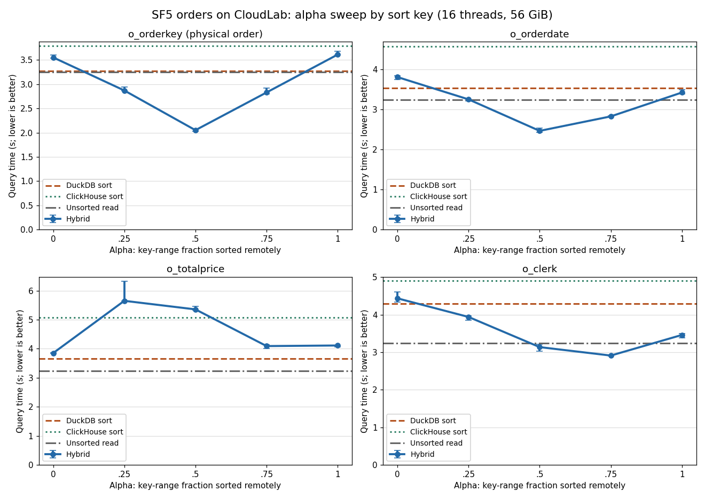
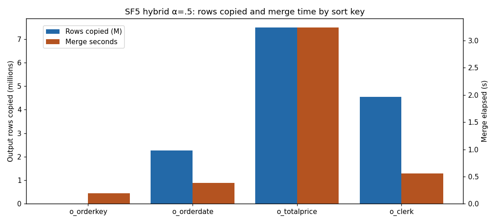
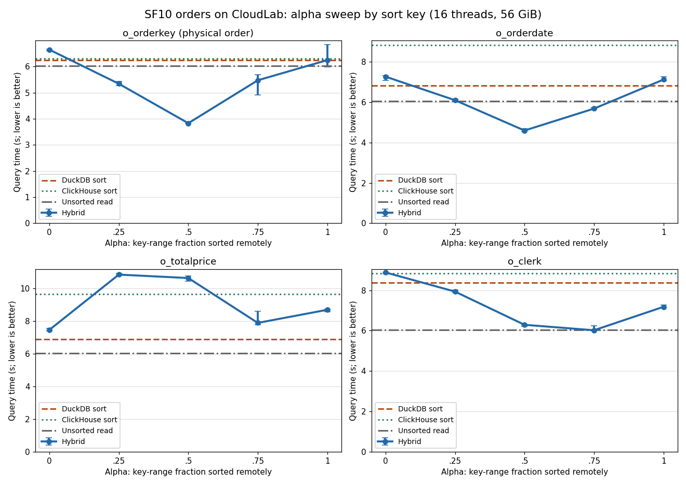
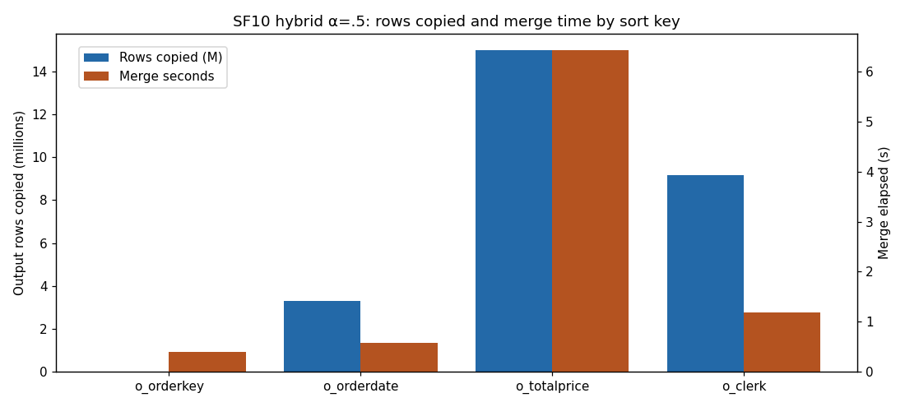
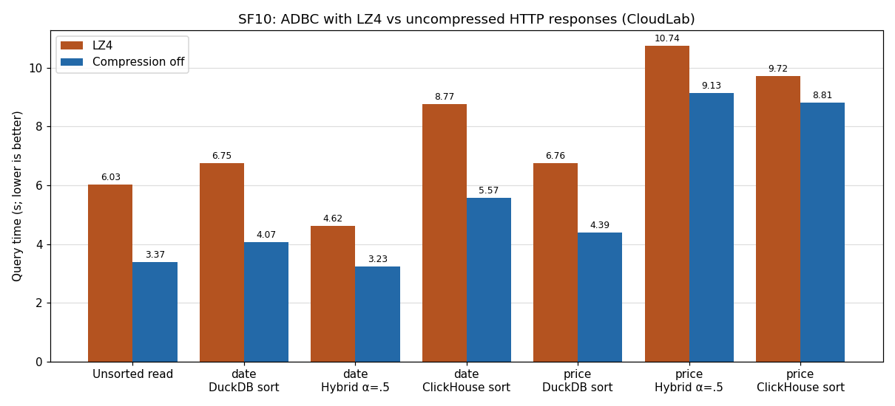
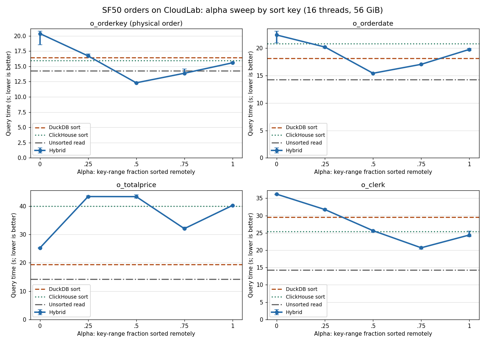
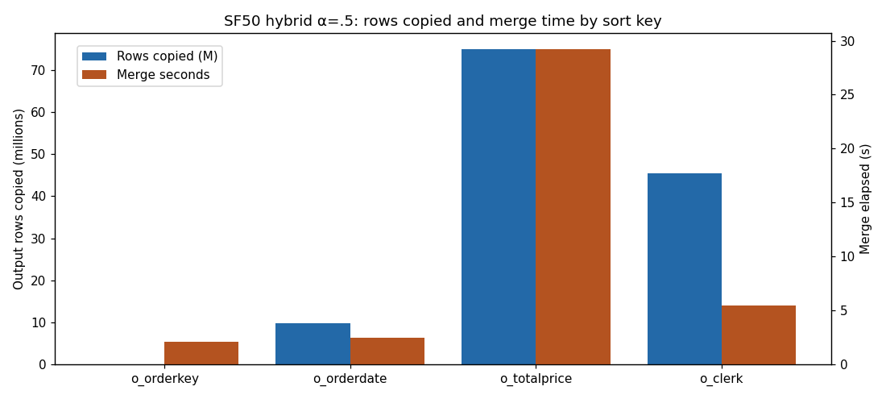
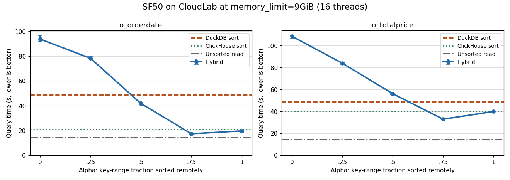
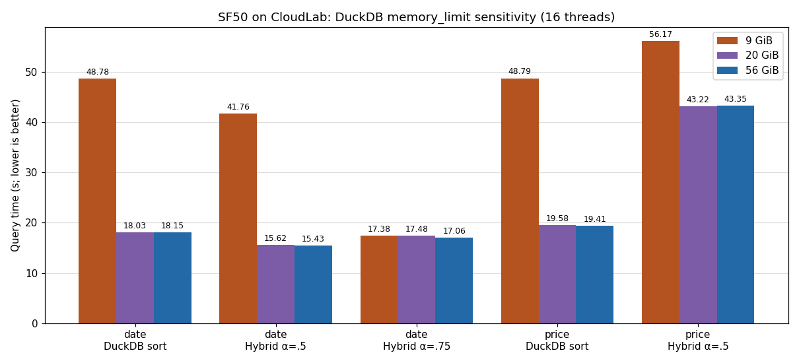

# CloudLab reproduction of the SF5 / SF10 / SF50 sort reports

## SF5 alpha and sort-key sweep (stock dbc 0.1.1 driver, LZ4)

Each cell: CloudLab median of three runs; workstation report value in parentheses where one exists. **Bold** marks the fastest path per key on CloudLab.

| Sort key | DuckDB | Remote | α=0 | α=.25 | α=.5 | α=.75 | α=1 | Best (CloudLab) | Best (report) |
|---|---:|---:|---:|---:|---:|---:|---:|---|---|
| `o_orderkey` | 3.273 (1.123) | 3.783 (1.052) | 3.551 (1.218) | 2.869 (0.992) | **2.051 (0.764)** | 2.829 (0.826) | 3.610 (1.010) | α=0.5 | α=0.5 |
| `o_orderdate` | 3.535 (1.098) | 4.586 (1.513) | 3.814 (1.339) | 3.256 (1.247) | **2.469 (1.029)** | 2.831 (1.071) | 3.429 (1.337) | α=0.5 | α=0.5 |
| `o_totalprice` | **3.657 (1.208)** | 5.085 (1.822) | 3.851 (1.392) | 5.653 (1.885) | 5.357 (1.839) | 4.093 (1.425) | 4.113 (1.611) | DuckDB | DuckDB |
| `o_clerk` | 4.288 (1.685) | 4.903 (1.618) | 4.435 (1.841) | 3.938 (1.819) | 3.135 (1.437) | **2.910 (1.192)** | 3.459 (1.362) | α=0.75 | α=0.75 |

Unsorted `SELECT *` ADBC read: **3.244 s** (report 1.029); two-column read: 0.760 s (report 0.171).

Normalized to the unsorted read on the same machine (hardware-independent shape):

| Sort key | DuckDB / read | Remote / read | best α / read | CloudLab best α | report best α |
|---|---:|---:|---:|---:|---:|
| `o_orderkey` | 1.01× (1.09×) | 1.17× (1.02×) | 0.63× (0.74×) | 0.5 | 0.5 |
| `o_orderdate` | 1.09× (1.07×) | 1.41× (1.47×) | 0.76× (1.00×) | 0.5 | 0.5 |
| `o_totalprice` | 1.13× (1.17×) | 1.57× (1.77×) | 1.19× (1.35×) | 0 | 0 |
| `o_clerk` | 1.32× (1.64×) | 1.51× (1.57×) | 0.90× (1.16×) | 0.75 | 0.75 |

Hybrid α=.5 merge behaviour (median):

| Sort key | Output rows copied (M) | Merge s | Merge loop s | Local sort s | Remote read/buffer s | Spill GB |
|---|---:|---:|---:|---:|---:|---:|
| `o_orderkey` | 0.00 | 0.196 | 0.004 | 1.785 | 1.928 | 0.00 |
| `o_orderdate` | 2.27 | 0.385 | 0.178 | 2.029 | 2.076 | 0.00 |
| `o_totalprice` | 7.50 | 3.244 | 3.075 | 2.084 | 2.436 | 0.00 |
| `o_clerk` | 4.54 | 0.553 | 0.278 | 2.480 | 2.265 | 0.00 |

Two-column `o_orderkey,o_totalprice` projection, sorted by `o_totalprice`:

| Path | 9 columns | 2 columns | 2 columns (report) |
|---|---:|---:|---:|
| Unsorted read | 3.244 | 0.760 | 0.171 |
| DuckDB sort | 3.657 | 0.960 | 0.267 |
| ClickHouse sort | 5.085 | 1.669 | 0.462 |
| Hybrid α=0 | 3.851 | 0.898 | 0.3 |
| Hybrid α=.5 | 5.357 | 1.541 | 0.582 |
| Hybrid α=1 | 4.113 | 1.500 | 0.42 |

## SF10 alpha and sort-key sweep (stock dbc 0.1.1 driver, LZ4)

Each cell: CloudLab median of three runs; workstation report value in parentheses where one exists. **Bold** marks the fastest path per key on CloudLab.

| Sort key | DuckDB | Remote | α=0 | α=.25 | α=.5 | α=.75 | α=1 | Best (CloudLab) | Best (report) |
|---|---:|---:|---:|---:|---:|---:|---:|---|---|
| `o_orderkey` | 6.240 (2.159) | 6.299 (2.065) | 6.649 (2.438) | 5.343 (2.047) | **3.831 (1.579)** | 5.475 (1.572) | 6.247 (1.984) | α=0.5 | α=0.75 |
| `o_orderdate` | 6.827 (2.197) | 8.827 (2.894) | 7.263 (2.621) | 6.094 (2.372) | **4.592 (2.012)** | 5.678 (2.115) | 7.116 (2.538) | α=0.5 | α=0.5 |
| `o_totalprice` | **6.881 (2.333)** | 9.639 (3.627) | 7.450 (2.703) | 10.835 (4.073) | 10.626 (3.621) | 7.881 (2.704) | 8.683 (3.203) | DuckDB | DuckDB |
| `o_clerk` | 8.385 (3.446) | 8.849 (3.090) | 8.885 (3.704) | 7.936 (3.242) | 6.290 (2.678) | **6.020 (2.326)** | 7.181 (2.678) | α=0.75 | α=0.75 |

Unsorted `SELECT *` ADBC read: **6.035 s** (report 1.969); two-column read: 1.482 s (report 0.277).

Normalized to the unsorted read on the same machine (hardware-independent shape):

| Sort key | DuckDB / read | Remote / read | best α / read | CloudLab best α | report best α |
|---|---:|---:|---:|---:|---:|
| `o_orderkey` | 1.03× (1.10×) | 1.04× (1.05×) | 0.63× (0.80×) | 0.5 | 0.75 |
| `o_orderdate` | 1.13× (1.12×) | 1.46× (1.47×) | 0.76× (1.02×) | 0.5 | 0.5 |
| `o_totalprice` | 1.14× (1.18×) | 1.60× (1.84×) | 1.23× (1.37×) | 0 | 0 |
| `o_clerk` | 1.39× (1.75×) | 1.47× (1.57×) | 1.00× (1.18×) | 0.75 | 0.75 |

Hybrid α=.5 merge behaviour (median):

| Sort key | Output rows copied (M) | Merge s | Merge loop s | Local sort s | Remote read/buffer s | Spill GB |
|---|---:|---:|---:|---:|---:|---:|
| `o_orderkey` | 0.00 | 0.392 | 0.008 | 3.381 | 3.536 | 0.00 |
| `o_orderdate` | 3.32 | 0.579 | 0.224 | 3.941 | 4.132 | 0.00 |
| `o_totalprice` | 15.00 | 6.431 | 6.043 | 4.085 | 5.009 | 0.00 |
| `o_clerk` | 9.17 | 1.194 | 0.589 | 4.958 | 4.444 | 0.00 |

Two-column `o_orderkey,o_totalprice` projection, sorted by `o_totalprice`:

| Path | 9 columns | 2 columns | 2 columns (report) |
|---|---:|---:|---:|
| Unsorted read | 6.035 | 1.482 | 0.277 |
| DuckDB sort | 6.881 | 1.831 | 0.527 |
| ClickHouse sort | 9.639 | 3.391 | 0.909 |
| Hybrid α=0 | 7.450 | 1.893 | 0.544 |
| Hybrid α=.5 | 10.626 | 3.006 | 1.102 |
| Hybrid α=1 | 8.683 | 3.185 | 0.8 |

## SF10: connector with and without HTTP response compression

Both drivers built from `adbc_clickhouse` 2c374ad (0.1.1); the only change is `with_compression(Compression::None)`. Median of three passes, alternating driver order.

| Sort key | Path | LZ4 | Off | LZ4 (report) | Off (report) |
|---|---|---:|---:|---:|---:|
| either | Unsorted read | 6.029 | 3.372 | 1.985 | 0.694 |
| `o_orderdate` | DuckDB sort | 6.748 | 4.070 | 2.176 | 0.978 |
| `o_orderdate` | Hybrid α=.5 | 4.618 | 3.229 | 1.944 | 1.447 |
| `o_orderdate` | ClickHouse sort | 8.770 | 5.569 | 2.88 | 1.772 |
| `o_totalprice` | DuckDB sort | 6.763 | 4.390 | 2.351 | 1.069 |
| `o_totalprice` | Hybrid α=.5 | 10.743 | 9.134 | 3.643 | 3.09 |
| `o_totalprice` | ClickHouse sort | 9.720 | 8.811 | 3.637 | 3.052 |

## SF10: schema-only connector with compression off

`ExecuteSchema` via `DESCRIBE (<query>)` plus no response compression. Median of three runs after warmup.

| Path | Date, 9 cols | Price, 9 cols | Price, 2 cols | Report (date / price / price-2) |
|---|---:|---:|---:|---|
| Unsorted read | 3.324 | 3.246 | 0.953 | 0.674 / 0.674 / 0.104 |
| DuckDB sort | 4.129 | 4.210 | 1.376 | 0.977 / 1.046 / 0.321 |
| ClickHouse sort | 5.041 | 7.985 | 3.006 | 1.453 / 2.738 / 0.755 |
| Hybrid α=.5 | 3.222 | 9.135 | 2.560 | 1.507 / 2.967 / 1.008 |

Hybrid bind (LIMIT-1 probe) median: 0.014 s.

## SF10: curl output-format controls

| Format | Median wall s (min–max) | Runs | Network bytes (GB) | Report |
|---|---:|---:|---:|---:|
| Native | 2.505 (2.441–2.605) | 6 | 2.023 | 1.06 |
| ArrowStream | 4.185 (4.067–4.241) | 6 | 1.934 | 1.238 |

## SF50 orders (75M rows)

Connector: schema-only + no compression + separate schema query IDs, with the Date/Decimal mapping fixes. Main matrix at 56 GiB; the report's main table used 9 GiB, so the 9 GiB rows from the memory phase are the like-for-like comparison.

Each cell: CloudLab median of three runs; workstation report value in parentheses where one exists. **Bold** marks the fastest path per key on CloudLab.

| Sort key | DuckDB | Remote | α=0 | α=.25 | α=.5 | α=.75 | α=1 | Best (CloudLab) | Best (report) |
|---|---:|---:|---:|---:|---:|---:|---:|---|---|
| `o_orderkey` | 16.444 | 15.952 | 20.359 | 16.704 | **12.301** | 13.864 | 15.577 | α=0.5 | — |
| `o_orderdate` | 18.149 | 20.831 | 22.401 | 20.211 | **15.429** | 17.057 | 19.773 | α=0.5 | — |
| `o_totalprice` | **19.413** | 40.043 | 25.259 | 43.380 | 43.352 | 32.056 | 40.240 | DuckDB | — |
| `o_clerk` | 29.531 | 25.432 | 36.177 | 31.751 | 25.647 | **20.706** | 24.395 | α=0.75 | — |

Unsorted `SELECT *` ADBC read: **14.286 s**; two-column read: 4.037 s.

Normalized to the unsorted read on the same machine (hardware-independent shape):

| Sort key | DuckDB / read | Remote / read | best α / read | CloudLab best α | report best α |
|---|---:|---:|---:|---:|---:|
| `o_orderkey` | 1.15× | 1.12× | 0.86× | 0.5 | — |
| `o_orderdate` | 1.27× | 1.46× | 1.08× | 0.5 | — |
| `o_totalprice` | 1.36× | 2.80× | 1.77× | 0 | — |
| `o_clerk` | 2.07× | 1.78× | 1.45× | 0.75 | — |

Hybrid α=.5 merge behaviour (median):

| Sort key | Output rows copied (M) | Merge s | Merge loop s | Local sort s | Remote read/buffer s | Spill GB |
|---|---:|---:|---:|---:|---:|---:|
| `o_orderkey` | 0.00 | 2.075 | 0.030 | 10.176 | 11.565 | 0.00 |
| `o_orderdate` | 9.91 | 2.470 | 0.622 | 12.856 | 14.516 | 0.00 |
| `o_totalprice` | 75.00 | 29.245 | 27.397 | 13.666 | 21.594 | 0.00 |
| `o_clerk` | 45.44 | 5.457 | 2.665 | 19.639 | 17.373 | 0.00 |

Two-column `o_orderkey,o_totalprice` projection, sorted by `o_totalprice`:

| Path | 9 columns | 2 columns | 2 columns (report) |
|---|---:|---:|---:|
| Unsorted read | 14.286 | 4.037 | — |
| DuckDB sort | 19.413 | 5.753 | — |
| ClickHouse sort | 40.043 | 14.956 | — |
| Hybrid α=0 | 25.259 | 5.710 | — |
| Hybrid α=.5 | 43.352 | 11.587 | — |
| Hybrid α=1 | 40.240 | 14.797 | — |

### Sort paths vs the SF50 report

| Sort key | DuckDB 56G | DuckDB 9G | Report DuckDB 9G | ClickHouse | Report CH | α=.5 9G | Report α=.5 | α=.75 9G | Report α=.75 |
|---|---:|---:|---:|---:|---:|---:|---:|---:|---:|
| `o_orderkey` | 16.444 | — | 7.841 | 15.952 | 4.724 | — | 10.489 | — | 4.871 |
| `o_orderdate` | 18.149 | 48.783 | 8.414 | 20.831 | 7.481 | 41.755 | 11.877 | 17.380 | 7.726 |
| `o_totalprice` | 19.413 | 48.795 | 9.013 | 40.043 | 15.469 | 56.169 | 18.309 | 32.923 | 13.085 |
| `o_clerk` | 29.531 | — | 15.898 | 25.432 | 9.252 | — | 19.132 | — | 10.776 |

Unsorted read: 14.286 s (report 3.308).

### SF50 alpha and DuckDB memory

The ClickHouse-sort and unsorted-read baselines come from the 56 GiB runs; neither path sorts in DuckDB.

| α | date 9G | date report | date spill GB | price 9G | price report | price spill GB | date 20G | price 20G | date 56G | price 56G |
|---:|---:|---:|---:|---:|---:|---:|---:|---:|---:|---:|
| 0 | 93.747 | 38.797 | 10.52 | 108.520 | 63.708 | 10.96 | 40.825 | 42.843 | 22.401 | 25.259 |
| 0.25 | 78.219 | 23.763 | 8.00 | 83.986 | 45.662 | 8.54 | 30.192 | 48.235 | 20.211 | 43.380 |
| 0.5 | 41.755 | 11.877 | 4.65 | 56.169 | 18.309 | 4.11 | 15.617 | 43.223 | 15.429 | 43.352 |
| 0.75 | 17.380 | 7.726 | 0.00 | 32.923 | 13.085 | 0.00 | 17.477 | 33.522 | 17.057 | 32.056 |
| 1 | 19.645 | 8.214 | 0.00 | 39.924 | 14.662 | 0.00 | 19.928 | 40.145 | 19.773 | 40.240 |

| Path | 9 GiB | 20 GiB | 56 GiB | Report 9 / 20 GiB | Spill 9 GiB (GB) |
|---|---:|---:|---:|---|---:|
| date: DuckDB sort | 48.783 | 18.030 | 18.149 | 8.414 / 4.471 | 4.94 |
| date: Hybrid α=.5 | 41.755 | 15.617 | 15.429 | 11.877 / 7.623 | 4.65 |
| date: Hybrid α=.75 | 17.380 | 17.477 | 17.057 | 7.726 / 7.447 | 0.00 |
| totalprice: DuckDB sort | 48.795 | 19.577 | 19.413 | 9.013 / 5.157 | 5.20 |
| totalprice: Hybrid α=.5 | 56.169 | 43.223 | 43.352 | 18.309 / 14.512 | 4.11 |

Two-column projection (price): read 4.037 s (report 0.489), DuckDB 5.753 s (report 1.67), ClickHouse 14.956 s (report 5.284), α=.5 11.587 s (report 4.768).

## SF50: curl output-format controls

| Format | Median wall s (min–max) | Runs | Network bytes (GB) | Report |
|---|---:|---:|---:|---:|
| Null | 1.977 (1.974–1.978) | 3 | 0 | 1.278 |
| Native | 8.456 (8.426–8.567) | 6 | 10.120 | 1.662 |
| ArrowStream | 14.589 (14.474–14.781) | 6 | 9.673 | 2.629 |

## perf leaf-symbol shares (user-space cycles, one profiled run each)

Profiled runs are separate from the timed matrix. Shares are of sampled user cycles, not wall time.

**sf10-price-hybrid05** (client): Report (SF10 price α=.5 client): memmove 17.2%, VectorStringBuffer::CopyInternal 13.5%, memcmp 10.4%.

| Share | Symbol |
|---:|---|
| 8.97% | `adbc.duckdb_extension  duckdb::VectorStringBuffer::CopyInternal(duckdb::Vector const&, duckdb::SelectionVector` |
| 7.10% | `adbc.duckdb_extension  void duckdb::TupleDataTemplatedGather<duckdb::string_t>(duckdb::TupleDataLayout const&,` |
| 5.45% | `libc.so.6  0x0000000000188e05` |
| 4.64% | `adbc.duckdb_extension  duckdb::ArrowToDuckDBConversion::ColumnArrowToDuckDB(duckdb::Vector&, ArrowArray&, unsi` |
| 4.27% | `adbc.duckdb_extension  void duckdb::TupleDataTemplatedGather<long>(duckdb::TupleDataLayout const&, duckdb::Vec` |
| 4.20% | `adbc.duckdb_extension  duckdb::CopyVectorBuffer(unsigned char*, unsigned char const*, duckdb::SelectionVector ` |
| 3.63% | `adbc.duckdb_extension  void duckdb::TupleDataTemplatedGather<int>(duckdb::TupleDataLayout const&, duckdb::Vect` |
| 3.43% | `libc.so.6  0x0000000000188d91` |

**sf10-price-hybrid05-narrow** (client): 

| Share | Symbol |
|---:|---|
| 7.07% | `adbc.duckdb_extension  duckdb::adbc::(anonymous namespace)::PartialSortState::ScanInternal(duckdb::DataChunk&)` |
| 5.86% | `adbc.duckdb_extension  void std::__merge_adaptive<duckdb::SortKey<(duckdb::SortKeyType)7>*, long, duckdb::Sort` |
| 5.21% | `adbc.duckdb_extension  void duckdb::TupleDataTemplatedGather<long>(duckdb::TupleDataLayout const&, duckdb::Vec` |
| 5.17% | `adbc.duckdb_extension  void duckdb_ska_sort::detail::UnsignedInplaceSorter<128ul, 1024ul, duckdb_ska_sort::det` |
| 3.81% | `adbc.duckdb_extension  duckdb::(anonymous namespace)::CreateSortKeyInternal(duckdb::vector<duckdb::unique_ptr<` |
| 3.44% | `adbc.duckdb_extension  void duckdb_pdqsort::pdqsort_detail::pdqsort_loop<duckdb::block_iterator_t<duckdb::Bloc` |
| 3.12% | `adbc.duckdb_extension  duckdb::StandardVectorBuffer::ToUnifiedFormat(duckdb::UnifiedVectorFormat&) const` |
| 3.05% | `adbc.duckdb_extension  duckdb::VectorBuffer::Copy(duckdb::Vector const&, duckdb::SelectionVector const&, unsig` |

**sf10-price-remote** (server): 

| Share | Symbol |
|---:|---|
| 21.72% | `[.] DB::ColumnString::insertFrom(DB::IColumn const&, unsigned long)` |
| 14.23% | `[.] ZSTD_decompressSequences.llvm.13489169479170685438` |
| 10.39% | `[.] _ZNSt3__116__variant_detail12__visitation6__base12__dispatcherIJLm16EEE10__dispatchB9fqe220101IONS1_9__var` |
| 10.17% | `[.] DB::ColumnDecimal<DB::Decimal<long> >::compareAt(unsigned long, unsigned long, DB::IColumn const&, int) co` |
| 6.24% | `[.] COW<DB::IColumn>::immutable_ptr<DB::IColumn> DB::ColumnString::indexImpl<unsigned long>(DB::PODArray<unsig` |
| 5.67% | `[.] __llvm_libc::memcpy_ge64_baseline(__llvm_libc::cpp::byte*, __llvm_libc::cpp::byte const*, unsigned long)` |
| 4.82% | `[.] DB::ColumnDecimal<DB::Decimal<long> >::insertFrom(DB::IColumn const&, unsigned long)` |
| 4.25% | `[.] bool DB::operator><long>(DB::Decimal<long> const&, DB::Decimal<long> const&)` |

**sf50-date-hybrid05** (client): Report (SF50 date α=.5 client): memmove 24.0%; DuckDB ZSTD ~20% (spill at 9 GiB).

| Share | Symbol |
|---:|---|
| 13.63% | `adbc.duckdb_extension  void duckdb::TupleDataTemplatedGather<long>(duckdb::TupleDataLayout const&, duckdb::Vec` |
| 12.36% | `adbc.duckdb_extension  void duckdb::TupleDataTemplatedGather<duckdb::string_t>(duckdb::TupleDataLayout const&,` |
| 10.52% | `libc.so.6  0x0000000000188e05` |
| 7.31% | `adbc.duckdb_extension  duckdb::ArrowToDuckDBConversion::ColumnArrowToDuckDB(duckdb::Vector&, ArrowArray&, unsi` |
| 5.29% | `adbc.duckdb_extension  void duckdb::ColumnDataCopy<duckdb::string_t>(duckdb::ColumnDataMetaData&, duckdb::Unif` |
| 5.13% | `libc.so.6  0x0000000000189087` |
| 3.73% | `libc.so.6  0x0000000000188d91` |
| 2.73% | `adbc.duckdb_extension  void duckdb::TupleDataTemplatedGather<int>(duckdb::TupleDataLayout const&, duckdb::Vect` |

**sf50-date-remote** (server): 

| Share | Symbol |
|---:|---|
| 23.43% | `[.] ZSTD_decompressSequences.llvm.13489169479170685438` |
| 14.33% | `[.] memcpy` |
| 14.26% | `[.] __llvm_libc::memcpy_ge64_baseline(__llvm_libc::cpp::byte*, __llvm_libc::cpp::byte const*, unsigned long)` |
| 11.88% | `[.] _ZNSt3__116__variant_detail12__visitation6__base12__dispatcherIJLm1EEE10__dispatchB9fqe220101IONS1_9__vari` |
| 9.06% | `[.] DB::ColumnString::insertRangeFrom(DB::IColumn const&, unsigned long, unsigned long)` |
| 8.41% | `[.] COW<DB::IColumn>::immutable_ptr<DB::IColumn> DB::ColumnString::indexImpl<unsigned long>(DB::PODArray<unsig` |
| 1.77% | `[.] DB::ArrowIPC::RecordBatchEncoder::encodeField(DB::IColumn const&, std::__1::shared_ptr<DB::IDataType const` |
| 1.55% | `[.] DB::ColumnString::insertFrom(DB::IColumn const&, unsigned long)` |

**sf50-price-hybrid05** (client): Report (SF50 price α=.5 client): memmove 15.57%; DuckDB ZSTD ~14% (spill at 9 GiB).

| Share | Symbol |
|---:|---|
| 8.39% | `libc.so.6  0x0000000000188e05` |
| 7.73% | `adbc.duckdb_extension  void duckdb::TupleDataTemplatedGather<duckdb::string_t>(duckdb::TupleDataLayout const&,` |
| 7.49% | `adbc.duckdb_extension  duckdb::VectorStringBuffer::CopyInternal(duckdb::Vector const&, duckdb::SelectionVector` |
| 6.23% | `adbc.duckdb_extension  void duckdb::TupleDataTemplatedGather<long>(duckdb::TupleDataLayout const&, duckdb::Vec` |
| 4.00% | `adbc.duckdb_extension  duckdb::ArrowToDuckDBConversion::ColumnArrowToDuckDB(duckdb::Vector&, ArrowArray&, unsi` |
| 3.90% | `adbc.duckdb_extension  duckdb::CopyVectorBuffer(unsigned char*, unsigned char const*, duckdb::SelectionVector ` |
| 3.81% | `adbc.duckdb_extension  void duckdb::TupleDataTemplatedGather<int>(duckdb::TupleDataLayout const&, duckdb::Vect` |
| 3.61% | `libc.so.6  0x0000000000188d91` |

**sf50-price-remote** (server): Report (SF50 price remote sort): ColumnString::insertFrom 15.79%, Decimal compareAt 14.33%, ZSTD decompression 12.16%, Decimal greater-than 9.28%.

| Share | Symbol |
|---:|---|
| 24.52% | `[.] DB::ColumnString::insertFrom(DB::IColumn const&, unsigned long)` |
| 13.18% | `[.] _ZNSt3__116__variant_detail12__visitation6__base12__dispatcherIJLm16EEE10__dispatchB9fqe220101IONS1_9__var` |
| 11.56% | `[.] ZSTD_decompressSequences.llvm.13489169479170685438` |
| 9.43% | `[.] DB::ColumnDecimal<DB::Decimal<long> >::compareAt(unsigned long, unsigned long, DB::IColumn const&, int) co` |
| 8.52% | `[.] bool DB::operator><long>(DB::Decimal<long> const&, DB::Decimal<long> const&)` |
| 6.55% | `[.] DB::ColumnDecimal<DB::Decimal<long> >::insertFrom(DB::IColumn const&, unsigned long)` |
| 4.37% | `[.] __llvm_libc::memcpy_ge64_baseline(__llvm_libc::cpp::byte*, __llvm_libc::cpp::byte const*, unsigned long)` |
| 4.14% | `[.] COW<DB::IColumn>::immutable_ptr<DB::IColumn> DB::ColumnString::indexImpl<unsigned long>(DB::PODArray<unsig` |
