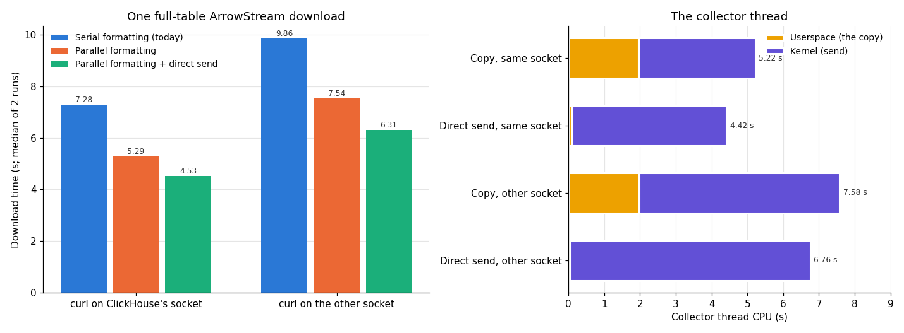
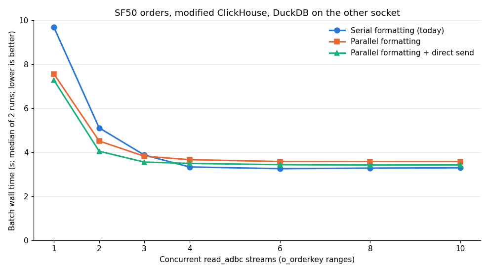

# Sending parallel-formatted output without a copy

Measured 2026-11-11 on `c220g2-010602.wisc.cloudlab.us` (2× Xeon E5-2660 v3, Haswell), as a follow-up to
[parallel ArrowStream formatting in ClickHouse](../parallel-arrowstream-20261111/README.md). With parallel
formatting, one thread per query, the collector, still writes the whole result to the client's connection. This
report finds what that thread spends its time on, removes its copy of every formatted chunk, and measures the
result.

**Summary.**

- **The single connection is not limited by TCP buffers, and zero-copy sends would not help on loopback.**
  Plain loopback TCP (iperf3) reaches 3.6 GB/s on one socket and 1.9 GB/s across sockets, limited by the
  sender's CPU. Raising the TCP buffer limits to 64 MB changed nothing. Linux copies anyway when a zero-copy send
  is delivered to a local socket.
- **The collector was 99% busy, and 2 s of that was a copy.** For one 9.67 GB download it spent 1.96 s in
  userspace, copying every encoded chunk into the HTTP response buffer, plus 3.3 s (ClickHouse's socket) or 5.6 s
  (the other socket) in the kernel sending it. It never waited for the formatter threads.
- **The change sends each chunk from the formatter's own memory.** The HTTP response buffer gains a "write
  directly" path that flushes the chunk through the usual send code, so headers, chunk framing and counters are
  unchanged. Output is byte-identical for ArrowStream and the other parallel formats.
- **One download is 14–16% faster than parallel formatting alone, and 36–38% faster than today.** It takes
  4.53 s instead of 7.28 s on ClickHouse's socket, and 6.31 s instead of 9.86 s across sockets. About half of the
  copy's cost moved into the kernel's send, which now reads the chunks from memory that other cores wrote.
- **One `read_adbc` stream gains only 4% more (7.28 s), because the connector is now the limit.** curl takes
  6.31 s from the same socket, and ClickHouse waits on DuckDB in `send()` for most of the query. Two streams gain
  the most: 4.05 s instead of 5.11 s today. From 4 streams up, today's serial formatting is still 4–6% faster.

## Setup

As in the parallel-ArrowStream report:

- **ClickHouse:** the modified 26.11.1.1 build with parallel `ArrowStream` formatting (`a5be5f0c7`), plus the
  change in this report (`c933d005d`), in its 16-CPU slice on socket 0 (CPUs 0–7, 20–27).
- **Data:** SF50 `orders`, 75,000,000 rows, 9.67 GB of uncompressed Arrow.
- **Clocks:** pinned at 2.6 GHz (`performance` governor, turbo off).
- **Serial vs parallel:** `output_format_parallel_formatting` = 0 or 1 per query on the same binary. The
  "parallel formatting" results without direct send are from the parallel-ArrowStream report's runs of the
  `a5be5f0c7` binary.
- **Raw downloads:** `curl` on CPU 9 (ClickHouse's socket) or CPU 19 (the other socket), `max_threads=32`.
- **`read_adbc` streams:** [`bench/parallel_read_adbc`](../../bench/parallel_read_adbc.cpp) with N `o_orderkey`
  ranges and `max_threads` = floor(32 / N), DuckDB in its 16-CPU slice on socket 1 with `threads=16` and the
  reader thread on (`ADBC_READER_THREAD=1`).

Each configuration ran twice.

## 1. What limits one connection

**Loopback TCP itself** ([data](./data/tcp-ceiling.txt), [script](./scripts/tcp_ceiling.sh)). iperf3, one
connection, sender on CPU 3 (a ClickHouse CPU):

| Receiver | 128 KB writes | 1 MB writes | Sender CPU | Receiver CPU |
|---|---:|---:|---:|---:|
| CPU 9 (ClickHouse's socket) | 3.25 GB/s | 3.58 GB/s | 100% | 75–79% |
| CPU 19 (other socket) | 1.78 GB/s | 1.89 GB/s | 100% | 57–61% |

- **The sender limits one loopback connection.** On loopback the sending thread also runs most of the
  receive-side TCP processing.
- **Crossing sockets halves the ceiling.**
- **At those rates, sending 9.67 GB costs the sender about 2.7 s and 5.1 s.** ClickHouse's time in `send()` was
  3.2–3.3 s and 5.6–5.8 s, so `send()` is mostly the sender's own kernel work, not waiting for the receiver.

**Larger TCP buffers do not help.** With `net.ipv4.tcp_wmem` and `tcp_rmem` maximums raised from 4–6 MB to 64 MB,
iperf3 and ClickHouse downloads were unchanged. The server's send buffer stayed at 2.6 MB and held only 0–0.9 MB
when sampled, so it was never full.

**Zero-copy sends do not apply here.** `MSG_ZEROCOPY`, io_uring's `SEND_ZC` and `splice` avoid copying the
sender's memory into the kernel, but Linux performs a deferred copy for zero-copy packets delivered to a local
socket. Over a real network they can save sender CPU, but the link would then be the limit.

**The collector thread** ([data](./data/collector-threads.txt), [script](./scripts/collector_profile.sh)), from
`system.query_thread_log` with `log_query_threads=1`, one download with parallel formatting:

| | curl on ClickHouse's socket | curl on the other socket |
|---|---:|---:|
| Collector lifetime (≈ query wall time) | 5.29 s | 7.61 s |
| Userspace CPU | 1.96 s | 1.98 s |
| Kernel CPU | 3.26 s | 5.60 s |
| …of which in `send()` | 3.26 s | 5.71 s |
| Busy | 99% | 99% |

- **The collector never waits for the formatters,** so they are not the limit.
- **Its userspace time is the copy.** Its only userspace work is `out.write(chunk)` into the 1 MiB HTTP response
  buffer: 9.67 GB at about 4.9 GB/s, on either socket.

## 2. The change

[Patch](./patches/clickhouse-direct-send.patch) on top of the parallel ArrowStream prototype, 40 lines plus a
new 18-line header:

- **`IO/WriteBufferWithDirectWrite.h`:** a one-method interface, `writeDirect(data, size)`, with the effect of
  `write`. A new header keeps the rebuild small; changing `WriteBuffer.h` would recompile most of ClickHouse.
- **`WriteBufferFromHTTPServerResponse::writeDirect`:**
  - flushes anything already buffered, so bytes stay in order;
  - temporarily points the buffer's working memory at the caller's block and flushes it through the usual
    `next()`, so headers, HTTP chunk framing, `HEAD` requests, byte counts and the `NetworkSend*` profile events
    are exactly as for any flush (headers and framing go straight to the socket, never into the buffer);
  - restores its own memory;
  - copies instead for blocks under 64 KiB, fixed-length bodies and canceled buffers.
- **`ParallelFormattingOutputFormat`'s collector** uses `writeDirect` when its output buffer supports it. Over
  HTTP that is the response buffer, unless HTTP compression or response buffering sits in between, in which case
  it copies as before.

This applies to every format ClickHouse formats in parallel over HTTP, not only `ArrowStream`.

## 3. Correctness

[Output](./data/correctness-direct.txt):

- **The parallel-ArrowStream suite** ([script](./scripts/parallel_arrow_correctness.sh)) passes unchanged, with
  the same hashes as before the change:
  - byte-identical serial and parallel output for the full table, a 500,000-row ordered result, an empty result
    and `LIMIT 10`;
  - the serial fallbacks for dictionaries and combined batches;
  - matching `read_adbc` row-hash sums over 75,000,000 rows;
  - a mid-stream error reaching DuckDB.
- **Other formats and HTTP modes** ([script](./scripts/direct_write_formats.sh)): serial and parallel output are
  byte-identical for `ArrowStream`, `RowBinary`, `TSV`, `CSV` and `JSONEachRow`; for HTTP/1.0 (not chunked);
  with progress headers; and with `buffer_size` response buffering.
- **gzip responses** take the copy path. Their compressed bytes differ between serial and parallel formatting
  because the compressor flushes at different points, but they decompress to the same body as the uncompressed
  serial output.

## 4. One stream

[Vector version](./single_stream.svg); data in [single_stream.tsv](./single_stream.tsv),
[curl-direct.txt](./data/curl-direct.txt) and [curl-parallel.txt](./data/curl-parallel.txt).

| Download time | Serial (today) | Parallel formatting | + direct send | vs parallel | vs serial |
|---|---:|---:|---:|---:|---:|
| curl on ClickHouse's socket | 7.21–7.35 s | 5.17–5.40 s | **4.45–4.60 s** | −14% | −38% |
| curl on the other socket | 9.85–9.86 s | 7.51–7.56 s | **6.22–6.40 s** | −16% | −36% |

- **The copy is gone:** the collector's userspace time fell from 1.96 s to 0.08 s.
- **About half its cost reappeared in the kernel.** Kernel time rose by about 1.1 s on either socket (3.26 →
  4.34 s and 5.60 → 6.71 s), so the collector saves 0.8 s net. The likely reason, not profiled: before, the
  `memcpy` paid the cache misses of reading chunks that formatter threads on other cores had just written, and the
  kernel then copied from a small buffer already in cache. Now the kernel copies straight from the formatters'
  memory and pays those misses itself.
- **The kernel send now costs more than iperf3's** (4.34 s against about 2.7 s for the same bytes), for the same
  reason: iperf3 sends one buffer that stays in cache.

## 5. `read_adbc` streams

[Vector version](./streams.svg); data in [streams.tsv](./streams.tsv). Batch wall times, median of 2 runs:

| Streams | Serial (today) | Parallel formatting | + direct send |
|---:|---:|---:|---:|
| 1 | 9.69 s | 7.57 s | **7.28 s** |
| 2 | 5.11 s | 4.52 s | **4.05 s** |
| 3 | 3.88 s | 3.82 s | **3.56 s** |
| 4 | **3.34 s** | 3.67 s | 3.50 s |
| 6 | **3.26 s** | 3.58 s | 3.44 s |
| 8 | **3.28 s** | 3.58 s | 3.43 s |
| 10 | **3.30 s** | 3.58 s | 3.43 s |

ClickHouse's per-query view is in [streams-direct-clickhouse.txt](./data/streams-direct-clickhouse.txt) and
[streams-serial-clickhouse.txt](./data/streams-serial-clickhouse.txt).

- **One stream is now limited by the client.** `read_adbc` takes 7.14–7.28 s against curl's 6.22–6.40 s from the
  same socket, and ClickHouse spends a median 7.16 s of the query blocked in `send()`, waiting for DuckDB. That is
  the connector's single-threaded decoding.
- **Up to 3 streams, direct send is the fastest configuration.** Two streams take 4.05 s, against 5.11 s today.
- **From 4 streams up, serial formatting is still 4–6% faster.** The gap was 8–9% without direct send. ClickHouse
  now uses about the same CPU per batch with either formatting (49.4–50.0 against 48.2–50.2 CPU-seconds), so
  extra CPU no longer explains the gap. What does is not known.

## 6. What limits one stream now

- **ClickHouse:** the collector is still the only thread writing a query's result, and its time is now almost all
  kernel send work: 4.3 s on ClickHouse's socket and 6.7 s across sockets, plus 0.5 s before the first block
  arrives.
- **`read_adbc`:** the connector's decoding, about 1 s slower than ClickHouse can now send.

## Correction to the parallel-ArrowStream report

That report attributed 1.35 s of the parallel output stage to the collector copying chunks into the HTTP buffer.
That figure subtracted two different threads' times: the output processor's "busy" time in
`processors_profile_log` belongs to the pipeline thread that hands chunks to the formatter (mostly waiting for a
free slot), and the time in `send()` belongs to the collector. Measured per thread (section 1), the copy took
1.96 s. The report has been corrected.

## Next steps

1. **Decode in parallel in the connector.** Arrow IPC messages are length-prefixed, so splitting the stream is
   cheap and the record batches could be decoded on several threads. That is now the single-stream limit for
   `read_adbc`.
2. **Find why parallel formatting is still slower from 4 streams up,** for example by profiling a 6-stream batch
   with both settings.
3. **Reduce the kernel send's cache misses,** for example by keeping each formatted chunk on the collector's
   socket or sending from the formatter thread itself. This is speculative.

## Caveats

- Two runs per configuration; the "parallel formatting" column is from an earlier run of the previous binary.
- All transfers are loopback on one host. Over a real network, one connection's ceiling would be the link.
- `read_adbc` was measured only with DuckDB on the other socket.
- The cache-miss explanation for the kernel time increase, and the cause of the many-stream gap, are inferred.
- `query_thread_log` logs each parallel formatting task as its own row, so its formatter CPU totals may be
  incomplete; the collector is one long-lived thread and is unaffected.

## Files

- **[patches/clickhouse-direct-send.patch](./patches/clickhouse-direct-send.patch):** the change, as a
  `git format-patch` of commit `c933d005d` on top of `a5be5f0c7`.
- **[scripts/](./scripts/):** the host runners, which expect the experiment directory layout on the CloudLab host.
  - `tcp_ceiling.sh` and `collector_profile.sh`: section 1.
  - `parallel_arrow_correctness.sh` and `direct_write_formats.sh`: section 3.
  - `parallel_arrow_timing.sh`: sections 4 and 5; `OUT_DIR` selects the output directory.
  - `start_modified_clickhouse.sh`: starts and stops the modified server; `CLICKHOUSE_BIN=...` selects another
    binary.
- **[data/](./data/):** the raw output of each script. `streams-{serial,parallel,direct}.tsv` and
  `curl-{parallel,direct}.txt` hold the timing runs.
- **[plot_direct_send.py](./plot_direct_send.py)** draws both charts: `python3 plot_direct_send.py data .`
  (needs matplotlib).
