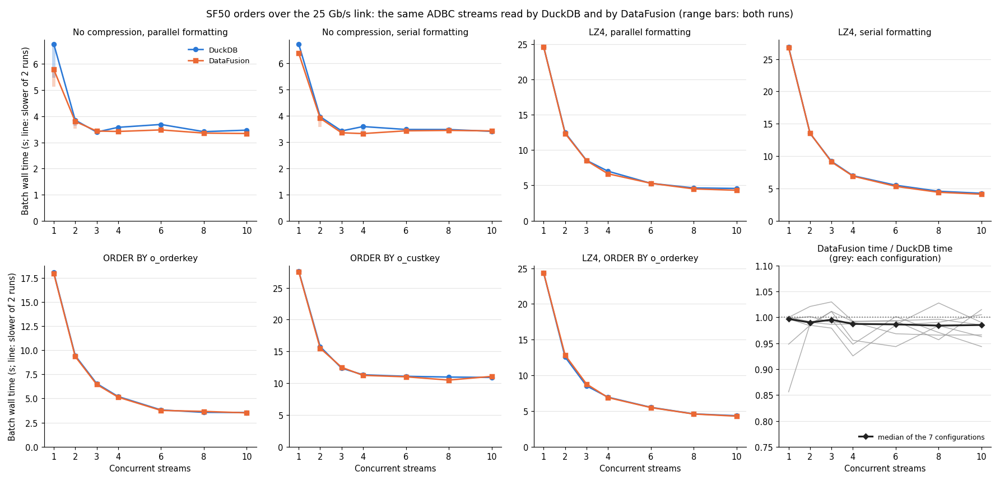
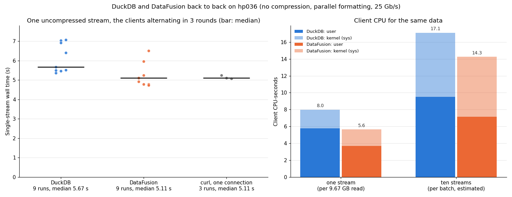

# DuckDB vs DataFusion reading the same ADBC streams

Measured 2026-11-12 on the CloudLab nodes of the
[25 Gb/s two-node report](../two-node-25gbe-20261112/README.md). That report read SF50 `orders` from ClickHouse
into DuckDB as N parallel `read_adbc` streams. This one repeats every configuration with
[DataFusion](https://datafusion.apache.org/) in DuckDB's place, to see whether the client engine affects the
results. Everything else is identical: the same ClickHouse server, the same ADBC connector builds, the same
queries and the same experiment scripts.

**Summary.**

- **The client engine makes almost no difference.** The comparison covers 7 configurations × 7 stream counts.
  - DataFusion's batch time is 0.93–1.03× DuckDB's from 2 streams up (median 0.99).
  - With enough streams, both clients hit the same limits: the link without compression, and ClickHouse's
    CPU with LZ4 or with a sort on another column.
- **The one visible gap is a single uncompressed stream.** That is the only case where one connection, rather
  than ClickHouse or the link, is the limit.
  - In 3 rounds that alternated the clients back to back, DataFusion's median was 5.11 s, the same as curl
    downloading over one connection (5.11 s).
  - DuckDB's median was 5.67 s, 11% slower.
- **DuckDB uses about 40% more client CPU for the same data:** 8.0 CPU-seconds per 9.67 GB stream against 5.6 for
  DataFusion. DataFusion consumes Arrow batches as they arrive. DuckDB converts every batch into its own format.
  That extra work only shows in wall time when the client's receive path is the limit.

## Setup

- **Nodes, server, connector and data:** as in the 25 Gb/s report.
  - `hp034` runs ClickHouse 26.11.1.1 (custom build `c933d005d`); `hp036` runs the client.
  - Both are Xeon E5-2640 v4 with 20 CPUs at 2.4 GHz, joined by a 25 Gb/s link.
  - The ClickHouse ADBC connector is `v0.1.1` plus
    [connector.diff](../parallel-streams-20261110/connector.diff), built without and with LZ4 compression.
  - The data is TPC-H SF50 `orders`: 75,000,000 rows, 9.67 GB as Arrow.
- **DuckDB:** [`bench/parallel_read_adbc`](../../bench/parallel_read_adbc.cpp), with the reader-thread and
  Arrow-conversion patches, `threads=20` and `ADBC_READER_THREAD=1`. Its numbers are the 25 Gb/s report's
  ([data](../two-node-25gbe-20261112/data/)).
- **DataFusion:** [`bench/datafusion`](../../bench/datafusion/) (`parallel_read_datafusion`), new for this
  report. It mirrors `parallel_read_adbc`:
  - **Same driver:** it loads the same connector library through the same ADBC profile, with
    `adbc_driver_manager` 0.24.0.
  - **No conversion:** the driver manager and DataFusion 55.2.0 both use arrow 59.3.2, so batches pass from
    the driver to DataFusion unconverted.
  - **One reader thread per stream:** each stream opens its own connection on a dedicated reader thread, like
    `read_adbc` with `ADBC_READER_THREAD=1`, and pushes Arrow batches into a channel holding up to 4 batches.
  - **Same query shape:** DataFusion runs `SELECT * FROM` a `StreamingTable` over that channel and drains every
    batch. This mirrors DuckDB's `EXPLAIN ANALYZE SELECT * FROM read_adbc(...)`, which reads every row without
    keeping any.
  - **Shared execution:** all streams share one `SessionContext` and one tokio runtime with 20 workers.
  - **One difference:** it does not call ADBC `ExecuteSchema` before each query, while `read_adbc` does. That
    is one extra round trip per stream for DuckDB.
- **Runs** ([scripts/run_datafusion.sh](./scripts/run_datafusion.sh)):
  - The 25 Gb/s report's scripts, with only the benchmark binary swapped.
  - Each configuration covers N = 1, 2, 3, 4, 6, 8, 10, with a warm-up and then 2 runs per N.
  - The DataFusion runs took place about 3 hours after the DuckDB runs, on the same nodes and server.
- **Back-to-back check** ([scripts/interleaved.sh](./scripts/interleaved.sh)):
  - 3 rounds without compression, with parallel formatting.
  - Each round runs DuckDB, DataFusion and one curl download, alternating.
  - Each client runs 3 batches of 1 stream and 3 batches of 10 streams.
  - The shell's `time` records each client process's CPU time.

## 1. Correctness

DataFusion's checks match in every configuration, as DuckDB's did. One full read and the 4- and 10-range reads
return 75,000,000 rows and the same row-hash sum, both uncompressed and with LZ4, and with each per-stream sort
([checksum.txt](./data/datafusion/checksum.txt), [lz4](./data/datafusion/lz4/checksum.txt),
[o_orderkey](./data/datafusion/sorted/checksum-o_orderkey.txt),
[o_custkey](./data/datafusion/sorted/checksum-o_custkey.txt)). The DataFusion benchmark hashes rows with FNV-1a
over arrow's row encoding, so its hash value differs from DuckDB's `hash()`. Each tool is checked against its
own full read.

## 2. Every configuration

[Vector version](./compare.svg); every run and the ratios in [compare.tsv](./compare.tsv).

| Configuration | 1 stream, DuckDB | 1 stream, DataFusion | Best batch, DuckDB (N) | Best batch, DataFusion (N) |
|---|---:|---:|---:|---:|
| No compression, parallel formatting | 5.48–6.76 s | 5.13–5.79 s | 3.36 s (8) | 3.33 s (3) |
| No compression, serial formatting | 6.68–6.72 s | 6.37–6.38 s | 3.33 s (6) | 3.30 s (3) |
| LZ4, parallel formatting | 24.46–24.62 s | 24.31–24.61 s | 4.47 s (10) | 4.30 s (10) |
| LZ4, serial formatting | 26.72–26.87 s | 26.71–26.79 s | 4.21 s (10) | 3.99 s (10) |
| `ORDER BY o_orderkey` | 17.97–18.02 s | 17.93–17.95 s | 3.46 s (8) | 3.46 s (10) |
| `ORDER BY o_custkey` | 27.56–27.64 s | 27.24–27.57 s | 10.83 s (8) | 10.49 s (8) |
| LZ4, `ORDER BY o_orderkey` | 24.34–24.36 s | 24.31–24.36 s | 4.33 s (10) | 4.25 s (10) |

- **The curves overlap.** Over all 49 points, DataFusion's slower run is 0.86–1.03× DuckDB's, with median 0.99.
  The only point below 0.92 is a single uncompressed stream with parallel formatting (0.86).
- **Where ClickHouse is the limit, the client doesn't matter.** That covers LZ4 (one compression thread per query),
  a single sorted query (an almost serial in-order read, or a single-threaded final merge), and `o_custkey`
  sorts with many streams (ClickHouse's CPUs full). Batch times agree to within a few percent there.
- **With LZ4 at 8–10 streams, DataFusion is 0–6% faster** (for example 4.30 s against 4.47 s). Each LZ4 run also
  decompresses on the client, so less client CPU per batch may help there; that was not profiled. All of these
  differences are smaller than the noise between separate sessions, so the next section repeats the clearest case
  back to back.

## 3. Back to back: one stream, and client CPU

[Vector version](./interleaved.svg); [raw output](./data/interleaved.tsv), and summary in
[interleaved_summary.tsv](./interleaved_summary.tsv).

| | DuckDB | DataFusion | curl, one connection |
|---|---:|---:|---:|
| One stream, median of runs | **5.67 s** (9 runs) | **5.11 s** (9 runs) | 5.11 s (3 runs) |
| One stream, range | 5.36–7.07 s | 4.73–6.51 s | 5.07–5.25 s |
| 10 streams, range (9 runs each) | 3.38–3.48 s | 3.32–3.40 s | |
| Client CPU per single-stream read | 8.0 CPU-s (72% user) | 5.6 CPU-s (65% user) | |
| Client CPU per 10-stream batch (estimate) | 17.1 CPU-s | 14.3 CPU-s | |

- **DataFusion matches one TCP connection; DuckDB is 11% slower.**
  - DataFusion's single stream takes as long as curl's raw download over one connection, which is limited by one
    TCP connection's rate on this link (about 2.1 GB/s in iperf3).
  - DuckDB adds about 0.56 s at the median.
  - Both clients have occasional slow runs: DuckDB 4 of 9 at 6.4–7.1 s, DataFusion 2 of 9 at 6.0–6.5 s. Their
    cause was not investigated.
- **DuckDB spends 2.4 CPU-seconds more per stream:** 5.8 against 3.7 CPU-seconds of user time, and 2.2 against
  2.0 of kernel time.
  - The extra user time fits DuckDB converting each Arrow batch into its own vectors, which DataFusion doesn't
    need to do. The CPU wasn't profiled, so this attribution is inferred.
  - With one stream, the connection delivers data only as fast as the client receives it, so the client's
    per-batch work is on the critical path.
- **With 10 streams the link is the limit,** and DataFusion's 2% lead (median 3.34 s against 3.39 s) is within
  the run-to-run range.
- **Ten streams cost the client 2.1–2.5× the CPU of one stream for the same 9.67 GB.** Both clients show this,
  and more than half of the increase is kernel time. That points at the extra TCP connections rather than either
  engine. These are estimates: each process also runs a single-stream warm-up, which is subtracted using the
  one-stream measurement.

## What this means

- **For these transfers, the network and ClickHouse set the speed, not the client engine.** The findings of the
  earlier reports carry over to DataFusion unchanged:
  - multiple streams for one fast link;
  - no LZ4 at 25 Gb/s;
  - free sorting by the partition key with enough streams.
- **DuckDB's Arrow conversion matters only when the client's receive path is the limit.** Here that is one stream
  on a fast link. It costs about 0.5 s (11%) and 2.4 CPU-seconds per 9.67 GB. Faster conversion in DuckDB (the
  stream-limits report's conversion patch is already applied here), or more streams, would close the gap.

## Caveats

- **The two sweeps ran about 3 hours apart.** Only section 3 alternates the clients. Single-connection curl times
  also moved between sessions: 4.71–4.90 s in the DuckDB sweep, and 5.08–5.40 s in the DataFusion sweep.
- **Section 3 has 3 rounds:** 9 runs per client for each stream count.
- **The CPU figures are whole-process `time` measurements.**
  - Per-read CPU includes a quarter of the process start-up and the key-range query.
  - The 10-stream figure subtracts an estimated warm-up.
- **Not profiled:** where DuckDB's extra single-stream time goes, and the occasional slow runs of both clients.
- **The workloads differ slightly.** DataFusion skips `ExecuteSchema` (one round trip per stream), and its reader
  channel holds up to 4 batches. DuckDB's reader-thread queue was not matched to it.

## Files

- **[scripts/](./scripts/):**
  - `run_datafusion.sh`: the full sweep with DataFusion.
  - `interleaved.sh`: the back-to-back check.
- **[data/datafusion/](./data/datafusion/):** the DataFusion sweep, in the same layout as the 25 Gb/s report's
  `data/`, including the ClickHouse query-log summaries and the full `run-log.txt`.
- **[data/interleaved.tsv](./data/interleaved.tsv):** the back-to-back runs, with CPU times.
- **[plot_compare.py](./plot_compare.py)** draws both charts:
  `python3 plot_compare.py data ../two-node-25gbe-20261112/data .`
- **The benchmark:** [`bench/datafusion/`](../../bench/datafusion/). Build it with `cargo build --release`; the
  options are in [bench/README.md](../../bench/README.md).
