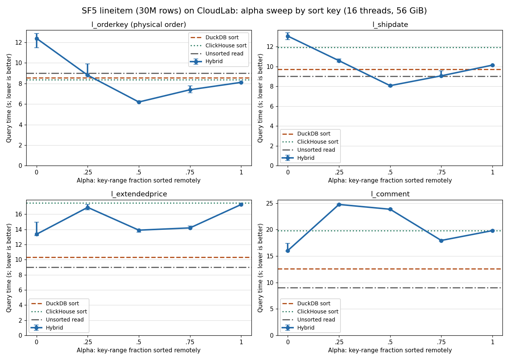
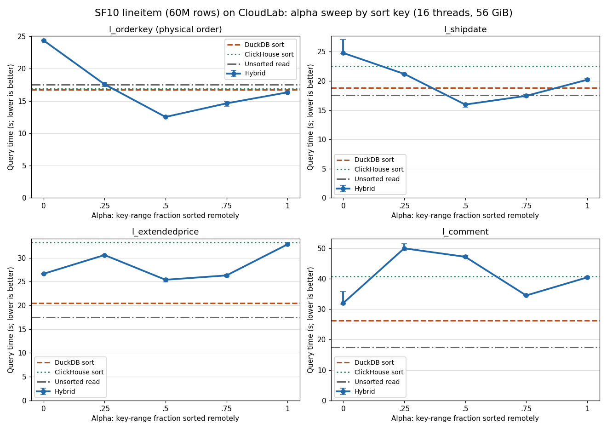
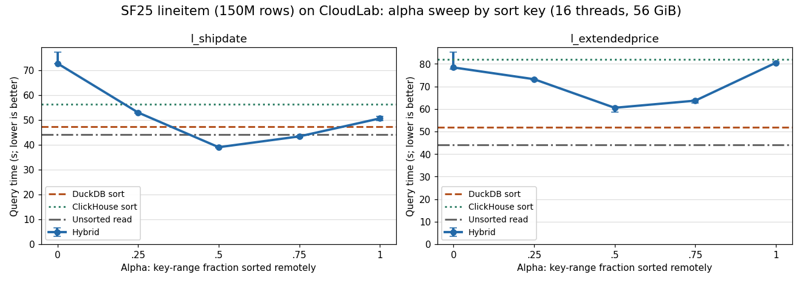

# lineitem sort experiments on CloudLab

Measured 2026-11-10 on `c220g2-010602.wisc.cloudlab.us`, with the same host and
settings as the [CloudLab orders rerun](../cloudlab-repro-20261110/README.md):
16-CPU systemd slices per engine, DuckDB `threads=16` and `memory_limit=56GiB`,
ClickHouse 26.9.12.8, and the schema-only, no-compression ClickHouse connector
with the Date/Decimal mapping fixes. Full tables are in [results.md](./results.md).

TPC-H `lineitem` is ordered by `(l_orderkey, l_linenumber)` in ClickHouse and has
16 columns: 4 integers, 4 Decimal(15,2), 3 dates and 5 strings. The hybrid
splits on `l_orderkey`. Sort keys mirror the `orders` reports:

| lineitem key | Kind | orders analogue |
|---|---|---|
| `l_orderkey` | physical order (integer) | `o_orderkey` |
| `l_shipdate` | date, not correlated with the split key | `o_orderdate` |
| `l_extendedprice` | Decimal(15,2) | `o_totalprice` |
| `l_comment` | string, 10–43 chars, nearly unique | `o_clerk` (15 chars, 1,000·SF values) |

| Scale | Rows | Logical `SELECT *` bytes | Keys | Two-column runs |
|---|---:|---:|---|---|
| SF5 | 29,999,795 | 4.68 GB | all four | yes |
| SF10 | 59,986,052 | 9.36 GB | all four | yes |
| SF25 | 149,996,355 | 23.40 GB | shipdate, extendedprice | no |

Each cell is the median `EXPLAIN (ANALYZE, FORMAT JSON)` `total_time` of three
measured passes after a warmup, with key and case order alternating between passes.
Before the matrix, the stock and fixed connectors gave identical full-row
checksums for SF5 `read_adbc` and the hybrid, and the hybrid shipdate output had
zero ordering violations. All 279 measured and warmup cases returned the expected row count.

## Charts

## Results

| Key | SF5 best | SF10 best | SF25 best | DuckDB sort (SF5 / SF10 / SF25) | Best hybrid (SF5 / SF10 / SF25) |
|---|---|---|---|---|---|
| `l_orderkey` | α=.5 6.20 s | α=.5 12.53 s | — | 8.57 / 16.79 | 6.20 / 12.53 |
| `l_shipdate` | α=.5 8.07 s | α=.5 15.96 s | α=.5 39.00 s | 9.74 / 18.81 / 47.33 | 8.07 / 15.96 / 39.00 |
| `l_extendedprice` | DuckDB 10.33 s | DuckDB 20.45 s | DuckDB 51.99 s | 10.33 / 20.45 / 51.99 | 13.36 (α=0) / 25.39 / 60.52 (α=.5) |
| `l_comment` | DuckDB 12.57 s | DuckDB 26.21 s | — | 12.57 / 26.21 | 16.04 / 31.96 (α=0) |

- **The winner depends on the sort key, and the rankings are identical at
  every scale.** Hybrid α=.5 wins the physically ordered key and the date
  key. DuckDB's local sort wins decimal and string keys. ClickHouse's sort
  never wins: its best showing is a near-tie on `l_orderkey` (SF5 8.37 vs DuckDB 8.57 s).
- **Date: the hybrid beats DuckDB by 15–18%** (SF5 8.07 vs 9.74 s, SF10 15.96
  vs 18.81 s, SF25 39.00 vs 47.33 s) and beats ClickHouse by 29–32%.
- **The hybrid finishes faster than the plain unsorted read** for `l_orderkey`
  α=.5 (0.69× at SF5, 0.71× at SF10) and `l_shipdate` α=.5 (0.88–0.91×). As in
  the orders rerun, two concurrent ADBC queries let ClickHouse produce two
  Arrow streams in parallel, which lowers the transfer floor (about 0.5 GB/s
  per stream on this host). This is an interpretation, not separately profiled.
- **Decimal and string keys lose in the output merge.** At α=.5 the merge copies
  every row for `l_extendedprice` (30.0M / 60.0M / 150.0M) and nearly every
  row for `l_comment` (29.9M / 59.5M). The single-thread merge loop takes
  6.0 / 9.4 / 18.9 s for price and 14.0 / 26.7 s for comment. Date copies only
  12–18% of rows (loop 0.37 / 0.55 / 1.17 s), and orderkey copies none.
- **`l_comment` does not repeat the `o_clerk` result.** For `o_clerk`, α=.75 won
  at every orders scale. Long, nearly unique comment strings interleave
  completely; α=.25 and α=.5 are the worst paths for this key (SF10 49.9 / 47.2 s
  vs ClickHouse 40.8 s), and even the best hybrid trails DuckDB by 22–28%.
- **Run time scales linearly.** Seconds per million rows are flat from SF5 to
  SF25 (unsorted read 0.300 / 0.292 / 0.295). The hybrid price path gets slightly
  cheaper per row as it grows (0.463 → 0.404), because fixed costs are amortized.
- **Projecting two columns** (SF10, sort by price) shrinks every path by 4–6×,
  but does not change the ranking: DuckDB 4.75 s ties hybrid α=0 4.74 s, then
  α=.5 5.27 s and ClickHouse 6.67 s; the unsorted read is 3.29 s.
- **Memory:** nothing spilled at SF5 or SF10. At SF25 only α=0 spilled (1.00 GB
  for date, 1.35 GB for price). α=.5 at SF25 queued up to 13.4 GB of remote
  data in DuckDB's buffer manager without spilling.

## lineitem SF10 vs orders SF50

The two tables have similar sizes (60M rows × 16 columns, 9.36 GB, vs 75M rows ×
9 columns, 7.20 GB) and were run with the same connector and settings.

| Path | orders date | lineitem shipdate | orders price | lineitem extendedprice |
|---|---:|---:|---:|---:|
| Unsorted read | 14.29 | 17.53 | 14.29 | 17.53 |
| DuckDB sort | 18.15 | 18.81 | **19.41** | **20.45** |
| ClickHouse sort | 20.83 | 22.48 | 40.04 | 33.23 |
| Hybrid α=.5 | **15.43** | **15.96** | 43.35 | 25.39 |
| Hybrid α=.75 | 17.06 | 17.45 | 32.06 | 26.30 |

Date behaves the same on both tables. For price the hybrid copies every row on
both, but its merge loop costs 0.16 µs per copied row on lineitem versus 0.37 µs
on orders (9.4 s / 60M vs 27.4 s / 75M). Most lineitem strings fit in DuckDB's
12-byte inline `string_t`, while orders carries a 15-character `o_clerk` and a
long `o_comment` that need heap copies. That is a plausible but unprofiled
explanation; the earlier perf runs did show `VectorStringBuffer::CopyInternal`
near the top of the hybrid price profile.

## Reproduce

`scripts/experiments/run_cases.py` gained a `--table` option (default `orders`;
existing commands are unchanged). The runner is [run_lineitem.py](./run_lineitem.py)
(run inside `scripts/run_duckdb_cgroup.sh`; phases `sf5`, `sf10`, `sf25`), and
the tables and charts come from [analyze_lineitem.py](./analyze_lineitem.py)
(`python3 analyze_lineitem.py RAW_DIR OUT_DIR [ORDERS_SF50_DIR]`; needs
matplotlib). Raw summaries, DuckDB profiles and ClickHouse query logs are under
ignored `build/experiments/lineitem-20261110/` on the host. The connector is the
`exp/schema-nocompress-queryid` build described in
[connector.diff](../cloudlab-repro-20261110/connector.diff).
