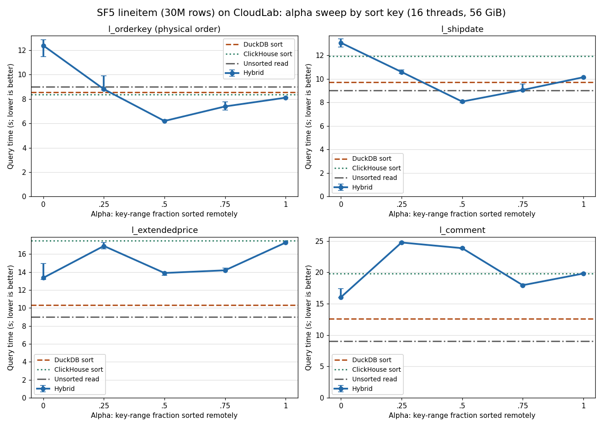
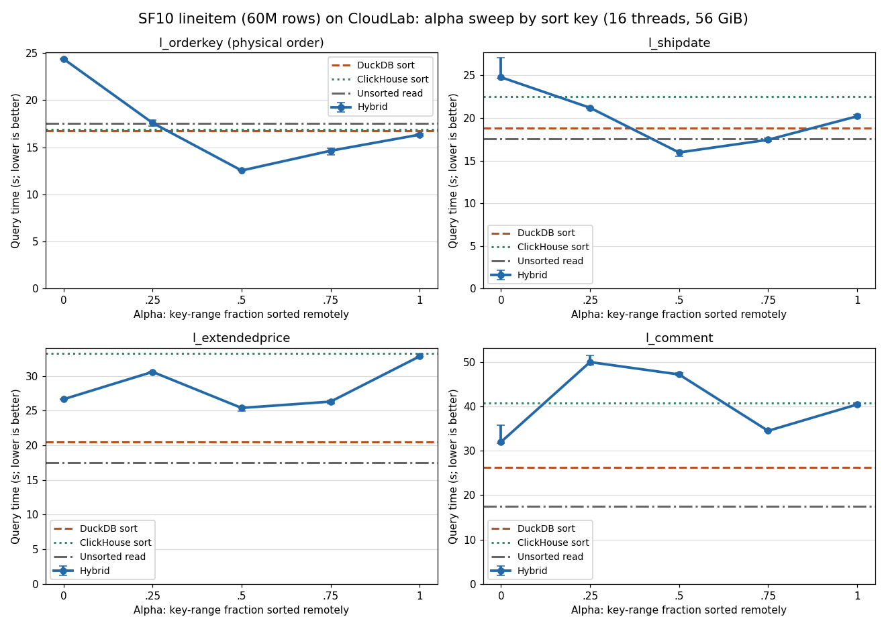
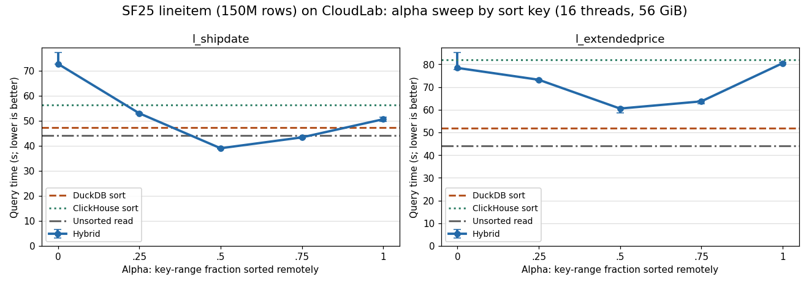

# lineitem sort experiments on CloudLab

## SF5 lineitem (29,999,795 rows)

Median of three measured runs after a warmup pass; **bold** is the fastest path per key.

| Sort key | DuckDB | ClickHouse | α=0 | α=.25 | α=.5 | α=.75 | α=1 | Best |
|---|---:|---:|---:|---:|---:|---:|---:|---|
| `l_orderkey` | 8.570 | 8.373 | 12.389 | 8.808 | **6.199** | 7.391 | 8.111 | α=0.5 |
| `l_shipdate` | 9.737 | 11.947 | 13.067 | 10.587 | **8.071** | 9.062 | 10.140 | α=0.5 |
| `l_extendedprice` | **10.332** | 17.477 | 13.356 | 16.906 | 13.896 | 14.193 | 17.281 | DuckDB |
| `l_comment` | **12.570** | 19.838 | 16.041 | 24.760 | 23.853 | 17.947 | 19.810 | DuckDB |

Unsorted `SELECT *` ADBC read: **9.001 s** (4.68 GB logical intermediate output). Two-column `l_orderkey,l_extendedprice` read: 1.764 s.

| Sort key | DuckDB / read | ClickHouse / read | best hybrid / read | best α |
|---|---:|---:|---:|---:|
| `l_orderkey` | 0.95× | 0.93× | 0.69× | 0.5 |
| `l_shipdate` | 1.08× | 1.33× | 0.90× | 0.5 |
| `l_extendedprice` | 1.15× | 1.94× | 1.48× | 0 |
| `l_comment` | 1.40× | 2.20× | 1.78× | 0 |

Hybrid α=.5 internals (median; phases overlap and are not additive):

| Sort key | Rows copied (M) | Merge s | Merge loop s | Local sort s | Remote read/buffer s | Peak remote queue GB | Spill GB |
|---|---:|---:|---:|---:|---:|---:|---:|
| `l_orderkey` | 0.00 | 0.914 | 0.015 | 5.326 | 6.171 | 2.76 | 0.00 |
| `l_shipdate` | 5.39 | 1.329 | 0.370 | 6.694 | 7.662 | 2.55 | 0.00 |
| `l_extendedprice` | 30.00 | 6.844 | 5.957 | 6.946 | 10.216 | 1.92 | 0.00 |
| `l_comment` | 29.91 | 15.558 | 14.002 | 8.092 | 11.449 | 2.55 | 0.00 |

DuckDB temporary-directory spill: none in any case.

Sorted by `l_extendedprice`, full width vs `l_orderkey,l_extendedprice`:

| Path | 16 columns | 2 columns |
|---|---:|---:|
| Unsorted read | 9.001 | 1.764 |
| DuckDB sort | 10.332 | 2.508 |
| ClickHouse sort | 17.477 | 4.209 |
| Hybrid α=0 | 13.356 | 2.469 |
| Hybrid α=.5 | 13.896 | 3.205 |
| Hybrid α=1 | 17.281 | 4.283 |

## SF10 lineitem (59,986,052 rows)

Median of three measured runs after a warmup pass; **bold** is the fastest path per key.

| Sort key | DuckDB | ClickHouse | α=0 | α=.25 | α=.5 | α=.75 | α=1 | Best |
|---|---:|---:|---:|---:|---:|---:|---:|---|
| `l_orderkey` | 16.786 | 16.886 | 24.381 | 17.585 | **12.531** | 14.632 | 16.338 | α=0.5 |
| `l_shipdate` | 18.807 | 22.481 | 24.774 | 21.196 | **15.957** | 17.445 | 20.193 | α=0.5 |
| `l_extendedprice` | **20.449** | 33.234 | 26.639 | 30.585 | 25.387 | 26.298 | 32.829 | DuckDB |
| `l_comment` | **26.209** | 40.794 | 31.963 | 49.942 | 47.161 | 34.473 | 40.402 | DuckDB |

Unsorted `SELECT *` ADBC read: **17.528 s** (9.36 GB logical intermediate output). Two-column `l_orderkey,l_extendedprice` read: 3.292 s.

| Sort key | DuckDB / read | ClickHouse / read | best hybrid / read | best α |
|---|---:|---:|---:|---:|
| `l_orderkey` | 0.96× | 0.96× | 0.71× | 0.5 |
| `l_shipdate` | 1.07× | 1.28× | 0.91× | 0.5 |
| `l_extendedprice` | 1.17× | 1.90× | 1.45× | 0.5 |
| `l_comment` | 1.50× | 2.33× | 1.82× | 0 |

Hybrid α=.5 internals (median; phases overlap and are not additive):

| Sort key | Rows copied (M) | Merge s | Merge loop s | Local sort s | Remote read/buffer s | Peak remote queue GB | Spill GB |
|---|---:|---:|---:|---:|---:|---:|---:|
| `l_orderkey` | 0.00 | 1.926 | 0.031 | 10.527 | 12.197 | 5.73 | 0.00 |
| `l_shipdate` | 8.96 | 2.418 | 0.548 | 13.513 | 14.886 | 5.48 | 0.00 |
| `l_extendedprice` | 59.99 | 11.227 | 9.416 | 14.026 | 19.994 | 4.01 | 0.00 |
| `l_comment` | 59.48 | 30.054 | 26.742 | 16.880 | 22.664 | 5.14 | 0.00 |

DuckDB temporary-directory spill: none in any case.

Sorted by `l_extendedprice`, full width vs `l_orderkey,l_extendedprice`:

| Path | 16 columns | 2 columns |
|---|---:|---:|
| Unsorted read | 17.528 | 3.292 |
| DuckDB sort | 20.449 | 4.745 |
| ClickHouse sort | 33.234 | 6.672 |
| Hybrid α=0 | 26.639 | 4.742 |
| Hybrid α=.5 | 25.387 | 5.267 |
| Hybrid α=1 | 32.829 | 6.609 |

## SF25 lineitem (149,996,355 rows)

Median of three measured runs after a warmup pass; **bold** is the fastest path per key.

| Sort key | DuckDB | ClickHouse | α=0 | α=.25 | α=.5 | α=.75 | α=1 | Best |
|---|---:|---:|---:|---:|---:|---:|---:|---|
| `l_shipdate` | 47.326 | 56.311 | 72.712 | 52.956 | **39.000** | 43.343 | 50.584 | α=0.5 |
| `l_extendedprice` | **51.987** | 81.916 | 78.423 | 73.207 | 60.519 | 63.681 | 80.506 | DuckDB |

Unsorted `SELECT *` ADBC read: **44.202 s** (23.40 GB logical intermediate output).

| Sort key | DuckDB / read | ClickHouse / read | best hybrid / read | best α |
|---|---:|---:|---:|---:|
| `l_shipdate` | 1.07× | 1.27× | 0.88× | 0.5 |
| `l_extendedprice` | 1.18× | 1.85× | 1.37× | 0.5 |

Hybrid α=.5 internals (median; phases overlap and are not additive):

| Sort key | Rows copied (M) | Merge s | Merge loop s | Local sort s | Remote read/buffer s | Peak remote queue GB | Spill GB |
|---|---:|---:|---:|---:|---:|---:|---:|
| `l_shipdate` | 18.26 | 5.861 | 1.169 | 32.947 | 36.509 | 13.40 | 0.00 |
| `l_extendedprice` | 149.99 | 23.750 | 18.925 | 35.784 | 48.426 | 10.56 | 0.00 |

DuckDB temporary-directory spill: `l_shipdate` partial0 1.00 GB, `l_extendedprice` partial0 1.35 GB.

## Scaling with row count

Seconds per million rows (median time / rows). Flat values mean linear scaling.

| Path | SF5 | SF10 | SF25 |
|---|---:|---:|---:|
| Unsorted read | 0.3000 | 0.2922 | 0.2947 |
| `l_shipdate` DuckDB sort | 0.3246 | 0.3135 | 0.3155 |
| `l_shipdate` ClickHouse sort | 0.3982 | 0.3748 | 0.3754 |
| `l_shipdate` hybrid α=.5 | 0.2690 | 0.2660 | 0.2600 |
| `l_shipdate` hybrid α=.75 | 0.3021 | 0.2908 | 0.2890 |
| `l_extendedprice` DuckDB sort | 0.3444 | 0.3409 | 0.3466 |
| `l_extendedprice` ClickHouse sort | 0.5826 | 0.5540 | 0.5461 |
| `l_extendedprice` hybrid α=.5 | 0.4632 | 0.4232 | 0.4035 |
| `l_extendedprice` hybrid α=.75 | 0.4731 | 0.4384 | 0.4246 |

## lineitem SF10 vs orders SF50 (same connector and settings)

orders SF50 is 75M rows × 9 columns; lineitem SF10 is 60M rows × 16 columns. Both use the schema-only, no-compression connector at 16 threads and 56 GiB.

| Path | orders SF50, date | lineitem SF10, shipdate | orders SF50, price | lineitem SF10, extendedprice |
|---|---:|---:|---:|---:|
| Unsorted read | 14.286 | 17.528 | 14.286 | 17.528 |
| DuckDB sort | 18.149 | 18.807 | 19.413 | 20.449 |
| ClickHouse sort | 20.831 | 22.481 | 40.043 | 33.234 |
| Hybrid α=.5 | 15.429 | 15.957 | 43.352 | 25.387 |
| Hybrid α=.75 | 17.057 | 17.445 | 32.056 | 26.298 |

Logical bytes read: orders SF50 7.20 GB, lineitem SF10 9.36 GB. Unsorted read throughput: 0.50 vs 0.53 GB/s.
