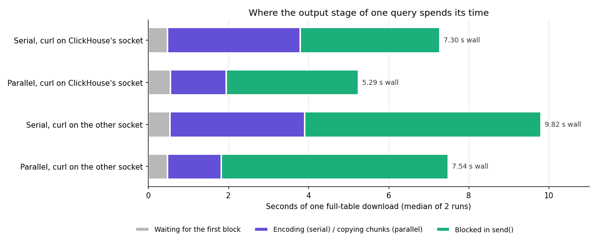
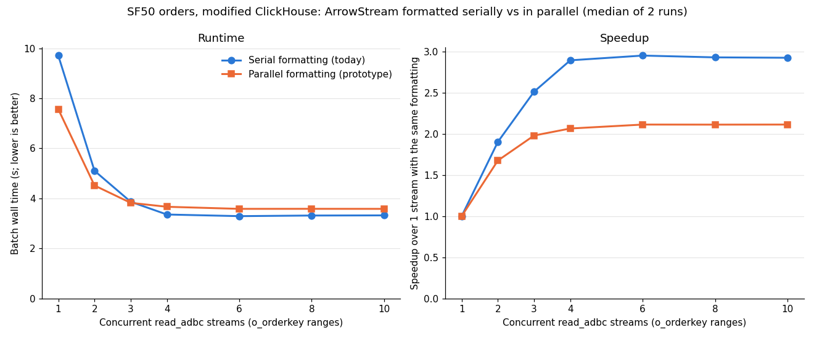

# Parallel ArrowStream formatting in ClickHouse

Measured 2026-11-11 on `c220g2-010602.wisc.cloudlab.us` (2× Xeon E5-2660 v3, Haswell), as a follow-up to
[what limits ADBC streams from the modified ClickHouse](../stream-limits-20261110/README.md). That report found
that one query's output is a serial stage: one processor encodes every Arrow block and writes it to the socket.
This report prototypes encoding `ArrowStream` output in parallel and measures what it changes.

**Summary.**

- **The prototype reuses ClickHouse's existing parallel formatting.** `ArrowStream` record batches are
  independent messages between a schema and an end-of-stream marker, so ClickHouse's order-preserving
  `ParallelFormattingOutputFormat` can encode chunks on a thread pool while one collector thread writes them in
  order. Output is byte-identical to the serial writer.
- **One stream is 22–27% faster.** A raw download takes 5.29 s instead of 7.30 s with the client on ClickHouse's
  socket, and 7.54 s instead of 9.82 s on the other socket. One `read_adbc` stream takes 7.57 s instead of 9.71 s.
- **Many streams are 8–9% slower.** From 4 streams up the batch takes 3.58–3.67 s instead of 3.29–3.36 s.
  ClickHouse's CPUs are already 90–96% busy there, and parallel formatting costs a little more CPU. The fastest
  batch is still serial formatting with 6–10 streams, at 3.29 s.
- **The new single-stream bottleneck is the query's one connection.** The collector thread spends 70–80% of its
  time blocked in `send()`: 3.3 s on ClickHouse's socket and 5.7 s from the other, the same as before. One
  connection moves about 1.8 GB/s and 1.3 GB/s respectively.
- **Multiple streams still help because each has its own connection.** Before, they also parallelized encoding;
  now only sending. The best speedup over one stream drops from 2.96× to 2.11×.

## Setup

As in the stream-limits report:

- **ClickHouse:** the modified 26.11.1.1 build plus the prototype commit (below), in its 16-CPU slice on socket 0
  (CPUs 0–7, 20–27; 8 cores with hyperthreading), on copies of the five SF50 `orders` parts.
- **Data:** SF50 `orders`, 75,000,000 rows, 9.67 GB of uncompressed Arrow.
- **Clocks:** pinned at 2.6 GHz (`performance` governor, turbo off).
- **Serial vs parallel:** sections 3–5 use the same prototype binary, switching `output_format_parallel_formatting`
  between 0 and 1 per query. With 0 the prototype takes the old serial path, so build differences cannot affect
  the comparison. Section 1 ran on the modified build before the prototype.
- **Raw downloads:** `curl` on CPU 9 (ClickHouse's socket) or CPU 19 (the other socket), `max_threads=32`.
- **`read_adbc` streams:** [`bench/parallel_read_adbc`](../../bench/parallel_read_adbc.cpp) with N
  `o_orderkey` ranges, `max_threads` = floor(32 / N) per query, and the new `--ch-settings` option to set
  `output_format_parallel_formatting`. DuckDB runs in its 16-CPU slice on socket 1 with `threads=16` and the
  experimental reader thread on (`ADBC_READER_THREAD=1`).

Each configuration ran twice.

## 1. Why parallel formatting should help

ClickHouse already formats some output formats in parallel, including `RowBinary`, but not Arrow. Downloading
the same table as `RowBinary` with parallel formatting off and on
([data](./data/rowbinary-parallel-formatting.txt), [script](./scripts/parallel_formatting.sh)), on the build
before the prototype:

| Format | curl on ClickHouse's socket | curl on the other socket |
|---|---:|---:|
| `ArrowStream` (serial; no parallel support) | 7.32–7.37 s | 9.82–9.86 s |
| `RowBinary`, parallel formatting off | 12.46–12.64 s | 14.58–14.59 s |
| `RowBinary`, parallel formatting on | 4.86–5.01 s | 6.32–6.38 s |

Parallel formatting made `RowBinary` 2.5× faster, and faster than serial Arrow, while the time blocked in
`send()` stayed about the same. That suggested taking Arrow's 3.4 s of encoding off the serial path would save
about 2 s.

## 2. The change

[Patch](./patches/clickhouse-parallel-arrowstream.patch) on the modified ClickHouse (`a2d3db7e5`), 34 lines in
three files:

- **`ArrowIPCBlockOutputFormat`:** the schema message moves from the first `consume()` to `writePrefix()`, and
  `finalizeImpl()` no longer writes it. `IOutputFormat` always writes the prefix before the first chunk and
  before finalizing, so the serial output is unchanged. Under parallel formatting each chunk is encoded by a
  fresh formatter instance, which now writes only that chunk's record batch.
- **Registration:** `ArrowStream` is marked as supporting parallel formatting. The `Arrow` file format is not,
  because its footer records the offset of every batch.
- **`FormatFactory`:** `ArrowStream` stays serial when record batches are combined
  (`output_format_arrow_record_batch_size` or `output_format_arrow_record_batch_size_bytes`) or when
  `LowCardinality` columns are written as Arrow dictionaries
  (`output_format_arrow_low_cardinality_as_dictionary`). Both carry state from one chunk to the next, which a
  fresh formatter per chunk would lose.

Parallel formatting is on by default in ClickHouse (`output_format_parallel_formatting=1`), so with the patch
`ArrowStream` uses it unless one of those settings is set.

## 3. Correctness

[scripts/parallel_arrow_correctness.sh](./scripts/parallel_arrow_correctness.sh) ([output](./data/correctness.txt)):

- **Byte-identical output.** Serial and parallel `ArrowStream` have the same SHA-256 for the full 9.67 GB table
  (`max_threads=1`, so the chunk order is fixed), a 500,000-row ordered result read with 32 threads, an empty
  result (schema plus end-of-stream marker, 512 bytes) and `LIMIT 10`.
- **Fallbacks:** with dictionary output or combined record batches, `processors_profile_log` shows the serial
  `ArrowIPCBlockOutputFormat` even with parallel formatting requested, and the output is byte-identical.
- **Through the connector:** a full `read_adbc`, decoded by arrow-rs, returns 75,000,000 rows and the same
  row-hash sum with either setting.
- **Errors:** a `throwIf` error raised in the middle of the stream reaches DuckDB with either setting.

## 4. One stream

Raw curl downloads of the full table, from `system.query_log` and `system.processors_profile_log`
([data](./data/curl.txt), [script](./scripts/parallel_arrow_timing.sh)):

[Vector version](./output_stage.svg); medians in [output_stage.tsv](./output_stage.tsv).

| | Serial, same socket | Parallel, same socket | Serial, other socket | Parallel, other socket |
|---|---:|---:|---:|---:|
| curl wall time | 7.27–7.33 s | **5.17–5.41 s** | 9.77–9.88 s | **7.51–7.56 s** |
| Output stage busy | 6.79–6.83 s | 4.58–4.82 s | 9.20–9.32 s | 6.98–7.03 s |
| …blocked in `send()` | 3.49 s | 3.22–3.39 s | 5.89–5.92 s | 5.64–5.70 s |
| …everything else | 3.30–3.33 s | 1.36–1.43 s | 3.31–3.40 s | 1.33–1.34 s |
| Waiting for the first block | 0.46–0.48 s | 0.54–0.55 s | 0.54 s | 0.48 s |
| Table readers blocked on output (longest) | 6.60–6.62 s | 4.36–4.61 s | 9.09–9.20 s | 6.76–6.83 s |
| ClickHouse CPU | 28.3–28.5 s | 31.0–31.3 s | 30.7–30.9 s | 31.0–31.4 s |

- **Encoding is off the serial path.** Outside `send()`, the serial output stage spent 3.3 s, mostly encoding.
  The parallel collector spends 1.35 s, copying each encoded chunk into the HTTP output buffer.
- **`send()` time did not change,** so the saving is the encoding time, about 2 s on either socket.
- **The query is still paced by one thread.** The first-block wait plus the output stage's busy time still equals
  the wall time, and the 32 table readers still spend most of the query blocked on output.

One `read_adbc` stream, DuckDB on the other socket: **9.71 s serial, 7.57 s parallel** (best run 7.28 s). That
matches curl from the same socket, so the connector with the reader thread keeps up.

## 5. Multiple streams

[Vector version](./parallel_streams.svg); data in [parallel_streams.tsv](./parallel_streams.tsv). Batch wall
times, median of 2 runs:

| Streams | Serial | Parallel | Change |
|---:|---:|---:|---:|
| 1 | 9.71 s | **7.57 s** | −22% |
| 2 | 5.10 s | 4.52 s | −12% |
| 3 | 3.87 s | 3.82 s | −1% |
| 4 | 3.36 s | 3.67 s | +9% |
| 6 | **3.29 s** | 3.58 s | +9% |
| 8 | 3.32 s | 3.58 s | +8% |
| 10 | 3.32 s | 3.58 s | +8% |

ClickHouse's side of the same runs ([serial](./data/streams-par0-clickhouse.txt),
[parallel](./data/streams-par1-clickhouse.txt)):

| Streams | CPU per batch: serial / parallel | Median time blocked in `send()` per query: serial / parallel |
|---:|---|---|
| 1 | 30.6 / 30.3 s | 5.70 / 5.35 s |
| 2 | 33.6 / 41.6 s | 3.00 / 3.29 s |
| 4 | 48.5 / 51.4 s | 1.83 / 2.35 s |
| 10 | 50.8 / 52.2 s | 1.04 / 1.28 s |

- **Up to 2 streams, parallel formatting wins,** because each query's output stage is still the limit.
- **From 4 streams up it loses 8–9%.** ClickHouse uses 50–52 CPU-seconds per batch, 90–96% of its 16 CPUs over
  the batch, and parallel formatting needs about 3–6% more. That extra CPU does not fully account for an 8%
  slowdown. The time blocked in `send()` also rises, which could mean the client side is a limit at this point.
  Neither was profiled.

## 6. The new bottleneck, and why multiple streams still help

- **One query is limited by its single connection.** The parallel collector is the only thread that writes to the
  socket, and 70–80% of its time is blocked in `send()`. One connection moves 9.67 GB in about 5.3 s
  (1.8 GB/s) to ClickHouse's socket and in about 7.5 s (1.3 GB/s) to the other socket.
- **What `send()` waits on is open.** It could be the sending thread's own kernel work; on loopback the sender
  also does much of the receive-side TCP processing. Or the socket buffer could be full, waiting for the receiver.
  The client is not the limit compared with curl, since one `read_adbc` stream matches curl's time.
- **N streams give N connections and N collectors,** so the time blocked in `send()` overlaps. Before this change,
  multiple streams also overlapped encoding; parallel formatting already does that within one query, so the gain
  from multiple streams shrinks from 2.96× to 2.11×.
- **From about 4 streams, ClickHouse's total CPU is the limit,** with either formatting. About half of that CPU is
  decompressing the table (stream-limits report, section 10).

## Next steps

1. **Use parallel formatting only where it pays.** For example, enable it only when a query has enough
   `max_threads`; at 10 streams each query has 3.
2. **Make the parallel path cheaper,** so it also wins when CPU is the limit:
   - have the collector send each encoded chunk straight to the socket instead of copying it into the HTTP buffer
     (1.35 s per full table);
   - reuse encoders across chunks, which the serial writer does and a fresh formatter per chunk cannot.
3. **Measure the single-connection ceiling directly:** a plain loopback TCP transfer (iperf3, or `nc` from
   `/dev/zero`) with the receiver on CPU 9 and CPU 19. If it tops out near 1.8 and 1.3 GB/s, the remaining
   single-stream limit is one TCP connection on this host.
4. **Profile the collector off-CPU,** to split its `send()` time into its own kernel work and waiting for the
   receiver.

## Caveats

- Two runs per configuration; the two runs differed by at most 0.3 s.
- All transfers are loopback on one host. Over a real network one connection's ceiling would be the link.
- `read_adbc` was measured only with DuckDB on the other socket.
- The explanations of the many-stream slowdown and of what `send()` waits on are inferred, not profiled.
- The prototype is not upstream. It was built on this host with clang 22.1.8 from the modified tree's existing
  build directory.

## Files

- **[patches/clickhouse-parallel-arrowstream.patch](./patches/clickhouse-parallel-arrowstream.patch):** the
  prototype, as a `git format-patch` of commit `a5be5f0c7` on the modified tree's `a2d3db7e5`.
- **[scripts/](./scripts/):** the host runners, which expect the experiment directory layout on the CloudLab host.
  - `parallel_formatting.sh`: section 1.
  - `parallel_arrow_correctness.sh`: section 3.
  - `parallel_arrow_timing.sh`: sections 4 and 5.
  - `start_modified_clickhouse.sh`: starts and stops the modified server; `CLICKHOUSE_BIN=...` selects another
    binary.
- **[data/](./data/):** the raw output of each script: `parallel_read_adbc` results per setting
  (`streams-par0.tsv`, `streams-par1.tsv`), ClickHouse's per-query summaries, and the curl, correctness and
  `RowBinary` runs.
- **[plot_parallel_arrowstream.py](./plot_parallel_arrowstream.py)** draws both charts:
  `python3 plot_parallel_arrowstream.py data .` (needs matplotlib).
