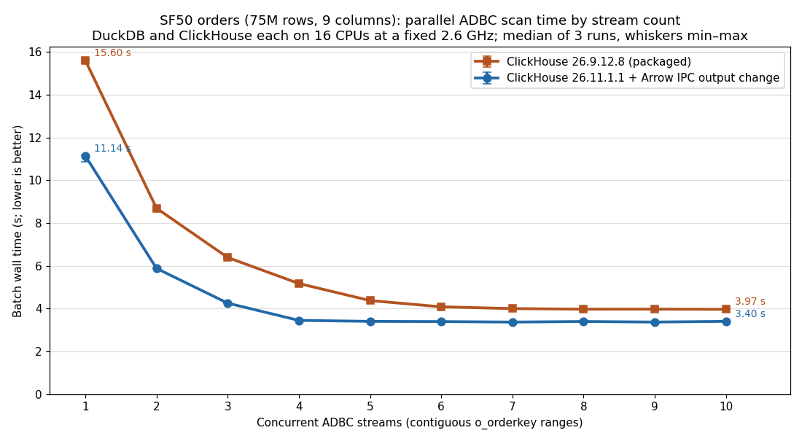

# Parallel ADBC streams: packaged vs modified ClickHouse

Measured 2026-11-10 on `c220g2-010602.wisc.cloudlab.us`. The full SF50 `orders`
table (75,000,000 rows, 9 columns, 9.67 GB of uncompressed Arrow) is read through
ADBC as N concurrent streams. Each stream covers one contiguous `o_orderkey`
range and runs in its own DuckDB process. The comparison is between two ClickHouse
servers:

- **ClickHouse 26.9.12.8**, the packaged release the experiments host normally runs.
- **ClickHouse 26.11.1.1 with the Arrow IPC output change**, built from
  `/proj/slogora-PG0/ClickHouse` at `a2d3db7e5` ("Reduce allocations and copies in
  Arrow IPC output") on top of master `f07035a24`. It is a Release build (clang 22).



[Vector version](./streams_runtime.svg). Each point is the median batch wall
time of three measured runs; whiskers show the minimum and maximum. A batch runs
from launching all N DuckDB processes until the last one finishes.

| Streams | 26.9.12.8 | 26.11.1.1 + Arrow change | Change |
|---:|---:|---:|---:|
| 1 | 15.60 s | **11.14 s** | −29% |
| 2 | 8.69 s | **5.88 s** | −32% |
| 3 | 6.39 s | **4.26 s** | −33% |
| 4 | 5.17 s | **3.45 s** | −33% |
| 5 | 4.38 s | **3.40 s** | −22% |
| 6 | 4.08 s | **3.39 s** | −17% |
| 7 | 4.00 s | **3.37 s** | −16% |
| 8 | 3.97 s | **3.40 s** | −15% |
| 9 | 3.98 s | **3.37 s** | −15% |
| 10 | 3.97 s | **3.40 s** | −14% |

Minimum and maximum times are in [streams_runtime.tsv](./streams_runtime.tsv).

## Findings

- **The modified server is faster at every stream count.** A single stream
  drops from 15.60 to 11.14 s (−29%), and 2–4 streams improve by about a third.
- **More streams stop helping sooner.** The modified server reaches its floor
  at 4 streams (about 3.4 s); the packaged server reaches its floor at about 7
  streams (about 4.0 s). The floor itself is 14–16% lower.
- **Why more streams help at all.** ClickHouse encodes each query's result
  through a single `ArrowIPCBlockOutputFormat` processor. In an earlier
  single-stream run on 26.9, that one processor was busy for 13.1 s of a 13.7 s
  query, while 32 table-reading threads were each busy for at most 0.6 s. Each
  extra stream adds another encoder running in parallel. In earlier 26.9
  measurements with the default governor, the curve flattened once ClickHouse's
  16 CPUs were nearly saturated (about 15 of 16 busy at 10 streams). I did not
  repeat that CPU measurement for these fixed-clock runs.

## Why the clocks are fixed

These runs use the `performance` frequency governor with turbo off, so every
core runs at the 2.6 GHz base clock. Measured effective clocks during
single-stream runs were 2.67–2.73 GHz for both ClickHouse and DuckDB.

Under the host's default (`schedutil`, from Ubuntu's kernel config; the CPU has no
hardware-managed P-states, so `intel_pstate` runs in passive mode), the
single-stream comparison came out the other way. The modified server took 18.4 s
against 14.7 s for 26.9, even though it executed 12% fewer instructions (144 G vs
164 G). The faster server outran the DuckDB client. Its backpressured threads
then ran in short bursts, which dropped ClickHouse's cores to an effective
1.57 GHz, and DuckDB ran at about 1.25 GHz throughout. With fixed clocks, that
interaction disappears, and the comparison reflects the work each server does.

Turbo is off, so these times are not comparable with turbo-enabled numbers
elsewhere in this repository.

## Method

- **Resources:** ClickHouse and DuckDB run in separate systemd slices of 16
  logical CPUs (8 physical cores) each, on different NUMA nodes, each capped at
  64 GiB. DuckDB uses `threads=16` and `memory_limit=56GiB` per process.
- **Queries:** each stream is `EXPLAIN (ANALYZE, FORMAT JSON) SELECT * FROM
  read_adbc(…, 'SELECT * FROM tpch_sf50.orders WHERE o_orderkey BETWEEN lo AND
  hi SETTINGS max_threads=k')`. That consumes every row without an output sink.
  Ranges are contiguous and disjoint and cover `[1, 300000000]`.
- **ClickHouse threads per query:** `k = floor(32 / N)`. ClickHouse limits all
  queries together to 32 CPU slots on this host (`ConcurrencyControlSoftLimit`).
  With its default `max_threads=16`, the first two or three queries take most
  of the slots, and the rest run nearly single-threaded.
- **Connector:** the ClickHouse ADBC connector 0.1.1 with HTTP response
  compression off. It also has metadata-only `ExecuteSchema` via `DESCRIBE`,
  separate schema query IDs, the Date/Decimal type-mapping fixes, and a retry on
  `SESSION_IS_LOCKED`. Arrow IPC compression was `none` on every data query, as
  recorded in ClickHouse's query log. The source is branch `experiment`
  (`4e289c2`); see [connector.diff](./connector.diff).
- **Same data on both servers:** the modified server ran on its own data
  directory, holding copies of the same five SF50 `orders` parts, with merges
  stopped. Only one server ran at a time.
- **Repeats:** one warmup batch, then three passes over N = 1–10, with the order
  of N reversed on the second pass.
- **Correctness checks:**
  - Every measured batch returned exactly 75,000,000 rows.
  - Full-row checksums of SF5 and SF50 `orders` read through ADBC matched
    between the two servers.
  - A single-threaded ArrowStream export of the same 10M rows was byte-identical
    from both servers (same SHA-256).

## Caveats

- The baseline is the 26.9 release, not 26.11 without the Arrow commit. Some
  of the difference may come from other changes between the two versions.
- These are loopback transfers on one host, for one table. A real network
  would add bandwidth limits and latency that these runs do not exercise.

## Reproduce

[run.sh](./run.sh) runs the sweep. Run it from the repository root, inside the
DuckDB slice:

```sh
sudo sh -c 'for f in /sys/devices/system/cpu/cpu*/cpufreq/scaling_governor; do echo performance > $f; done'
echo 1 | sudo tee /sys/devices/system/cpu/intel_pstate/no_turbo
CH_MAX_THREADS=split bash scripts/run_duckdb_cgroup.sh ./run.sh 1 2 3 4 5 6 7 8 9 10
```

It prints medians and writes per-stream results to `build/experiments/`. The raw
results for this report are [packaged.tsv](./packaged.tsv) and
[modified.tsv](./modified.tsv). The chart and table come from
[plot_streams.py](./plot_streams.py) (`python3 plot_streams.py packaged.tsv
modified.tsv .`; needs matplotlib). [start_modified_clickhouse.sh](./start_modified_clickhouse.sh)
swaps the host to the modified server on a separate data directory, and back
with `stop`. It is specific to this host's paths.
