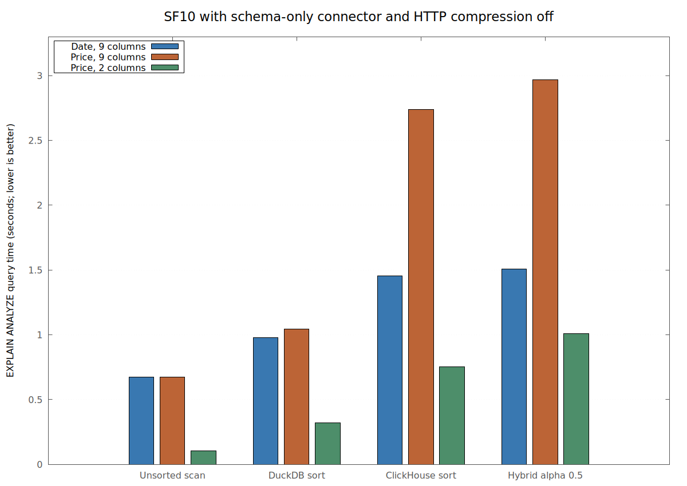
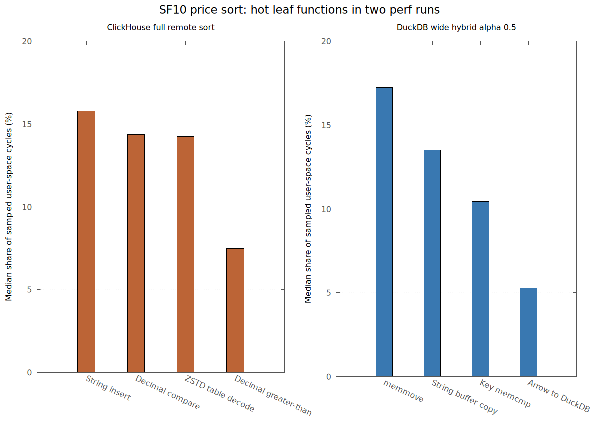

# SF10 with the schema-only connector and compression off

Measured 2026-11-09 on the local TPC-H SF10 `orders` table (15 million rows).
The connector build implements `ExecuteSchema` through `DESCRIBE (<SELECT>)`
and disables ClickHouse HTTP response compression. ClickHouse's query log
also records `output_format_arrow_compression_method=none` on the actual
ArrowStream data query. An explicit `none` setting produced the same
1,934,585,483 network bytes for an unsorted scan, confirming Arrow IPC
compression was already off. The `ZSTD` functions discussed below are in
ClickHouse's stored-data read path.

DuckDB and ClickHouse each had affinity to four physical cores. DuckDB used
four threads and a 9 GiB memory limit. Each query returned all 15 million
rows and either all nine columns or the two-column
`o_orderkey,o_totalprice` projection. There was no CSV sink or spill. The latency table is
the median of three `EXPLAIN ANALYZE` runs after a warmup pass; case and key
order alternated. `perf` was collected in separate runs to keep sampling
overhead out of the latency table.

| Path | Date, 9 columns (s) | Price, 9 columns (s) | Price, 2 columns (s) |
|---|---:|---:|---:|
| Unsorted ADBC scan | 0.674 | 0.674 | 0.104 |
| DuckDB sort | **0.977** | **1.046** | **0.321** |
| ClickHouse sort | 1.453 | 2.738 | 0.755 |
| Hybrid α=.5 | 1.507 | 2.967 | 1.008 |

[Vector timing chart](./perf_schema_off_times.svg). The full-row price remote sort
remains 2.6 times the DuckDB local sort, despite removing the duplicate
schema query and response compression. The hybrid price path is slower still.
Selecting only two columns cuts the remote price sort to 0.755 seconds and
the hybrid to 1.008 seconds, while returning the same 15 million keys.

## What consumes the time

### ClickHouse full price sort

The real price query took a median 2.728 seconds on the server and 9.501
server core-seconds. Its **single** `MergingSortedTransform` processor was
active for 2.188 seconds. The Arrow output processor was active for 0.800
seconds. These pipeline intervals overlap; they cannot be added. For the
date sort, the corresponding sorted merge was 0.467 seconds. The table is
physically ordered by `o_orderkey`, so both requested keys require sorting,
but merging the price runs is much more expensive.

Two `perf record -e cycles:u -F 199 --call-graph dwarf` runs of the full
remote price sort agreed on the hot leaf functions:

| ClickHouse function | Median share of sampled server user-space cycles |
|---|---:|
| `ColumnString::insertFrom` | 15.8% |
| Decimal `compareAt` | 14.4% |
| `ZSTD_decompressSequences` | 14.3% |
| Decimal greater-than | 7.5% |

Several additional hot functions perform string indexing, decimal insertion,
and variant dispatch. The profile points to decimal-key comparisons and
moving full string payloads during sorting, with stored-data decompression
also significant. Turning off response compression does not remove the
stored-data decompression work.

The two-column price sort sent 0.360 GB instead of 1.934 GB, used 2.331
instead of 9.501 server core-seconds, and reduced the single sorted-merge
processor from 2.188 to 0.651 seconds. It kept the same decimal sort key
and row count. This directly shows how much wide payload movement and
storage reading add to the full-row remote sort.

### Unsorted scan and local DuckDB sort

The unsorted scan took 0.674 seconds, used 1.908 ClickHouse core-seconds and
about 0.714 DuckDB process core-seconds, and sent 1.935 GB. Its single Arrow
output processor was active for 0.638 seconds. In the server scan profile,
`ZSTD_decompressSequences` accounted for 53.2% of sampled user-space cycles;
the Arrow record-batch encoder accounted for 6.2%. On the client, DuckDB's
`ArrowToDuckDBConversion::ColumnArrowToDuckDB` accounted for 30.1%, a Rust
connector iterator for 16.4%, and `memmove` for 13.4%. The scan floor is now
dominated by storage reading and Arrow-to-DuckDB conversion, with output
production and transfer on the critical path. These percentages describe
CPU samples, not fractions of elapsed latency.

Adding DuckDB's full price sort raised query time only from 0.674 to 1.046
seconds. It used 3.184 client core-seconds; hot functions were string gather
(11.2% of client samples), `memmove` (10.1%), and sort-key/radix operations.
The local sort is parallel and remains the fastest full-row price path.

### Hybrid α=.5

The wide price hybrid spent 1.133 seconds sorting the local half while its
remote branch read/buffered for 1.799 seconds. Those branches overlap. After
local sorting, the output merge took 1.803 seconds, of which 1.658 seconds
was its loop. It copied **all 15 million rows** into packed output chunks;
remote queue wait was zero. For the date key, 11.69 million rows could be
emitted as ordered references and the merge loop took only 0.077 seconds.

The two wide price hybrid `perf` runs consistently placed client cycles in
`memmove` (17.2% median), `VectorStringBuffer::CopyInternal` (13.5%), and
`memcmp` (10.4%). The `memcmp` call is the per-key comparison in
[`PartialSortState::LocalFirst`](../../src/adbc_partial_sort.cpp), which
compares encoded sort-key blobs; `DataChunk::Append` copies the short
interleaved spans. Some `memmove` samples came from local sort materialization,
so the 17.2% is **not** solely merge-copy CPU. The existing elapsed timers
and the `CopyInternal`/`memcmp` stacks isolate the merge's output-thread
cost more directly. In a two-column price profile with the same 15 million
copied rows, its merge loop was 0.622 seconds; the unprofiled median was
0.630 seconds. Narrowing the payload sharply reduced the copy work.
[Vector hotspot chart](./perf_schema_off_hotspots.svg).

## Schema check and next changes

Each sorted run logged a nine-row `DESCRIBE` followed by one 15-million-row
query. Across the unprofiled matrix interval, ClickHouse logged 74 starts,
74 finishes, and no processing exceptions for SF10 queries. The duplicate
full sorted schema probe described in [the earlier profiling report](./PROFILING.md)
is gone.

The highest-value implementation change for the hybrid is to avoid
per-row encoded-key `memcmp` and full-row `Append` when price keys interleave.
A typed key comparison plus batch-oriented payload movement, or a late
payload gather after merging row indices, are candidates to benchmark. For
the current implementation, use DuckDB's local sort for a full-row price or
date result on this machine. If remote sorting must be used, reducing the
payload before the ClickHouse sort is worth testing: full string-row
insertion is a prominent server hot spot.

## Artifacts and limits

The raw timing summaries, query and processor logs, and `perf.data` files
are under ignored `build/local-experiments/sf10-schema-perf-20261109/`.
The selected connector is the local
`libadbc_clickhouse_schema_nocompress.so` in ignored
`build/local-experiments/adbc-clickhouse-experiment-libs/` (SHA-256
`b7cefe77041fbea5300fc985d6df86f19f2ee6f007349587d177f906d78186e3`). The active
ignored `build/local-experiments/clickhouse.toml` now points to that build;
[`local_experiments.py`](../../scripts/local_experiments.py) retains the
choice on later `prepare` runs. The connector source change itself is in a
separate, uncommitted checkout and is not included in this repository.
The `DESCRIBE (<SELECT>)` implementation was validated on these SELECTs;
queries that are not valid ClickHouse subqueries need separate handling.

The tracked TSV files and [`plot_profile.py`](./plot_profile.py) regenerate
both charts. Perf percentages are leaf-symbol shares of sampled user-space
cycles from one run per path, except the two repeat profiles used for the
price hotspot chart. They do not measure wall-time fractions or include
kernel cycles. The symbolized DuckDB extension used for client profiling
was relinked from the same optimized object files without stripping;
the latency matrix used the ordinary release extension. ClickHouse processor
elapsed times can overlap one another and include pipeline backpressure.
