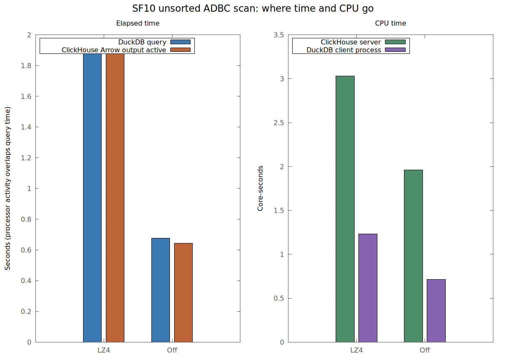
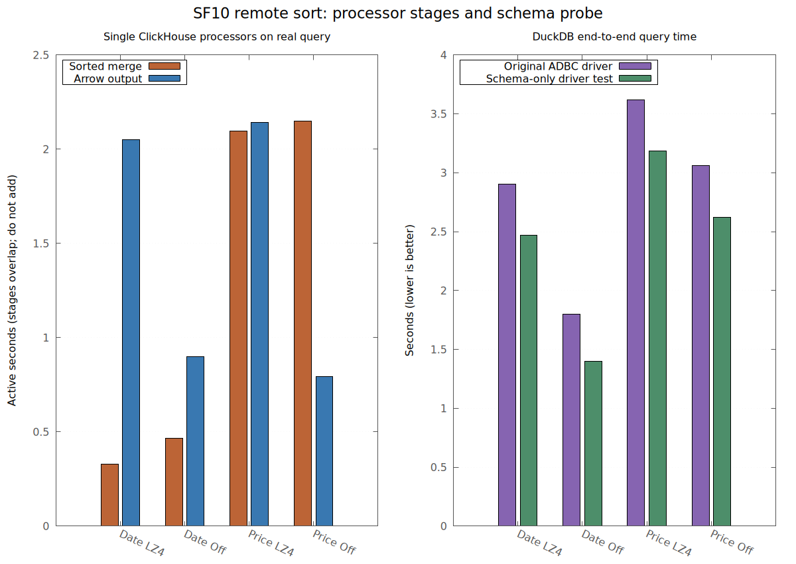
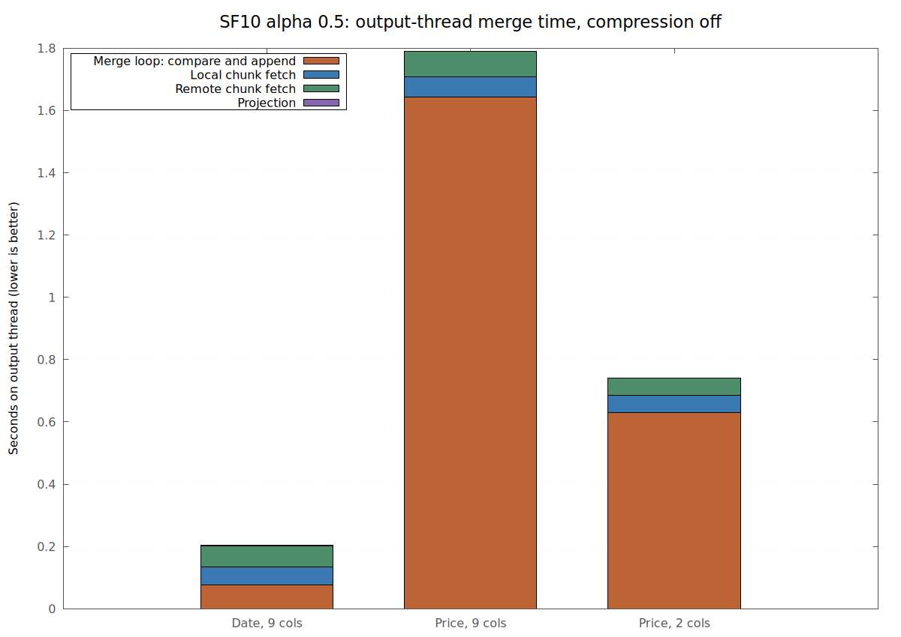

# SF10 profiling rerun

Measured 2026-11-09 on the local 15-million-row TPC-H SF10 `orders` table.
DuckDB and ClickHouse each had affinity to four physical cores. DuckDB used
four threads and a 9 GiB memory limit. Queries returned all nine columns
unless marked two-column. The table is physically ordered by `o_orderkey`.
`LZ4` and `Off` refer to ClickHouse HTTP response compression. Each value
below is the median of three runs; case order was alternated between passes.
The measurements use `EXPLAIN ANALYZE` without a CSV sink. No run spilled.

## End-to-end rerun

| Sort key | Path | LZ4 (s) | Compression off (s) |
|---|---|---:|---:|
| — | Unsorted ADBC scan | 1.954 | 0.678 |
| `o_totalprice` | DuckDB sort | **2.378** | **1.112** |
| `o_totalprice` | ClickHouse sort | 3.619 | 3.059 |
| `o_totalprice` | Hybrid α=.5 | 3.710 | 3.029 |
| `o_orderdate` | DuckDB sort | 2.231 | **0.955** |
| `o_orderdate` | ClickHouse sort | 2.903 | 1.799 |
| `o_orderdate` | Hybrid α=.5 | **1.970** | 1.498 |

The earlier compression result holds. Local DuckDB sorting is fastest for
both keys with compression off. Hybrid α=.5 remains the fastest date path
with LZ4. These are query latencies, not a claim that all three paths do the
same work internally.

## Scan and transfer

For the wide unsorted scan, disabling compression cut query time from 1.954
to 0.678 seconds, while wire bytes grew from 0.895 to 1.935 GB. The single
ClickHouse `ArrowIPCBlockOutputFormat` processor was active for 1.925 and
0.644 seconds, respectively. ClickHouse CPU fell from 3.030 to 1.962
core-seconds; the DuckDB process fell from 1.234 to 0.713 core-seconds.
The near match between query wall time and Arrow output processor time makes
the HTTP Arrow production/transfer path the scan's elapsed-time limit on this
loopback machine. The CPU change shows compression consumes work on both
sides; it does not by itself isolate encoding, compression, socket transfer,
and decoding. [Vector chart](./profile_scan.svg).

As a control, three direct `curl` transfers to `/dev/null` (no Arrow decoding)
took 1.871/0.586 seconds for unsorted ArrowStream with LZ4/off. They support
the server/transfer finding, but are not equivalent to ADBC query latency.

## Remote sort and the schema probe

The real ClickHouse query has a **single** `MergingSortedTransform` processor.
Its elapsed processor time for `o_totalprice` was 2.096 seconds with LZ4 and
2.148 seconds with compression off. For `o_orderdate` it was 0.329 and
0.468 seconds. The price key is unrelated to the table's physical order, so
the global merge remains costly even when the transfer is faster. The Arrow
output processor took 2.142/0.794 seconds for price and 2.051/0.900 for
date (LZ4/off). These processor stages overlap and **must not be summed**.
The price sort's ClickHouse server CPU was 10.838/9.553 core-seconds
(LZ4/off), much higher than the unsorted scan's 3.030/1.962.

There is also an avoidable binding-time query. In
[`AdbcArrowStreamFactory::GetSchema`](../../src/adbc_scan.cpp), DuckDB first
calls `AdbcStatementExecuteSchema`. The current v0.1.1 ClickHouse ADBC
driver returns `NOT_IMPLEMENTED`, so the extension executes the complete
SQL query to obtain its Arrow schema and cancels the stream. Then
`ProduceStream` executes the query again for the actual result. ClickHouse
logs the cancelled sorted probe as `ExceptionWhileProcessing` with
`Connection reset by peer`. Each price/date sorted probe scanned all
15 million rows, consumed about 3.0–3.3 core-seconds, and reached roughly
2.36–2.39 GB peak server memory. It began about 0.39–0.45 seconds before the
real query. Its lifetime overlaps the real query, so its full duration is
**not** additive to end-to-end latency. The regular `QueryFinish` logs alone
miss this work.

I tested an isolated driver variant that implements `ExecuteSchema` by
running `DESCRIBE (SELECT ...)`. It returns the nine column descriptions
without starting the data query. It is a prototype built in ignored
`build/local-experiments/` from local, uncommitted connector changes; the
tracked report does not include or install that connector source. The
measured binding time dropped from about 0.39–0.45 seconds to 0.008–0.009
seconds. ClickHouse logs for the 12 prototype runs contained no cancelled
schema probes. The end-to-end comparison was:

| Sort key | Compression | Current driver (s) | Schema-only prototype (s) | Saving (s) |
|---|---|---:|---:|---:|
| `o_orderdate` | LZ4 | 2.903 | 2.471 | 0.432 |
| `o_orderdate` | Off | 1.799 | 1.401 | 0.398 |
| `o_totalprice` | LZ4 | 3.619 | 3.187 | 0.432 |
| `o_totalprice` | Off | 3.059 | 2.619 | 0.440 |

The actual ClickHouse query duration changed little in this test. Most of
the wall-time saving comes from removing the binding delay; the CPU and
memory saved by avoiding the duplicate sort are additional benefits. Even
after that change, compression-off remote price sorting at 2.619 seconds is
well behind DuckDB's 1.112 seconds. [Vector chart](./profile_remote.svg).

## Hybrid merge

I added output-thread timers to [`PartialSortState`](../../src/adbc_partial_sort.cpp)
for fetching chunks, waiting on the remote queue, projecting the result,
and the remaining merge loop. These are elapsed times within the existing
`Merge Seconds` interval, not CPU samples. With compression off:

| α=.5 path | Query (s) | Local sort (s) | Remote read/buffer (s) | Merge (s) | Merge loop (s) | Output rows copied |
|---|---:|---:|---:|---:|---:|---:|
| Date, 9 columns | 1.502 | 1.273 | 1.323 | 0.207 | 0.076 | 3.318m |
| Price, 9 columns | 2.949 | 1.152 | 1.792 | 1.781 | 1.643 | 15.000m |
| Price, 2 columns | 1.010 | 0.259 | 0.414 | 0.740 | 0.631 | 15.000m |

The wide price merge spends 1.643 seconds in the loop, versus 0.064/0.081
seconds fetching local/remote chunks and 0.002 projecting. Remote queue
wait was effectively zero. The loop includes key comparison, span selection,
and `DataChunk::Append` into packed output chunks, so its timer does not
separate those operations. Narrowing the payload from nine columns to two
with the same keys and 15 million copied rows cuts the loop from 1.643 to
0.631 seconds. That strongly implicates full-row movement as the dominant
price hybrid output cost. The date path can reference about 11.68 million
rows in ordered spans, and its loop takes just 0.076 seconds. Local sorting
finishes before the output merge begins; the remote branch overlaps the
local sort. The local sort and remote read/buffer times therefore cannot be
added to the query time. [Vector chart](./profile_hybrid.svg).

## What to optimize next

1. Implement `AdbcStatementExecuteSchema` in the connector, or provide an
   equivalent metadata-only schema path. The prototype demonstrated about
   0.4 seconds saved for both sorted keys and compression modes.
2. Keep compression off for same-host, high-bandwidth transfers: it saves
   1.28 seconds on the wide unsorted scan. Other networks need their own
   measurement because wire bytes roughly double.
3. Avoid the hybrid's per-row wide append for heavily interleaved keys.
   A batch-oriented merge or a key/row-index merge followed by late payload
   gather is the main opportunity shown by the output-thread timers.
4. Treat the single ClickHouse sorted merge as a limit for the price key.
   Compression changes Arrow output time but leaves that roughly 2.1-second
   stage in place. DuckDB's local sort is the faster measured path here.

## Evidence and limits

Raw profiles, ClickHouse `system.query_log` and
`system.processors_profile_log` extracts, query-ID maps, cancelled probe
records, and direct curl controls are under ignored
`build/local-experiments/sf10-deep-profile-20261109/`. The tracked
[`plot_profile.py`](./plot_profile.py) renders the charts from tracked TSV
files; `--refresh-data` rebuilds those TSV files when the local raw logs are
present. The baseline matrix used the two isolated connector builds described
in [the compression report](./README.md#adbc-transfer-with-compression-off).
The schema-only variants and their profiles are in ignored
`build/local-experiments/adbc-clickhouse-experiment-libs/` and
`build/local-experiments/clickhouse-schema-{lz4,nocompress}-profiled.toml`.

ClickHouse processor times show time in a pipeline stage, not a sampled
function-level CPU attribution; stages can overlap and wait for one another.
The new merge timers are likewise elapsed-time partitions of one thread.
This machine has `perf_event_paranoid=4`; unprivileged `perf` sampling was
denied, so there are no hardware counter or call-stack profiles. The
multiple-run controls, server query logs, processor timings, and added
DuckDB timers support the bottlenecks above without claiming instruction-
level attribution.
