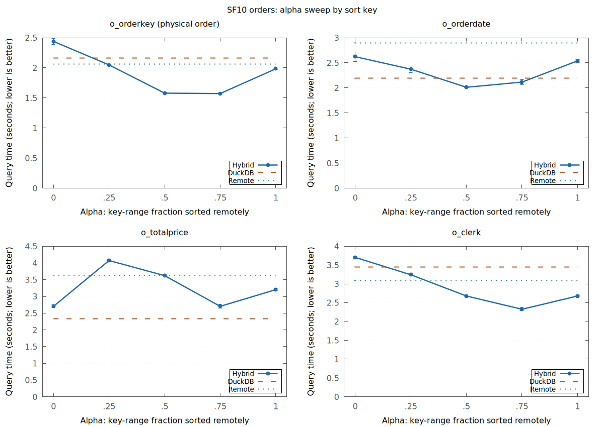
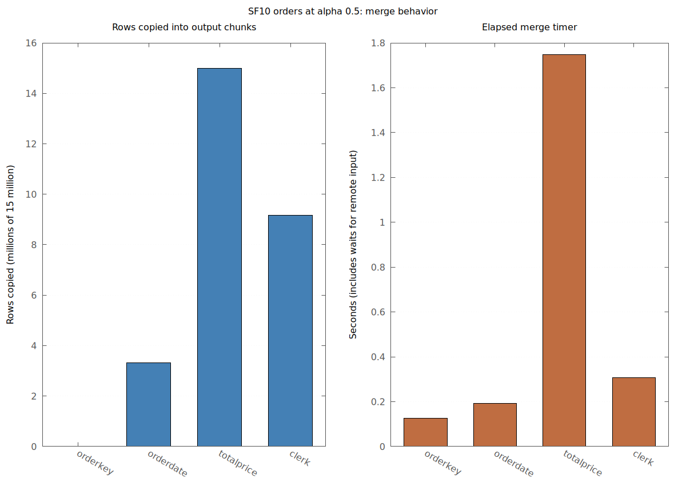
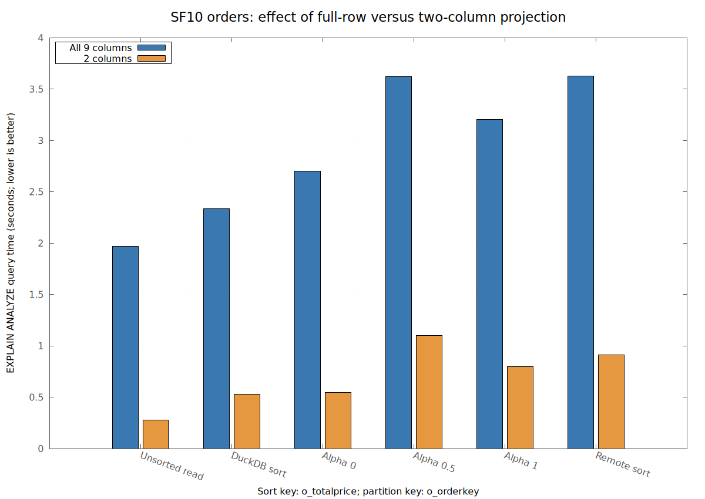
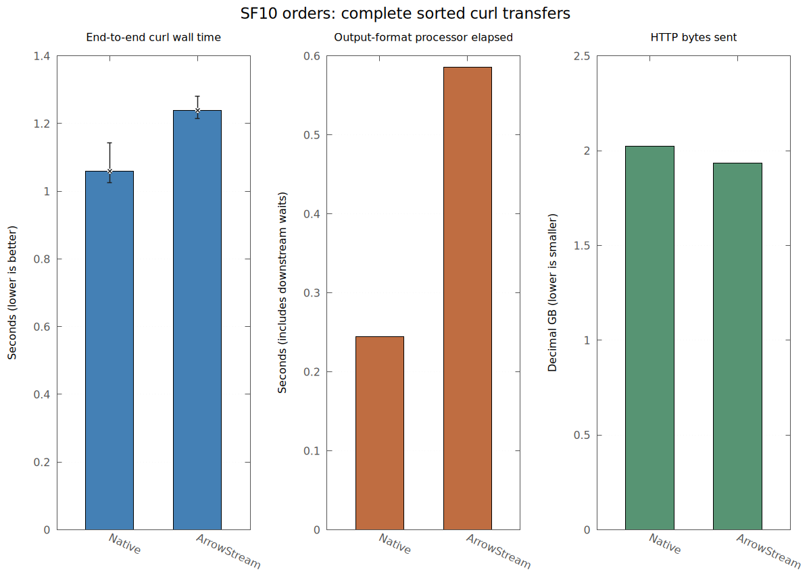

# SF10 alpha and sort-key sweep

Measured on 2026-11-09 using the rebuilt DuckDB/ADBC binaries, local
ClickHouse 26.10.1.1810, and TPC-H SF10 `orders` (15,000,000 rows). Each
engine had affinity to four physical cores; DuckDB used `threads=4` and
`memory_limit=9GiB`, and ClickHouse had a 13 GiB server cap. The partition
key was `o_orderkey`. Queries selected all nine `orders` columns unless
marked narrow. Times are `EXPLAIN (ANALYZE, FORMAT JSON)` query `total_time`
in seconds, with no CSV sink. Each main cell is the median of two runs; the
second pass reversed case order. The `o_clerk` DuckDB and alpha=.75 cells
use three runs because one DuckDB sort was a high outlier.

Alpha is the fraction of the integer partition-key range assigned to the
remote branch. For this dataset the row split was proportional. `DuckDB`
means unsorted `read_adbc` followed by DuckDB `ORDER BY`; `Remote` means
`read_adbc` with ClickHouse `ORDER BY`.

| Sort key | DuckDB | Remote | α=0 | α=.25 | α=.5 | α=.75 | α=1 |
|---|---:|---:|---:|---:|---:|---:|---:|
| `o_orderkey` | 2.159 | 2.065 | 2.438 | 2.047 | 1.579 | **1.572** | 1.984 |
| `o_orderdate` | 2.197 | 2.894 | 2.621 | 2.372 | **2.012** | 2.115 | 2.538 |
| `o_totalprice` | **2.333** | 3.627 | 2.703 | 4.073 | 3.621 | 2.704 | 3.203 |
| `o_clerk` | 3.446 | 3.090 | 3.704 | 3.242 | 2.678 | **2.326** | 2.678 |

The blue line is the hybrid function; whiskers show the observed run range.
Horizontal lines are the median DuckDB, remote-sort, and unsorted ADBC scan
baselines. The unsorted scan took 1.969 seconds and measures transfer without
producing ordered output. Each panel has its own vertical scale.
[Vector version](./alpha_sweep.svg).

The 0.007-second difference between the two best `o_orderkey` alpha values
is within the run-to-run spread; treat α=.5 and α=.75 as effectively tied.

## Bottlenecks and scale comparison

- **Wide ADBC transfer remains a floor.** An unsorted `SELECT *` took 1.969
  seconds for 1.44 GB of logical intermediate output. Selecting only
  `o_orderkey,o_totalprice` took 0.277 seconds for 240 MB. Both are roughly
  twice the SF5 workload's byte count. Each alpha still transfers all rows.
- **Interleaved full-row copying scales with row count.** At α=.5,
  `o_totalprice` copied all 15 million output rows and spent 1.749 seconds
  in the merge's elapsed timer; SF5 copied 7.5 million and spent 0.882
  seconds. For physically ordered `o_orderkey`, only 2,048 rows were copied
  and the merge timer was 0.125 seconds. The timer can include waits for
  remote input, so it is not a pure CPU measurement.
- **Narrow projection reduces transport and local sorting, but still exposes
  the merge cost.** For `o_orderkey,o_totalprice`, DuckDB took 0.527 seconds,
  remote 0.909, α=0 0.544, α=.5 1.102, and α=1 0.800. At α=.5 all 15
  million rows were copied and the merge timer was 0.744 seconds.
- **More local workers do not remove the single-thread output limit.** With
  eight DuckDB threads on the same four physical cores, decimal α=.5 took
  3.524 seconds versus 3.621 at four threads, still slower than DuckDB's
  2.333-second baseline. Date α=.5 changed from 2.012 to 1.968 seconds.
  There was no temporary-directory spill in any case.

At α=.5, interleaving ranges from almost no copied rows for `o_orderkey` to
all 15 million for `o_totalprice`. The merge timer is elapsed time and can
include remote-input waits. [Vector version](./merge_copy.svg).

The projection comparison uses the same 15 million rows and `o_totalprice`
sort key. The unsorted read provides the transfer baseline.
[Vector version](./projection_width.svg).

At α=.5, local sort and remote read/buffer elapsed times were 1.439/1.163
seconds for `o_orderkey`, 1.800/1.596 for `o_orderdate`, and 1.849/1.989 for
`o_totalprice`. These branches overlap; their times must not be added.
Binding and bounds queries remained around 0.005 and 0.003 seconds. Peak
queued remote buffers were about 1.3–1.45 GB in the wide α=.5 cases, with
DuckDB peak buffer memory around 2.6–2.7 GB, below the 9 GiB limit.

Compared with [SF5](../sf5/README.md), SF10 roughly doubles the
transfer and merge-copy time. The best alpha remains key dependent: a mixed
split helps integer, date, and string sorting, while no alpha beats direct
DuckDB sorting for decimal total price. The `o_clerk` DuckDB baseline ran
3.446, 4.340, and 3.430 seconds; the middle run is a high outlier. Its
alpha=.75 runs were 2.326, 2.387, and 2.289 seconds, so the advantage
persists across all three runs.

## Recheck: sorting by `o_totalprice`

Three new passes alternated the full-row DuckDB and ClickHouse sort cases,
with the same 15-million-row table, four physical cores per engine, four
DuckDB threads, and 9 GiB DuckDB memory limit. Both paths returned all rows;
neither DuckDB path spilled. The original result persists:

| Full-row path | Original two-run median (s) | New runs (s) | New median (s) |
|---|---:|---:|---:|
| DuckDB `ORDER BY` over unsorted ADBC | 2.333 | 2.467, 2.366, 2.359 | **2.366** |
| ClickHouse `ORDER BY` through ADBC | 3.627 | 3.532, 3.723, 3.564 | 3.564 |

The ClickHouse table is physically ordered by `o_orderkey`, so sorting by
`o_totalprice` requires a full sort. Its server query took a median 3.112
seconds and 10.762 core-seconds, versus 1.960 seconds and 3.024 core-seconds
for the unsorted query feeding DuckDB. The ClickHouse query log reported
roughly 2.1 seconds in `MergingSortedMilliseconds` and 2.34 GB peak query
memory for the remote sort. The corresponding unsorted ADBC query plus DuckDB
sort completed in 2.366 seconds; the standalone unsorted ADBC scan baseline
was 1.969 seconds. The local sort adds much less wall time on top of the
transfer than ClickHouse's sort adds to its server query. Pipeline stages
overlap, so those differences are not isolated sort timings.

ClickHouse's automatic `max_threads` value was 24 on this host, but forcing
`max_threads=4` or `8` in the remote SQL did not close the gap: three runs
with each limit remained around 3.5–3.8 seconds. Direct curl ArrowStream
controls help separate transport cost: the sorted query took 2.119 seconds
without HTTP compression and 2.975 seconds with LZ4 HTTP compression; the
unsorted query took 0.609 and 1.873 seconds under the same two settings.
The ADBC remote query sent 0.879 GB over HTTP, matching the LZ4 curl
control's wire size, so it appears to use the compressed transfer path.
Compression costs time in both sorted and unsorted transfers; it does not by
itself explain why the remote sort loses to the local sort. Curl discards
Arrow data, whereas ADBC decodes it into DuckDB, which also limits direct
timing comparisons between these clients.

## Curl output-format comparison

The same SF10 table was queried with `SELECT * FROM tpch_sf10.orders ORDER BY
o_orderdate ASC NULLS LAST` over ClickHouse HTTP using curl. The HTTP
`default_format` parameter selected `Native` or `ArrowStream`; each transfer
sent all 15 million sorted rows to `/dev/null`. Both HTTP and Arrow IPC
compression were disabled. ClickHouse
used four physical cores and `max_threads=4`; curl used the other four cores.
Each format had one warmup and three measured runs in each of two passes, with
case order reversed in the second pass. Values below are medians of the six
measured runs; ranges show the observed minimum and maximum.

| HTTP format | Curl wall time (s) | Server CPU (core-s) | HTTP bytes sent (GB) | Output processor elapsed (s) |
|---|---:|---:|---:|---:|
| Native | **1.060** (1.025–1.143) | 4.019 | 2.023 | 0.245 |
| ArrowStream | 1.238 (1.215–1.281) | 4.448 | **1.934** | 0.586 |

[Vector version](./curl_formats.svg). The output-processor elapsed timer can
include downstream waits and overlaps other stages; it is not an isolated
encoding CPU measurement. The server reported 15 million result rows in every
case. Curl's downloaded byte counts matched the approximately 2.023/1.934 GB
server send counts, apart from small HTTP accounting differences.

Native was about 0.178 seconds faster at the median despite sending about
90 MB more. ArrowStream used about 0.43 more core-seconds of server CPU,
and its output-format processor showed substantially more elapsed time. This
points to Arrow output conversion/serialization as a contributor to the
ArrowStream slowdown. Both queries also read about 1.648 GB from the table
and sorted all rows; transfer alone does not explain total time. Median server
network-send elapsed time was about 0.15–0.16 seconds in both formats. These
measurements do not show that the ADBC client's Arrow decoding has the same
cost: curl discards the output and never decodes it. Likewise, the curl wall
times and `EXPLAIN ANALYZE` times above have different client work and should
not be compared as equivalent query latencies. Here Native names ClickHouse's
HTTP binary output format, not the report's historical `native` DuckDB-sort
case label or the ClickHouse TCP protocol.

## Evidence and limits

The [runner](./run_all.py) executed the matrix sequentially. The charts can be
regenerated from the tracked TSV chart data with [plot_report.py](./plot_report.py)
and Gnuplot. Pass `--refresh-data` to update the TSV files from local raw
profiles and curl results. Ignored `build/local-experiments/sf10-sweep/`
contains 78 successful
`*-summary.json` files with query/stage metrics, DuckDB profiles, SQL, stderr,
and run logs.
Every profile reported 15 million rows and zero temporary-directory spill.
The server was stopped after measurement; SF10 data remains in the
repository's `build/tpch-sf10/` and `clickhouse/clickhouse-data/` directories.

This is a shared workstation with CPU affinity, not exclusive CPU partitions.
Most cases have two repeats. ClickHouse query logs and CPU profiles were not
collected for the ADBC sweep, so the remote read/buffer timer combines server
sorting, Arrow encoding, transfer, and conversion. The curl comparison did
collect ClickHouse query and processor logs, but no `perf` samples. Its raw
records are under ignored `build/local-experiments/sf10-curl-formats-20261109/`
and `build/local-experiments/sf10-curl-formats-reverse-20261109/`; the compact
chart data is tracked in [curl_formats.tsv](./curl_formats.tsv). To reproduce
the transfers, use [record_queries.py](../../scripts/experiments/record_queries.py)
with `--no-perf --repeats 3 --cases http_native http_arrow` and then reverse
the case order for a second pass. Set `--sql-file` to the query above,
`--threads 4 --expected-rows 15000000 --min-network-bytes 500000000`, and
point `--clickhouse-client` to a local ClickHouse client executable or wrapper.
The `o_totalprice` recheck profiles and server logs are under ignored
`build/local-experiments/sf10-totalprice-verify-20261109/`; related curl
controls are under `build/local-experiments/sf10-totalprice-curl-*` and
`build/local-experiments/sf10-unsorted-curl-arrow-20261109/`.
