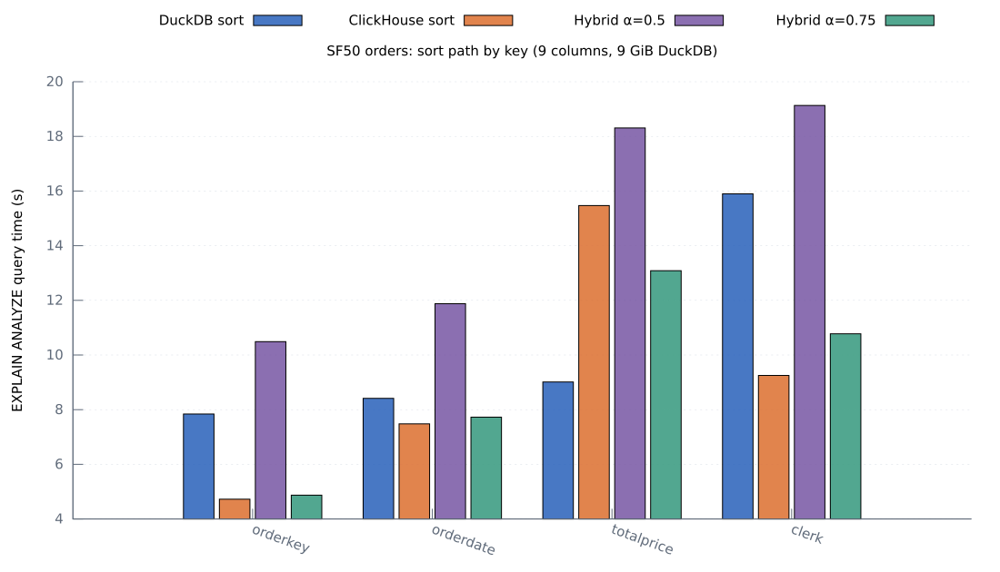
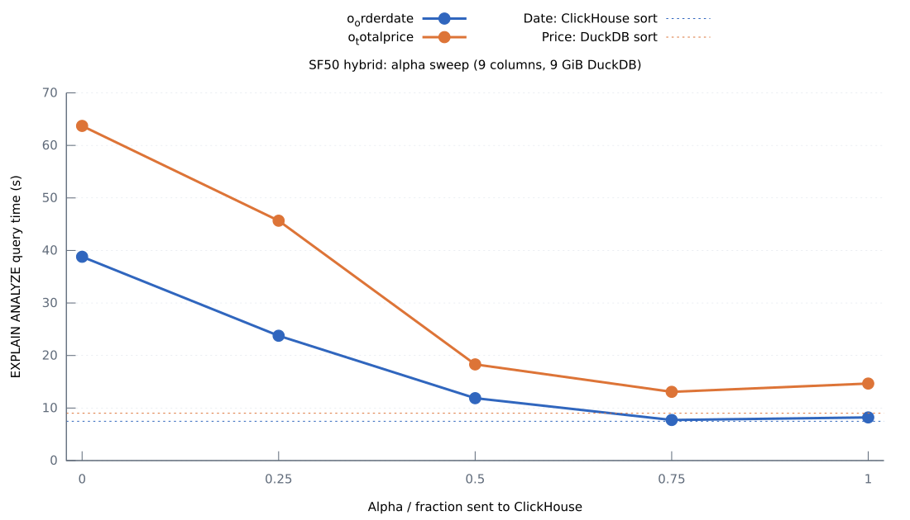
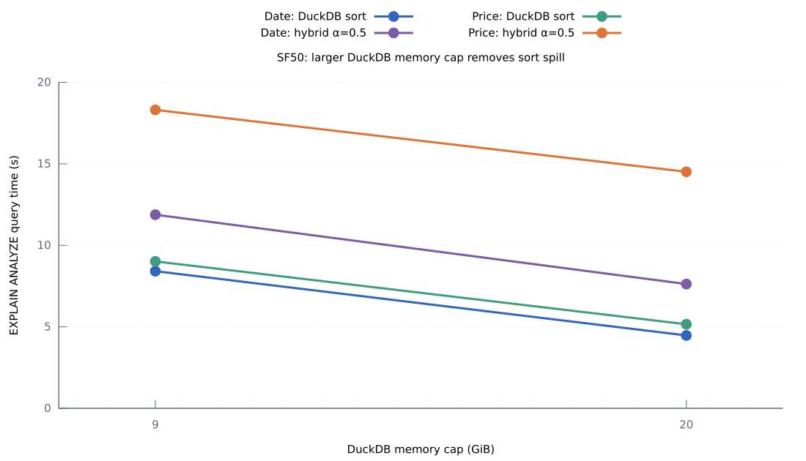

# SF50 orders: alpha, sort keys, and bottlenecks

Measured 2026-11-10 on this workstation with TPC-H SF50 `orders` (75,000,000
rows). Both engines had four physical cores. ClickHouse 26.10.1.1810 had a
26 GiB server memory cap; DuckDB had four threads and a 9 GiB memory limit
unless the table says 20 GiB. The connector used metadata-only `ExecuteSchema`,
separate query IDs for settings and `DESCRIBE`, and **no HTTP response
compression**. ClickHouse Arrow IPC compression was also off. Queries used
`EXPLAIN (ANALYZE, FORMAT JSON)` and consumed all rows without a CSV sink.
Times below are DuckDB's query `total_time` in seconds, with a warmup and the
median of two or three unprofiled runs. `perf` runs were separate. All nine
`orders` columns were projected unless noted.

| Sort key | DuckDB sort | ClickHouse sort | Hybrid α=.5 | Hybrid α=.75 |
|---|---:|---:|---:|---:|
| `o_orderkey` | 7.841 | **4.724** | 10.489 | 4.871 |
| `o_orderdate` | 8.414 | **7.481** | 11.877 | 7.726 |
| `o_totalprice` | **9.013** | 15.469 | 18.309 | 13.085 |
| `o_clerk` | 15.898 | **9.252** | 19.132 | 10.776 |

The unsorted ADBC scan took **3.308 s**. α=.75 is much better than α=.5,
but neither beats the best direct path for these keys. The price reversal
seen at SF10 persists: DuckDB's price sort is faster than ClickHouse's, even
though ClickHouse wins on the other three keys. `orders` is physically ordered
by `o_orderkey`; ClickHouse can exploit that key directly.

## Alpha and DuckDB memory

| α | `o_orderdate` | `o_totalprice` |
|---:|---:|---:|
| 0 | 38.797 | 63.708 |
| .25 | 23.763 | 45.662 |
| .5 | 11.877 | 18.309 |
| .75 | **7.726** | **13.085** |
| 1 | 8.214 | 14.662 |

The α=0 and .25 hybrid paths spill heavily (9–10 GB at α=0 for these
keys); they are not interchangeable with DuckDB's direct sort. At α=.5,
the date and price hybrids spilled 6.832 and 5.359 GB respectively. DuckDB's
direct date and price sorts also spilled 6.316 and 5.900 GB. α=.75 avoids
most spill (0.103 GB for date, zero for price), explaining much of its gain.

| Sort key and path | 9 GiB | 20 GiB |
|---|---:|---:|
| Date, DuckDB sort | 8.414 | **4.471** |
| Date, hybrid α=.5 | 11.877 | 7.623 |
| Date, hybrid α=.75 | 7.726 | 7.447 |
| Price, DuckDB sort | 9.013 | **5.157** |
| Price, hybrid α=.5 | 18.309 | 14.512 |

At 20 GiB, none of these runs spilled. This isolates a substantial DuckDB
spill cost: increasing memory cut direct sort time by about 4 seconds for
both keys. The hybrid still trails, especially for price.

## What consumes time

**ClickHouse price sort.** The full remote price query took 15.458 s on the
server, used 55.81 server core-seconds, and peaked at about 11.0 GB. Its
single `MergingSortedTransform` processor was active for **12.744 s**.
The Arrow output processor was active for 4.065 s; processor intervals
overlap and cannot be added. The date sort's corresponding merge was
2.383 s. A server `perf` run of the price query attributed 15.79% of sampled
user cycles to `ColumnString::insertFrom`, 14.33% to Decimal `compareAt`,
12.16% to stored-data ZSTD decompression, and 9.28% to Decimal greater-than.
These are sample shares, not portions of elapsed time. Comparing and moving
wide rows during the price merge is the main remote sort cost.

**Hybrid merge and local spill.** For α=.5 price, the connector reported
7.168 s in local sort, 10.402 s in remote read/buffer, and 11.308 s in
merge, including 7.416 s in its output loop. These phases overlap. It
copied **all 75 million output rows** and reached a 5.509 GB remote queue.
For date, it copied about 9.9 million rows and referenced the other 65.1
million; its merge loop was only 0.190 s. Separate client `perf` runs show
`memmove` at 15.57% of sampled user cycles for price and 24.0% for date.
DuckDB ZSTD compression/decompression was also prominent (about 14% combined
for price; 20% for date), consistent with temporary sort spill. This ZSTD
work is separate from ClickHouse HTTP transfer, which was uncompressed.
At 20 GiB, spill vanished but the α=.5 price merge still took 8.517 s and
copied all 75 million rows.

**Projection width and transfer.** With only `o_orderkey,o_totalprice`, the
unsorted ADBC scan fell from 3.308 to **0.489 s**, DuckDB price sort from
9.013 to **1.670 s**, ClickHouse price sort from 15.469 to **5.284 s**, and
hybrid α=.5 from 18.309 to **4.768 s**. The narrow runs did not spill. The
wide remote price sort sent about 9.668 GB of ArrowStream data versus
1.800 GB for the narrow projection. This width change affects storage reads,
sorting, serialization, transfer, and decoding together; its entire saving
cannot be assigned to the network.

To separate some format work from scan and transport, `curl` consumed the
same unsorted 75-million-row `SELECT *` to `/dev/null` with four ClickHouse
threads and compression off:

| Format | Median wall time | Response bytes |
|---|---:|---:|
| `Null` | 1.278 s | 0 |
| `Native` | 1.662 s | ~10.12 GB |
| `ArrowStream` | 2.629 s | ~9.673 GB |
| ADBC ArrowStream scan | 3.308 s | ~9.673 GB |

`ArrowStream` costs about 0.97 s more than `Native` here despite fewer bytes.
The ADBC scan adds about 0.68 s over the ArrowStream `curl` control. The
clients do different work, so these are end-to-end differences, not isolated
serialization or deserialization timings. Transfer and Arrow processing
matter for the unsorted scan. They do not explain the 12.744 s ClickHouse
price merge or the hybrid's copying and spill.

## Scope and reproducibility

Only `orders` is fully loaded in ClickHouse. SF50 `lineitem` loading failed
at the prior 13 GiB ClickHouse cap (it attempted about 22.9 GiB); the
`orders` table was verified at exactly 75 million rows before these runs.
These results cover `orders` only. The 26 GiB server cap was used throughout
the SF50 measurements. SF10 used the same query shape and optimized connector
but a much smaller table; see [the SF10 connector profile](../sf10/PERF_SCHEMA_OFF.md).

The local experiment helper now accepts `LOCAL_CLICKHOUSE_MEMORY_GIB` and
`LOCAL_DUCKDB_MEMORY_GIB` during `prepare` and saves those overrides. This
run's ignored `build/local-experiments/config.json` selects the corrected
no-compression connector binary; its SHA-256 is
`96a8cb528da93a0a4ed9509af25e761af4329814804ba754a8cfd878d4b0ab0b`.
The corrected isolated source and all raw query profiles, query logs, and
`perf` data are under ignored `build/local-experiments/`. The tracked chart
inputs are the TSV files here; regenerate SVGs with `gnuplot plot_report.gp`
from this directory. The [query-ID patch](../../scripts/experiments/adbc_clickhouse_unique_schema_query_ids.patch)
applies on top of the schema-only connector source used for the SF10 runs;
the [compression patch](../../scripts/experiments/adbc_clickhouse_no_compression.patch)
disables the ClickHouse driver's HTTP response compression.
