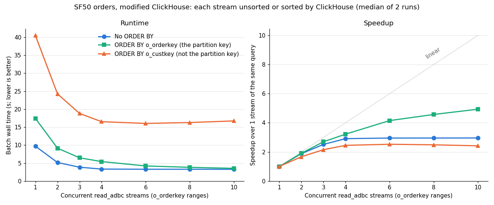

# Sorting in ClickHouse, one stream and many

Measured 2026-11-11 on `c220g2-010602.wisc.cloudlab.us` (2× Xeon E5-2660 v3, Haswell), as a follow-up to
[what limits ADBC streams from the modified ClickHouse](../stream-limits-20261110/README.md). These experiments
ask what happens when ClickHouse sorts the data it sends: first for one query, then when each of N parallel
`read_adbc` key-range streams sorts its own partition.

**Summary.**

- **One sorted query is 2–5× slower than an unsorted one, and the network stops mattering.** Each sort has a
  single-threaded stage that takes longer than the whole unsorted transfer (7.3–9.9 s):
  - `ORDER BY o_orderkey`, the table's sort key, takes 17.2 s. ClickHouse reads the parts in key order, and on
    this table that runs the readers almost one at a time.
  - `ORDER BY o_custkey` takes 40 s, 34 s of it in a single-threaded final merge.
- **Sorting each stream by the partition key is nearly free with enough streams.** Ten `o_orderkey` range
  streams, each with `ORDER BY o_orderkey`, take 3.54 s, only 8% slower than unsorted (3.28 s), and the ranges
  concatenate into one globally sorted result. That is a 4.93× speedup over one sorted stream, still rising at
  10.
- **Sorting each stream by another column saturates ClickHouse's CPU.** With `ORDER BY o_custkey` per stream,
  the batch levels off at about 16 s from 4 streams up: ClickHouse burns about 256 CPU-seconds in 16 s, all 16
  CPUs of its slice. The result is N separately sorted runs that still need a merge.

## Setup

As in the stream-limits report:

- **ClickHouse:** the modified 26.11.1.1 build, in its 16-CPU slice on socket 0 (CPUs 0–7, 20–27; 8 cores with
  hyperthreading). It holds copies of the five SF50 `orders` parts, with merges stopped.
- **Data:** SF50 `orders`, 75,000,000 rows, 9.67 GB of uncompressed Arrow. The table's sort key and primary key
  are `o_orderkey`.
- **Clocks:** pinned at 2.6 GHz (`performance` governor, turbo off).
- **Connector:** branch `experiment` of the ClickHouse ADBC connector.

Section 1 uses raw `curl` downloads, so no DuckDB is involved. Section 2 uses
[`bench/parallel_read_adbc`](../../bench/parallel_read_adbc.cpp) with the new `--order-by` option. That runs
N threads in one DuckDB process, each with a `read_adbc` of one `o_orderkey` range:

```sql
SELECT * FROM tpch_sf50.orders WHERE o_orderkey BETWEEN lo AND hi [ORDER BY col] SETTINGS max_threads = floor(32 / N)
```

DuckDB runs in its 16-CPU slice on socket 1 with `threads=16` and the experimental reader thread on
(`ADBC_READER_THREAD=1`; see the stream-limits report, section 6).

## 1. One sorted query

One full-table query per row. The `Null` format reads and sorts but sends nothing; `ArrowStream` sends the
result to curl on ClickHouse's socket (CPU 9) or the other socket (CPU 19). Data and every processor's
profile are in [data/sort-processors.txt](./data/sort-processors.txt).

| Query | `Null` | ArrowStream, same socket | ArrowStream, other socket | Server CPU | Peak memory |
|---|---:|---:|---:|---:|---:|
| No ORDER BY | 2.40 s | 7.33 s | 9.79 s | 28–38 s | 48–113 MiB |
| `ORDER BY o_orderkey` | 16.90 s | 17.20 s | 17.18 s | 20–29 s | 645–677 MiB |
| `ORDER BY o_custkey` | 38.04–38.44 s | 39.65 s | 39.98 s | 177–191 s | 10.4 GiB |

**`ORDER BY o_orderkey`: the in-order read runs nearly serially.** ClickHouse skips the sort and reads in key
order: 36 in-order readers feed one `MergingSortedTransform`. The parts' key ranges explain why that is slow:

| Part | Rows | `o_orderkey` range |
|---|---:|---|
| `all_1_1_0` | 46,323,711 (62%) | 1 – 185,294,823 |
| `all_2_2_0` | 9,926,840 | 185,294,848 – 260,296,451 |
| `all_3_3_0` | 6,617,673 | 202,941,958 – 273,530,469 |
| `all_4_4_0` | 6,617,673 | 216,178,629 – 286,767,140 |
| `all_5_5_0` | 5,514,103 | 229,412,647 – 300,000,000 |

- **The merge can only take from the stream holding the smallest key.** The largest part covers keys no other
  part overlaps, so for 62% of the output every other reader is blocked: readers spend about 15.5 s of 16.9 s
  waiting on their output.
- **So decompression runs about one reader at a time:** 20 CPU-seconds in 16.9 s, about 1.2 cores, against
  about 4 cores unsorted.
- **The output stage is hidden behind it.** Arrow output adds only 0.3 s over `Null`, and both sockets take
  17.2 s.

**`ORDER BY o_custkey`: a full sort with a single-threaded final merge.**

- **The parallel phase is short.** 32 threads read, sort their blocks (`PartialSortingTransform`) and merge
  their own runs (`MergeSortingTransform`); the final merge receives its first input after about 4.5 s.
- **One `MergingSortedTransform` then merges the 32 runs for 34 s.** That is 2.2 million rows per second.
- **The Arrow output stage waits on that merge for 31–34 s** and adds only 1.2–1.9 s over `Null`, whichever
  socket curl is on.

## 2. N streams, each sorted by ClickHouse



[Vector version](./sorted_streams.svg); data in [sorted_streams.tsv](./sorted_streams.tsv). Batch wall times,
median of 2 runs:

| Streams | No ORDER BY | `ORDER BY o_orderkey` | `ORDER BY o_custkey` |
|---:|---:|---:|---:|
| 1 | 9.69 s | 17.44 s | 40.49 s |
| 2 | 5.16 s | 9.15 s | 24.26 s |
| 3 | 3.86 s | 6.47 s | 18.82 s |
| 4 | 3.33 s | 5.42 s | 16.52 s |
| 6 | 3.28 s | 4.20 s | **16.03 s** |
| 8 | 3.28 s | 3.81 s | 16.28 s |
| 10 | **3.28 s** | **3.54 s** | 16.73 s |
| Best speedup | 2.96× | 4.93× | 2.53× |

ClickHouse's side of the same runs, from `system.query_log` ([log](./data/sorted-streams-log.txt)):

| Streams | Server CPU per batch: none / `o_orderkey` / `o_custkey` | Median send-wait per query: none / `o_orderkey` / `o_custkey` |
|---:|---|---|
| 1 | 30.8 / 29.2 / 148.1 s | 5.65 / 5.69 / 5.61 s |
| 4 | 48.5 / 32.1 / 222.1 s | 1.82 / 1.54 / 1.89 s |
| 10 | 50.5 / 46.9 / 255.7 s | 1.04 / 0.70 / 1.19 s |

**Sorted by the partition key (`o_orderkey`):**

- **It scales better than unsorted.** Each range query has its own serial in-order read (section 1), and N of
  them run side by side. ClickHouse is far from its CPU limit at 29–47 CPU-seconds per batch.
- **The result is globally sorted.** The ranges are disjoint and contiguous, so reading the streams in range
  order gives the whole table in `o_orderkey` order.

**Sorted by another column (`o_custkey`):**

- **Splitting the sort helps at first.** Instead of one final merge of 75 million rows, there are N merges of
  75/N million rows, running in parallel.
- **From 4 streams up ClickHouse is CPU-bound.** About 256 CPU-seconds in about 16 s is all 16 CPUs of its slice.
  Total sort CPU grows with N (148 → 256 CPU-seconds per batch), most likely because busy hyperthread pairs
  make each CPU-second do less work.
- **Each stream's rows are sorted only within that stream.** A globally sorted result still needs an N-way
  merge in DuckDB.

## What this suggests

- **To get data sorted by the table's key, partition on that key and let ClickHouse sort each range.** At 10
  streams it costs 8% over an unsorted read.
- **For any other sort column, ClickHouse spends about 5× the time of moving the data** (16 s against 3.3 s),
  limited by its CPU. Not measured here: reading unsorted parallel streams (3.3 s) and sorting in DuckDB, for
  example with `read_adbc_partial_sort`, which may well be faster.

## Caveats

- Two runs per point in section 2, which differed by at most 0.3 s; one run per query in section 1.
- **Section 1's in-order read depends on this table's part layout.** The parts were copied from the 26.9 server
  with merges stopped. A table with a different set of parts would read in order differently.
- **Ranges are equal-width in `o_orderkey`,** which gives roughly equal row counts because TPC-H order keys are
  spread evenly. A skewed key would need range boundaries from quantiles.
- The hyperthreading explanation for the rising sort CPU is inferred, not profiled.

## Files

- **[scripts/sort_processors.sh](./scripts/sort_processors.sh):** section 1. One raw download per sort and
  output format, then `query_log` and `processors_profile_log`.
- **[scripts/sorted_streams.sh](./scripts/sorted_streams.sh):** section 2. Runs `parallel_read_adbc` for each
  sort inside the DuckDB slice, then summarizes `query_log`.
- Both scripts start and stop the modified server with `start_modified_clickhouse.sh` from the
  [stream-limits report](../stream-limits-20261110/scripts/) and expect the host's experiment directory layout.
- **[data/](./data/):** raw `parallel_read_adbc` output per sort (`none.tsv`, `o_orderkey.tsv`,
  `o_custkey.tsv`), the full run log, and section 1's output.
- **[plot_sorted_streams.py](./plot_sorted_streams.py)** draws the chart: `python3 plot_sorted_streams.py data .`
  (needs matplotlib).
