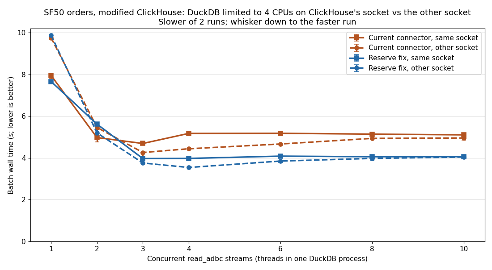

# What limits ADBC streams from the modified ClickHouse

Measured 2026-11-10 on `c220g2-010602.wisc.cloudlab.us` (2× Xeon E5-2660 v3, Haswell), as a follow-up to
[parallel ADBC streams](../parallel-streams-20261110/README.md). These experiments ask why a single
`read_adbc` stream from the modified ClickHouse is slower than ClickHouse can produce it, and which changes
help.

**Summary.**

- **With the modified ClickHouse, Arrow encoding is no longer the bottleneck.** It costs about 3.4 s of a
  single full-table stream, about 11% of server CPU. For most of the remaining time ClickHouse is blocked
  sending, waiting for the client to read.
- **A single stream is limited by ClickHouse's single output stage per query.** Reading and decompressing
  the table takes 2.4 s on 32 threads. One output processor then encodes every block and writes it to the
  socket, in series: about 3.4 s of Arrow encoding plus 3.5–5.9 s blocked in `send()`. A receiver that only
  discards bytes (curl, hyper, or the ClickHouse Rust client) gets about 1.3 GB/s with DuckDB's CPU on
  ClickHouse's socket and about 0.98 GB/s across sockets. DuckDB with the dedicated reader thread (below)
  already reaches the cross-socket rate.
- **Kernel copies are not most of the time.** Copying out of the socket is under 30% of a receiver that is
  only half busy, and copying into it is about 5% of ClickHouse's CPU. Placing DuckDB on the other socket adds
  kernel time on both sides, all of it in the `send()` part of ClickHouse's output stage.
- **DuckDB's Arrow → DuckDB conversion is not the bottleneck for `read_adbc`.** A patch makes conversion
  2.7× faster but leaves `read_adbc` wall time unchanged: `read_adbc` already converts batches in parallel,
  while the connector's `get_next` is serialized.
- **The ClickHouse ADBC connector's `get_next` is the client-side limit.** That call receives, decodes and
  validates each batch, and is CPU-bound at about 1.1 ms per batch. Keeping it on one dedicated thread cut a
  single stream from 11.1 s to 9.7 s. Reserving each IPC message's known size in arrow-rs saves another 16%
  of connector CPU. That shows up only where the transfer is faster (DuckDB on ClickHouse's socket) or where
  DuckDB has few CPUs.
- **Two arrow-rs findings worth upstreaming:**
  - `StreamDecoder` grows each message buffer by repeated reallocation, although the length is known from
    the message header.
  - `StreamDecoder::with_skip_validation` has no effect on record batches.

## Setup

Unless stated otherwise:

- **ClickHouse:** the modified 26.11.1.1 build (`a2d3db7e5`, "Reduce allocations and copies in Arrow IPC
  output"), on its own data directory holding copies of the five SF50 `orders` parts. Some tables also include
  the packaged 26.9.12.8 for comparison.
- **Data:** SF50 `orders`, 75,000,000 rows. The full table is 9.67 GB of uncompressed Arrow.
- **Clocks:** every CPU is pinned at 2.6 GHz (`performance` governor, turbo off).
- **CPU slices:** ClickHouse runs in its 16-CPU slice on socket 0 (CPUs 0–7, 20–27), and DuckDB in its 16-CPU
  slice on socket 1 (CPUs 10–17, 30–37), with `threads=16`.
- **Connector:** branch `experiment` of the ClickHouse ADBC connector (HTTP compression off, metadata-only
  `ExecuteSchema`, Date/Decimal fixes, `SESSION_IS_LOCKED` retry), as in the parallel-streams report.
- **Single stream:** a full-table `read_adbc` of
  `SELECT * FROM tpch_sf50.orders WHERE o_orderkey BETWEEN 1 AND 300000000 SETTINGS max_threads=32`.
- **Multiple streams:** split as in the parallel-streams report, with `max_threads` = floor(32 / N) per query.

Times are DuckDB query times, or batch wall times for multiple streams. ClickHouse send-wait is
`NetworkSendElapsedMicroseconds`, which measures time blocked in `send()`. Most rows are 2–3 runs.

## 1. N threads in one process match N processes

[`bench/parallel_read_adbc`](../../bench/parallel_read_adbc.cpp) runs N threads in one DuckDB process, each
executing an ordinary `read_adbc` on one key range. It is the single-process counterpart of the
parallel-streams report's `run.sh`, which starts N processes.

| Streams | 26.9, processes | 26.9, threads | Modified, processes | Modified, threads |
|---:|---:|---:|---:|---:|
| 1 | 15.60 s | 15.30 s | 11.14 s | 11.04 s |
| 2 | 8.69 s | 8.69 s | 5.88 s | 5.56 s |
| 3 | 6.39 s | 6.37 s | 4.26 s | 3.76 s |
| 4 | 5.17 s | 5.13 s | 3.45 s | 3.33 s |
| 5 | 4.38 s | 4.30 s | 3.40 s | 3.29 s |
| 7 | 4.00 s | 3.91 s | 3.37 s | 3.29 s |
| 10 | 3.97 s | 3.87 s | 3.40 s | 3.30 s |

These are medians of 3 runs. The process numbers are from the parallel-streams report; the thread data is in
[threads-packaged.tsv](./data/threads-packaged.tsv) and [threads-modified.tsv](./data/threads-modified.tsv).

- **Same shape:** threads are equal or slightly faster, because they skip process startup and extension
  loading.
- **Correct results:** with `--checksum`, the per-thread row counts and row-hash sums at N = 1, 2, 4, 7 and
  10 equal a single full `read_adbc`. ClickHouse logged one query per thread.

## 2. How much of ClickHouse's time is Arrow encoding

From `system.query_log` and `system.processors_profile_log` ([arrow_share.sql](./arrow_share.sql)), median per
range query:

| | 26.9, 1 stream | Modified, 1 stream | 26.9, 10 streams | Modified, 10 streams |
|---|---:|---:|---:|---:|
| Query wall time | 15.75 s | 10.47 s | 3.84 s | 3.21 s |
| `ArrowIPCBlockOutputFormat` busy | 15.14 s (96%) | 9.93 s (95%) | 2.60 s (68%) | 1.68 s (53%) |
| …of which blocked in `send()` | 5.66 s | 6.50 s | 0.87 s | 1.02 s |
| **Arrow encoding** (busy minus send) | **9.51 s** | **3.42 s** | **1.73 s** | **0.66 s** |
| Encoding share of server CPU | 25.9% | 11.5% | 28.5% | 12.9% |
| Table readers busy | 21.1 s | 21.6 s | 6.4 s | 6.2 s |

- **The modified encoder is about 2.8× cheaper.** It drops from 9.5 s to 3.4 s per full-table stream, at every
  stream count.
- **A single stream from the modified server mostly waits on the client:** 6.5 s of its 10.5 s are spent in
  `send()`.
- **The estimate is approximate.** "Encoding" also excludes the kernel's copy into the socket, and at 10
  streams the elapsed times include time the thread was not scheduled.

## 3. Where a single `read_adbc` stream spends its time

The scan was instrumented around the connector's `get_next` calls, the scan lock and each conversion
([patch](./patches/adbc-scan-reader-thread-and-timing.patch), enabled by `ADBC_SCAN_TIMING`). ClickHouse sent
9,158 Arrow batches of about 8,190 rows each.

| | Modified, `threads=16` (2 runs) | Modified, `threads=1` | 26.9, `threads=16` |
|---|---:|---:|---:|
| Query time | 11.20 / 11.07 s | 9.75 s | 15.46 s |
| Inside connector `get_next` | 10.61 / 10.51 s | 8.12 s | 14.89 s |
| …CPU (receive, decode, validate) | **10.58 / 10.48 s** | **7.67 s** | 11.65 s |
| …waiting for data | 0.03 / 0.03 s | 0.46 s | 3.23 s |
| No thread inside `get_next` | 0.49 / 0.50 s | 1.57 s | 0.49 s |
| DuckDB conversion (all threads) | 1.56 / 1.46 s | 1.34 s | 1.52 s |
| ClickHouse send-wait | 7.12 / 7.04 s | 5.78 s | 5.16 s |

- **The connector, not DuckDB's conversion, is what ClickHouse waits on.** Some thread is inside the
  serialized `get_next` for 96% of the stream, almost all of it CPU, at about 1.16 ms per batch. DuckDB's
  conversion totals 1.5 s and runs in parallel on 16 threads.
- **The same connector work costs about 2.9 CPU-seconds more when its calls hop between DuckDB's 16 threads**
  than when they all run on one thread. That is why the single-thread run is faster.
- **With 26.9 the server is the slower side,** so the connector waits 3.2 s for data.

## 4. DuckDB conversion patch: 2.7× faster conversion, no `read_adbc` speedup

[`bench/arrow_conversion_bench`](../../bench/README.md) showed DuckDB's string conversion cost about 11 ns per
row at every string length, with exactly one blocked store forward per row. Each 16-byte `string_t` is
assembled in a stack temporary and reloaded with a single 16-byte load. The
[patch](./patches/duckdb-arrow-conversion.patch) to `duckdb/src/function/table/arrow_conversion.cpp`:

- **Strings:** builds each `string_t` in registers and stores it directly into the output vector, and reads the
  validity mask once per chunk instead of through a virtual call per row.
- **Decimals:** narrows decimals with a branch-free loop.

**Microbenchmark,** old and new binaries alternated, every value verified, ns per row:

| Fixture | Before | After | Speedup |
|---|---:|---:|---:|
| `decimal(15,2)` from `decimal128` | 4.60 | 2.09 | 2.2× |
| `decimal(15,2)`, 10% NULLs | 4.55 | 2.13 | 2.1× |
| String, 1 char | 10.44 | 3.31 | 3.2× |
| String, 0–12 chars (every inline length) | 10.84 | 3.33 | 3.3× |
| String, 6–15 chars | 10.75 | 3.36 | 3.2× |
| String, 15 chars | 10.06 | 2.71 | 3.7× |
| String, 19–78 chars | 11.10 | 6.57 | 1.7× |
| String, 19–78 chars, 10% NULLs | 10.45 | 6.33 | 1.7× |
| `int64`, `date32` | 0.16 | 0.15–0.16 | — |

- **The stalls are gone:** blocked store forwards fell from 1.0 per string to effectively zero.
- **End to end, one stream converts in 1.41 s instead of 3.82 s.** By column: `o_clerk` 0.80 → 0.19 s,
  `o_comment` 0.85 → 0.28 s, `o_orderstatus` 0.84 → 0.27 s, `o_orderpriority` 0.88 → 0.42 s,
  `o_totalprice` 0.35 → 0.10 s. This was measured with an experimental single-thread scan that has since been
  removed.
- **Correctness:**
  - DuckDB's Arrow unit tests pass (99 of 100, plus 4 of 5 hidden). The failing test cannot find its Parquet
    test files, which this checkout lacks.
  - SF50 full-row checksums are unchanged.

The parallel-streams sweep (`run.sh`, both servers, N = 1–10) was unchanged within 1–2% at every N:

| Streams | 26.9 before | 26.9 patched | Modified before | Modified patched |
|---:|---:|---:|---:|---:|
| 1 | 15.60 s | 15.56 s | 11.14 s | 11.11 s |
| 2 | 8.69 s | 8.77 s | 5.88 s | 6.01 s |
| 4 | 5.17 s | 5.23 s | 3.45 s | 3.45 s |
| 10 | 3.97 s | 4.03 s | 3.40 s | 3.40 s |

DuckDB's Arrow scan lets every worker thread take a batch under a lock (`ArrowScanParallelStateNext`) and
convert it after releasing the lock. Conversion therefore overlaps the next fetch and was never on the
critical path. The patch belongs upstream in DuckDB; it is not applied in this repository.

## 5. Larger Arrow record batches make it slower

ClickHouse's `output_format_arrow_record_batch_size` combines blocks into larger Arrow batches. One stream, 16
DuckDB threads:

| Rows per batch | Modified: query (2 runs) | Modified: connector CPU / waiting | Modified: ClickHouse CPU | 26.9: query |
|---|---:|---:|---:|---:|
| default (one block, ~8,190 rows) | **11.08 / 11.29 s** | 10.5–10.7 / 0.03 s | 29.3–29.6 s | **15.34 s** |
| 65,536 | 15.13 / 14.95 s | 10.5–10.7 / 4.2 s | 36.3–36.4 s | 21.93 s |
| 262,144 | 22.05 / 21.88 s | 15.7 / 5.2–5.4 s | 40.7–41.6 s | — |
| 1,048,576 | 32.70 / 31.71 s | 22.3–22.4 / 8.2–9.0 s | 43.5–43.8 s | 42.62 s |

- **Per-batch overhead was not the issue.** At 65,536 rows there are 8× fewer batches but the same connector
  CPU, so decoding cost is per byte.
- **Batching costs on both sides.** ClickHouse spends 6–14 extra CPU-seconds combining blocks and sends each
  batch only when it is complete, so the client idles while it fills. Beyond 65,536 rows, decoding also gets
  more expensive per byte.
- **`max_block_size` and `preferred_block_size_bytes` are no help in the other direction.** They did not change
  the 9,158 granule-sized batches, so the messages could not be made smaller.

## 6. A dedicated reader thread

The experimental reader thread ([patch](./patches/adbc-scan-reader-thread-and-timing.patch),
`ADBC_READER_THREAD=1`) makes every connector `get_next` call on one thread and queues the batches. DuckDB's
threads only take batches from the queue and convert them.

| One stream | Modified, off (2 runs) | Modified, on (2 runs) | 26.9, off | 26.9, on |
|---|---:|---:|---:|---:|
| Query time | 11.28 / 10.91 s | **9.71 / 9.71 s** | 15.44 s | 15.81 s |
| Connector CPU | 10.67 / 10.36 s | 8.96 / 8.89 s | 11.56 s | 9.46 s |
| No `get_next` running | 0.49 / 0.47 s | 0.03 / 0.03 s | 0.50 s | 0.04 s |
| ClickHouse send-wait | 7.22 / 6.90 s | 5.70 / 5.73 s | 5.19 s | 5.61 s |

With multiple streams on the modified server (slower of 2 runs), the reader thread helps one and two streams
and makes no difference from four streams up, where ClickHouse is the limit:

| Streams | Off | On |
|---:|---:|---:|
| 1 | 10.88 s | 9.76 s |
| 2 | 5.59 s | 5.11 s |
| 3 | 3.97 s | 3.88 s |
| 4 | 3.33 s | 3.35 s |
| 6 | 3.29 s | 3.34 s |
| 10 | 3.31 s | 3.32 s |

Results are identical with and without the reader thread: full-row checksums match, an early `LIMIT 10`
returns in about 0.13 s, and a ClickHouse error injected mid-stream surfaces unchanged.

## 7. Connector experiments

Each change was built as a separate connector variant and compared against the current connector, one at a
time, with the reader thread on:

| Experiment | Reader CPU | Waiting for data | Query time | ClickHouse send-wait |
|---|---:|---:|---:|---:|
| Current connector | 8.7–9.0 s | 0.5–0.9 s | 9.6–9.7 s | 5.6–5.7 s |
| Smaller ClickHouse blocks (`max_block_size`) | no change | — | 9.6–9.8 s | no change |
| Reserve known message sizes in arrow-rs ([patch](./patches/arrow-ipc-reserve-known-lengths.patch)) | **7.46 s** | 2.2 s | 9.71–9.75 s | 5.7 s |
| hyper `http1_max_buf_size` = 16 MiB | no change | — | 9.71–9.77 s | 5.7 s |
| Skip arrow-rs validation ([fix](./patches/arrow-ipc-skip-validation-record-batches.patch) + [opt-in](./patches/clickhouse-ext-arrow-skip-validation.patch)) | **7.5–7.75 s** | 1.9–2.1 s | 9.68–9.71 s | 5.7 s |
| Receive on separate threads ([read-ahead](./patches/clickhouse-ext-arrow-read-ahead.patch) + [runtime](./patches/adbc-clickhouse-multithreaded-runtime.patch)) | **6.25–6.29 s** | 3.5 s | 9.84–9.87 s | 5.9 s |

Every variant returned identical checksums.

- **The reserve fix:** arrow-rs's `StreamDecoder` copies a message body that spans several HTTP pieces into a
  buffer that starts empty and grows by doubling, although `bodyLength` is known from the header. Reserving
  that length once removed `realloc`, which had been a third of the connector's user-space time.
- **The arrow-rs validation bug:** in arrow-rs 58.3, `StreamDecoder::with_skip_validation` sets a flag that the
  record-batch path never passes to `RecordBatchDecoder`; only the dictionary path does. A one-line fix makes
  the option work. Skipping validation remains `unsafe`: ClickHouse `String` columns may hold invalid UTF-8.
- **Why no variant changed query time:** each saving became waiting for data, because the transfer (sections 8–9)
  was the limit.

## 8. Raw HTTP download: the single-connection ceiling

[`http-download-bench`](./http-download-bench/) downloads the same ArrowStream response and discards it, with no
Arrow decoding. It uses the connector's exact versions of hyper and the ClickHouse Rust client:

| Raw download (9.67 GB) | Time | Throughput | ClickHouse send-wait |
|---|---:|---:|---:|
| curl on ClickHouse's socket (CPU 9) | 7.29–7.34 s | 1.32–1.33 GB/s | 3.46 s |
| hyper on ClickHouse's socket (CPU 9) | 7.48–7.52 s | 1.29 GB/s | 3.63 s |
| curl on the other socket (CPU 19) | 9.85–9.93 s | 0.97–0.98 GB/s | 5.94 s |
| hyper on the other socket (CPU 19) | 9.92–9.97 s | 0.97 GB/s | 6.05 s |
| In the DuckDB slice: curl, hyper (current-thread or 2 workers, default or 16 MiB buffer), clickhouse-rs `BytesCursor` | 9.8–10.0 s | 0.97–0.99 GB/s | 5.9–6.1 s |

- **The HTTP client is not the limit.** hyper and the ClickHouse Rust client are within 2–3% of curl.
- **Even a client that only reads leaves ClickHouse blocked in `send()` for 3.5–6 s,** and socket placement
  changes the download by about 2.6 s. Sections 9 and 10 show where that time goes: it is the serial output
  stage in ClickHouse, not the client.
- **hyper receives the body in pieces of about 64 KB** (median 65,483 bytes) with any buffer setting, so most
  ~1 MB Arrow messages span many pieces.

## 9. The serial step is ClickHouse's per-query output stage

The same full-table query was downloaded with curl in three output formats
([data](./data/format-processors.txt), [script](./scripts/format_processors.sh)). `Null` reads and decompresses
the table but sends nothing, and `Native` is ClickHouse's own format, with no Arrow encoding. One run each,
server-side times from `system.query_log` and `system.processors_profile_log`:

| Format, curl's socket | Wall | Output stage busy | Output stage waiting for first input | Blocked in `send()` | Busy, not sending | Sent |
|---|---:|---:|---:|---:|---:|---:|
| `Null` | 2.36–2.40 s | 0.20–0.22 s | 2.14–2.16 s | — | — | 0 |
| `Native`, same | 7.74 s | 7.20 s | 0.52 s | 2.80 s | 4.40 s | 8.02 GB |
| `Native`, other | 9.76 s | 9.19 s | 0.55 s | 4.80 s | 4.39 s | 8.02 GB |
| `ArrowStream`, same | 7.35 s | 6.86 s | 0.47 s | 3.49 s | **3.37 s** | 9.67 GB |
| `ArrowStream`, other | 9.89 s | 9.33 s | 0.54 s | 5.93 s | **3.40 s** | 9.67 GB |

- **Reading and decompressing the table takes only 2.4 s.** With `Null` output the 32 readers are the
  bottleneck and finish quickly.
- **With real output, one processor sets the pace.** Each query has exactly one output processor. Its wait for
  the first block plus its busy time equals the query's wall time within 0.02 s in every run. Meanwhile the
  32 readers spend 6.7–9.2 s, nearly the whole query, blocked on their output.
- **That processor does two things in series:** encoding (the busy time outside `send()`) and blocking socket
  writes. Encoding is constant per format: 3.4 s for Arrow, 4.4 s for `Native`. Only the `send()` time
  changes with socket placement, by 2.0–2.4 s.
- **Arrow is not the problem.** `Native` encodes for 1 s longer but sends 1.65 GB less, and ends up equally slow.
  Arrow encoding is about 12% of server CPU but about 46% of this serial stage on ClickHouse's socket.
- **This is why parallel streams help:** each `read_adbc` range is a separate query with its own output stage
  and connection.

## 10. Kernel copies are a minority of the time

A system-wide `perf` profile with kernel symbols during one raw download
([data](./data/kernel-profile.txt), [script](./scripts/kernel_profile_download.sh)), plus per-thread CPU from
`/usr/bin/time` and ClickHouse's `system.query_thread_log` ([script](./scripts/thread_cpu_download.sh); this
needs [the config with `query_thread_log`](./scripts/clickhouse-config-modified.xml)):

| | curl on ClickHouse's socket | curl on the other socket |
|---|---:|---:|
| Download | 7.3 s | 9.9–10.0 s |
| curl CPU (user + kernel) | 1.0 + 2.3 s, 45% busy | 1.3–1.4 + 3.5–3.6 s, 49–50% busy |
| Share of curl's CPU copying from the socket (`rep_movs_alternative`) | 28% | 29% |
| Share of curl's CPU entering and leaving system calls | about 21% | about 18% |
| ClickHouse kernel time (32 pipeline threads) | 4.4 s | 6.9 s |
| ClickHouse CPU: table decompression (`ZSTD_decompressSequences`) | 49% | 46% |
| ClickHouse CPU: copying into the socket (`rep_movs_alternative`) | 5.0% | 4.3% |
| ClickHouse CPU: zeroing new pages (`clear_page_erms`) | 3.6% | **9.0%** |

- **The receive copy is real but small:** about 0.9–1.4 s of a 7–10 s download, and curl is idle half the
  time.
- **On ClickHouse's side, socket copies are about 5% of CPU.** Half its CPU goes to decompressing the table,
  which runs in parallel and is not the limit (section 9).
- **The other socket costs extra kernel time on both sides:** about 1.2 s more for curl, whose copies read
  memory on ClickHouse's socket, and about 2.5 s more for ClickHouse, where page zeroing roughly triples. Why
  page zeroing rises is not yet known.

## 11. DuckDB on ClickHouse's socket

DuckDB was limited to the four free CPUs on ClickHouse's socket (8, 9, 28, 29; two cores). For comparison it
also ran on four free CPUs on the other socket (18, 19, 38, 39). ClickHouse kept its 16-CPU slice. The
reader thread was on and DuckDB used `threads=4`.

**One stream, DuckDB on ClickHouse's socket:**

| | Query time (2 runs) | Connector CPU | Waiting for data |
|---|---:|---:|---:|
| curl on the same CPUs (ceiling) | 7.36 / 7.22 s | — | — |
| Current connector | 7.99 / 8.50 s | 7.79 / 8.33 s | 0.11 / 0.08 s |
| Reserve fix | **7.72 / 7.73 s** | 6.29 / 6.42 s | 1.35 / 1.24 s |
| Skip validation | 8.05 / 8.03 s | 7.01 / 7.00 s | 0.94 / 0.95 s |
| Receive overlap | 7.88 / 8.09 s | 7.40 / 7.84 s | 0.39 / 0.17 s |

**Multiple streams,** DuckDB limited to 4 CPUs on each socket:

[Vector version](./same_socket_streams.svg); data in [same_socket_streams.tsv](./same_socket_streams.tsv).

| Streams | Current, same socket | Current, other socket | Reserve fix, same socket | Reserve fix, other socket |
|---:|---:|---:|---:|---:|
| 1 | 7.96 s | 9.76 s | 7.67 s | 9.89 s |
| 2 | 4.98 s | 5.46 s | 5.62 s | 5.20 s |
| 3 | 4.69 s | **4.26 s** | 3.97 s | 3.76 s |
| 4 | 5.18 s | 4.44 s | 3.98 s | **3.54 s** |
| 6 | 5.18 s | 4.67 s | 4.09 s | 3.85 s |
| 10 | 5.11 s | 4.96 s | 4.06 s | 4.04 s |

- **One stream:** placing DuckDB on ClickHouse's socket is worth 18–22%. There the connector becomes the
  limit, and the reserve fix brings the stream within 5–7% of curl.
- **Two or more streams:** the other socket matches or beats the same socket, because several connections are
  not held to one connection's transfer ceiling. A plausible but unmeasured cause is that two DuckDB cores
  compete with ClickHouse's 16 busy CPUs for that socket's cache and memory bandwidth.
- **With only 4 DuckDB CPUs, the reserve fix is 12–23% faster from 3 streams up**, where with 16 DuckDB
  CPUs it changed nothing.

## Recommendations

1. **Upstream to arrow-rs:** the `StreamDecoder` reserve fix and the `with_skip_validation` record-batch fix.
2. **Upstream to DuckDB:** the Arrow string/decimal conversion patch, which saves 2.4 CPU-seconds per
   full-table stream even when it does not shorten `read_adbc`.
3. **Finish the reader thread:**
   - remove the timing code;
   - extend it to the `ATTACH` path;
   - add tests for early `LIMIT` and mid-stream errors;
   - decide whether it should be the default.
4. **In ClickHouse, the per-query output stage is the serial step for a single stream.** Encoding blocks on
   several threads and keeping only the socket writes in order would attack both halves of it. Until then,
   parallel key-range streams are the way around it.
5. **For single-stream experiments, place DuckDB and ClickHouse deliberately.** On this host, socket placement
   changes a single stream by about 20%, more than any code change measured here.

## Caveats

- Most rows are 2–3 runs; sections 9 and 10 are one run per row. Some points vary by up to 0.5 s; for example, the current connector on ClickHouse's
  socket measured 7.99 and 8.50 s.
- All transfers are loopback on one host. A network link would change every ceiling.
- The baseline is the 26.9 release, not 26.11 without the Arrow commit.
- The rise in ClickHouse page zeroing across sockets (section 10) is unexplained. Whether its time blocked
  in `send()` is its own kernel work or waiting for the receiver has not been separated; on loopback the
  sender also does much of the receive-side TCP processing.
- The contention explanation in section 11, and the cause of the cross-thread `get_next` overhead in section 3,
  are inferred, not profiled.

## Files

- **[http-download-bench/](./http-download-bench/):** the raw download program and its runner (`run.sh`, run
  inside the DuckDB slice). Build it with `cargo build --release`; the toolchain version is pinned.
- **[arrow_share.sql](./arrow_share.sql):** the system-table query for section 2. Pass the run's start time as
  `param_start`.
- **[scripts/](./scripts/):** the host runners. They expect the experiment directory layout on the CloudLab host.
  - `start_modified_clickhouse.sh` starts and stops the modified server with
    `clickhouse-config-modified.xml`, which also enables `query_thread_log`.
  - `scan_timing_runs.sh`: one instrumented `read_adbc` stream (sections 3, 5–7).
  - `same_socket_runs.sh`: section 11's single-stream comparison.
  - `format_processors.sh`, `kernel_profile_download.sh` and `thread_cpu_download.sh`: sections 9 and 10.
- **[patches/](./patches/):** the experimental code changes. None is applied in this repository:
  - `duckdb-arrow-conversion.patch` applies to the `duckdb` submodule.
  - `adbc-scan-reader-thread-and-timing.patch` applies to `src/adbc_scan.cpp`. It contains both the reader
    thread and the timing code.
  - `arrow-ipc-*.patch` apply to arrow-ipc 58.3.0.
  - `clickhouse-ext-arrow-*.patch` apply to clickhouse-ext-arrow 0.1.0.
  - `adbc-clickhouse-multithreaded-runtime.patch` applies to the connector's `experiment` branch.

  The crates were patched as local copies through `[patch.crates-io]`.
- **[data/](./data/):** raw results for sections 1, 9, 10 and 11.
  [plot_same_socket.py](./plot_same_socket.py) draws the section 11 chart:
  `python3 plot_same_socket.py data .` (needs matplotlib).
