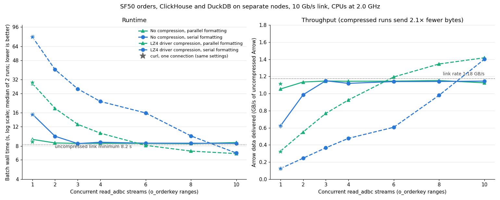

# Parallel streams across a 10 Gb/s link

Measured 2026-11-11 on two CloudLab Utah nodes, as a follow-up to
[sending parallel-formatted output without a copy](../direct-send-20261111/README.md). Every earlier stream
experiment ran ClickHouse and DuckDB on one machine over loopback. This one puts ClickHouse on one node and DuckDB
on another, connected by a real 10 Gb/s link, and repeats the parallel-streams experiment with the custom
ClickHouse build, without and then with the ADBC driver's LZ4 compression.

**Summary.**

- **Without compression, the network is the limit.** One TCP connection reaches the link's full rate (iperf3:
  1.17 GB/s), so the 9.67 GB result needs at least 8.2 s. Reading the table takes ClickHouse only 2.8 s. Every
  configuration with enough streams lands at 8.4–8.6 s.
- **With parallel formatting, one uncompressed stream nearly fills the link.** One `read_adbc` stream takes 9.18 s
  and curl over one connection 8.69 s, against 8.40 s for the best batch, so multiple streams add only 8–9%. With
  serial formatting, one stream takes 15.6 s and it takes 3 streams to reach the link.
- **The driver's LZ4 compression halves the bytes but makes one stream 3–5× slower.** ClickHouse sends 4.56 GB
  instead of 9.67 GB, but it compresses the whole response on a single thread. One stream takes 29.5 s with
  parallel formatting and 78.3 s with serial formatting.
- **With 10 streams, LZ4 is the fastest configuration: 6.8–6.9 s, 18–19% faster than the best uncompressed batch.**
  Each stream compresses on its own thread, so compression scales with the stream count. At 10 streams the link is
  only 57% busy, and ClickHouse's CPUs are about 90% busy.

## Setup

- **Nodes:** two identical CloudLab Utah machines: Intel Xeon D-1548 (8 cores, 16 hardware threads, one socket),
  62 GB RAM, NVMe disk, Ubuntu 24.04.
  - `ms1011` runs ClickHouse.
  - `ms1006` runs DuckDB.
  - They are connected by a 10 Gb/s experiment link (`10.10.1.1` ↔ `10.10.1.2`).
- **Resources:** each side gets the whole machine (16 CPUs, all memory), with no cgroup slices.
- **Clocks:** fixed at 2.0 GHz on both nodes: `performance` governor, turbo off, minimum frequency raised to the
  maximum ([script](./scripts/pin_frequency.sh), [verification](./data/frequency.txt)). The earlier Wisconsin
  host ran at 2.6 GHz.
- **ClickHouse:** the custom 26.11.1.1 build with parallel `ArrowStream` formatting and direct send (commit
  `c933d005d`, the same binary as the direct-send report). It listens on the experiment link
  ([config](./scripts/clickhouse-config-network.xml)).
- **"Serial formatting":** the same binary with `output_format_parallel_formatting=0`. ClickHouse then uses its
  single-threaded Arrow writer, where one thread per query encodes every block and writes it to the socket. Direct
  send does not apply, since it only exists in the parallel path. This behaves like the modified build before the
  two commits (`a2d3db7e5`), not like stock ClickHouse.
- **DuckDB side:** `duckdb-adbc-client` at `e01af01`, built on `ms1006` with the reader-thread patch and the DuckDB
  conversion patch from the [stream-limits report](../stream-limits-20261110/patches/), as in the earlier runs.
- **ADBC connector**, two builds ([script](./scripts/build_connectors.sh)). Both are upstream `v0.1.1` plus
  [connector.diff](../parallel-streams-20261110/connector.diff), with cargo feature `ffi`. They differ in one line:
  - **No compression** (`profile://myclickhouse`): `connector.diff` as is, which sets
    `with_compression(Compression::None)`. All earlier reports used this.
  - **LZ4** (`profile://myclickhouse-lz4`): that line removed, so the upstream default `Compression::Lz4` applies.
    ClickHouse then compresses the HTTP response into its own LZ4 blocks (as with `compress=1`), and the driver
    decompresses them. Arrow IPC compression stays `none` in both builds, because the driver's
    `clickhouse-ext-arrow` crate always sets it.
- **Data:** TPC-H SF50, generated with the DuckDB 2.0.0 release CLI and loaded with the repo's
  `load_clickhouse_tpch.py` ([script](./scripts/load_sf50.sh), [output](./data/load.txt)).
  - `orders` ended up in 2 parts, not the 5 parts on the Wisconsin host. Merges were enabled and idle before the
    run.
  - The data is identical to Wisconsin's: the row-hash sum below matches.
- **Experiment** ([script](./scripts/utah_streams.sh)):
  - [`bench/parallel_read_adbc`](../../bench/parallel_read_adbc.cpp) with N `o_orderkey` ranges, `max_threads` =
    floor(32 / N) per query, DuckDB `threads=16` and `ADBC_READER_THREAD=1`;
  - `--ch-settings` switches `output_format_parallel_formatting` per run;
  - one warmup batch, then two passes over N = 1–10;
  - raw curl downloads use `compress=1` in the LZ4 run, to get the same stream the driver gets.

## 1. The link and the scan

iperf3, 10 s per test, 1 MB writes ([data](./data/iperf3.txt)):

| Direction | 1 connection | 4 connections |
|---|---:|---:|
| ms1011 → ms1006 (ClickHouse to DuckDB) | 9.34 Gb/s = 1.167 GB/s | 9.41 Gb/s = 1.177 GB/s |
| ms1006 → ms1011 | 9.36 Gb/s = 1.170 GB/s | 9.41 Gb/s = 1.176 GB/s |

One connection already runs at line rate. At 1.177 GB/s the 9.67 GB uncompressed result needs 8.2 s.

**Reading the table** ([data](./data/null-format.txt)): the same full-table query with `default_format=Null`,
which reads and decompresses every row but sends nothing, takes **2.73–2.84 s** and 42.6–44.2 CPU-seconds
(`max_threads=32`). So ClickHouse can produce the data about 3× faster than the link can carry it uncompressed.

## 2. Correctness

([without compression](./data/checksum.txt), [with LZ4](./data/lz4/checksum.txt)) With either connector build,
one full `read_adbc` and 4 and 10 range reads all return 75,000,000 rows with row-hash sum
`691747052758391932685914880`, the same value as on the Wisconsin host.

## 3. Results

[Vector version](./streams.svg); data in [streams.tsv](./streams.tsv). Solid lines are without compression, dashed
lines with the driver's LZ4 compression. Stars are curl over one connection with the same settings. Throughput
counts uncompressed Arrow bytes, so a compressed run can exceed the link rate.

Batch wall times, range of two runs:

| | No compression, parallel | No compression, serial | LZ4, parallel | LZ4, serial |
|---|---:|---:|---:|---:|
| curl, one connection | 8.66–8.69 s | 15.29–15.44 s | 29.41–30.06 s | 78.04–78.05 s |
| 1 stream | 8.95–9.18 s | 15.30–15.56 s | 29.43–29.55 s | 77.40–78.27 s |
| 2 streams | 8.49–8.52 s | 9.57–9.80 s | 16.60–17.56 s | 39.47–39.51 s |
| 3 streams | 8.39–8.44 s | 8.40–8.41 s | 12.51–12.59 s | 26.42 s |
| 4 streams | 8.43–8.46 s | 8.53–8.64 s | 9.86–10.45 s | 20.28–20.29 s |
| 6 streams | 8.42–8.45 s | 8.47–8.48 s | 8.02–8.10 s | 15.94–15.95 s |
| 8 streams | 8.37–8.39 s | 8.46–8.48 s | 6.81–7.19 s | 8.85–9.87 s |
| 10 streams | 8.48–8.59 s | 8.40–8.44 s | **6.81–6.82 s** | **6.47–6.90 s** |

Raw output: [no compression](./data/) (`streams-par1.tsv`, `streams-par0.tsv`, `curl.txt`) and
[LZ4](./data/lz4/).

## 4. Without compression

- **From 3 streams up, both settings sit at the link limit** (1.12–1.15 GB/s against 1.17 GB/s).
- **One stream with parallel formatting is 9% from the best batch;** with serial formatting it is 1.8× slower.
- **`read_adbc` adds about 0.5 s over curl for one stream** (9.18 s against 8.69 s), so the DuckDB side nearly
  keeps up with the link.

ClickHouse's side, from `system.query_log` ([parallel](./data/streams-par1-clickhouse.txt),
[serial](./data/streams-par0-clickhouse.txt)):

| Streams | Median query time: parallel / serial | Median time blocked in `send()` per query: parallel / serial | ClickHouse CPU per batch: parallel / serial |
|---:|---|---|---|
| 1 | 8.86 / 15.21 s | 8.69 / 7.39 s | 96.2 / 75.7 s |
| 2 | 8.36 / 9.57 s | 8.16 / 4.77 s | 106.1 / 109.7 s |
| 4 | 7.86 / 8.02 s | 7.66 / 5.24 s | 105.6 / 106.6 s |
| 10 | 7.21 / 6.86 s | 7.00 / 5.23 s | 98.5 / 99.4 s |

- **With parallel formatting, ClickHouse waits on the network for almost the whole query** (8.69 of 8.86 s for
  one stream).
- **With serial formatting and one stream, half the query is spent outside `send()`** (15.2 s, of which 7.4 s in
  `send()`). The other half is the single thread encoding, so that thread, not the link, sets the pace.
- **ClickHouse used much more CPU per batch here than on the Wisconsin host** (96–111 CPU-seconds, against 31–52
  there). Reading the table accounts for about 43 of them (section 1). The slower 2.0 GHz CPU and a real network
  card instead of loopback explain part of the rest; without a profile, not all of it.

## 5. With the driver's LZ4 compression

**Bytes on the wire:** 4.56 GB instead of 9.67 GB, 2.1× less ([curl.txt](./data/lz4/curl.txt), and
`gb_sent_per_batch` in ClickHouse's query log).

**ClickHouse compresses the whole response on one thread.** With `compress=1`, ClickHouse's HTTP handler wraps the
response in a `CompressedWriteBuffer`, so every byte of a query's result passes through one compressing buffer:
- on the parallel formatting collector thread, with parallel formatting (direct send no longer applies);
- on the one thread that also encodes, with serial formatting.

ClickHouse's side ([parallel](./data/lz4/streams-par1-clickhouse.txt),
[serial](./data/lz4/streams-par0-clickhouse.txt)):

| Streams | Median query time: parallel / serial | Median time blocked in `send()`: parallel / serial | ClickHouse CPU per batch: parallel / serial |
|---:|---|---|---|
| 1 | 29.45 / 77.99 s | 1.42 / 3.36 s | 94.0 / 137.8 s |
| 2 | 16.18 / 39.34 s | 0.87 / 1.83 s | 106.2 / 138.3 s |
| 4 | 9.60 / 20.07 s | 0.53 / 0.90 s | 116.5 / 142.8 s |
| 10 | 6.54 / 6.48 s | 0.34 / 0.27 s | 96.8 / 96.7 s |

- **One stream is limited by that compressing thread, not the link.** ClickHouse spends only 1.4 s of a 29.5 s
  query blocked in `send()`. With parallel formatting, the one thread gets through about 0.33 GB/s of Arrow data.
- **With serial formatting, one stream is even slower than expected:** 0.12 GB/s. Encoding (about 0.63 GB/s alone,
  section 4) plus compression (about 0.33 GB/s alone) on one thread would suggest about 0.22 GB/s. The cause is not
  known without a profile, and the serial runs' CPU use per batch (138–182 CPU-seconds) is also unexplained.
- **Compression scales with streams, because each stream compresses on its own thread.** The serial runs fall
  almost exactly as 78 s / N up to 4 streams (15.9 s at 6 streams, where 78 s / 6 would be 13 s).
- **At 10 streams both settings take about 6.8 s,** and only 0.67 GB/s crosses the link (57% of it). ClickHouse
  uses about 97 CPU-seconds per batch, about 90% of its 16 CPUs, so its CPU is the limit there.

## 6. Compared with loopback

The same binary on the Wisconsin host (2.6 GHz, DuckDB on the other CPU socket, no compression, from the
[direct-send report](../direct-send-20261111/README.md)):

| | Loopback, one machine | 10 Gb/s, two nodes |
|---|---:|---:|
| curl, one connection, parallel formatting | 6.22–6.40 s | 8.66–8.69 s |
| One `read_adbc` stream, parallel formatting | 7.28 s | 9.18 s |
| Best batch | 3.26 s (serial, 6 streams) | 6.82 s (LZ4, parallel, 10 streams) |

## What this suggests

- **Over this network, compression helps only with enough parallel compression.** The driver's LZ4 compression
  happens on one thread per query in ClickHouse, which at 2.0 GHz compresses far more slowly than 10 Gb/s, so it
  needs about 6 or more streams to pay off.
- **ClickHouse could compress in parallel.** Its `compress=1` format is a sequence of self-contained compressed
  blocks, so the parallel formatter threads could compress their own chunks and the collector could send the
  blocks as they are. That would give one stream the 2.1× smaller transfer without the single-thread limit.
- **Arrow IPC compression is the other option.** With `output_format_arrow_compression_method=lz4_frame` or
  `zstd`, ClickHouse already compresses inside the parallel formatter threads. The driver would need changes: its
  `clickhouse-ext-arrow` crate forces `none`, and its arrow-rs build would need the compression features. Its
  decoding, one batch at a time, would then also have to decompress.
- **Without compression, parallel formatting makes multiple streams nearly unnecessary on this link:** one stream
  gets within 9% of the best uncompressed batch.

## Caveats

- Two runs per configuration.
- Different hardware from the earlier reports: 2.0 GHz Xeon D nodes instead of a 2.6 GHz two-socket Haswell host.
- `orders` has 2 parts here instead of 5.
- Unexplained: ClickHouse's high CPU use per batch, and why serial formatting with LZ4 is slower than encoding and
  compression separately would suggest.

## Files

- **[scripts/](./scripts/):**
  - `pin_frequency.sh`: fixes the clocks on a node and checks them under load.
  - `clickhouse-config-network.xml`: the ClickHouse server config.
  - `load_sf50.sh`: generates and loads SF50 on `ms1011`.
  - `build_connectors.sh`: builds both connector variants and their ADBC profiles on `ms1006`.
  - `utah_streams.sh`: correctness check, curl downloads and the streams sweep, run on `ms1006`. `PROFILE`,
    `OUT_DIR` and `CURL_PARAMS` select the connector build, output directory and extra curl parameters
    (`&compress=1` for the LZ4 run).
- **[data/](./data/):** the raw output of each step without compression, including the full run log, plus
  `iperf3.txt`, `null-format.txt` and `frequency.txt`. **[data/lz4/](./data/lz4/)** holds the LZ4 run.
- **[plot_two_node.py](./plot_two_node.py)** draws the chart: `python3 plot_two_node.py data .` (needs matplotlib).
