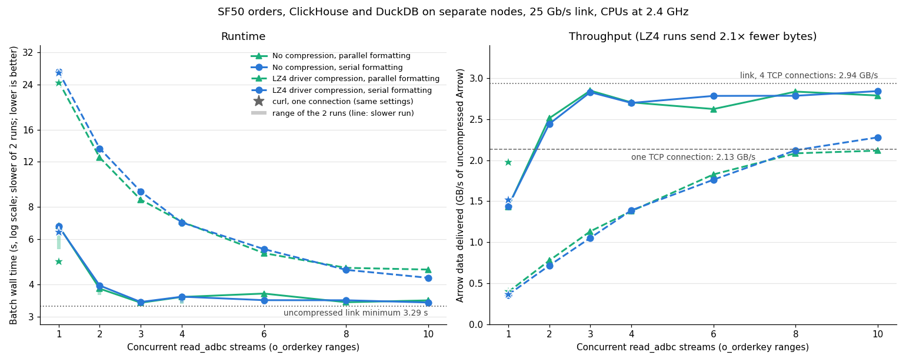
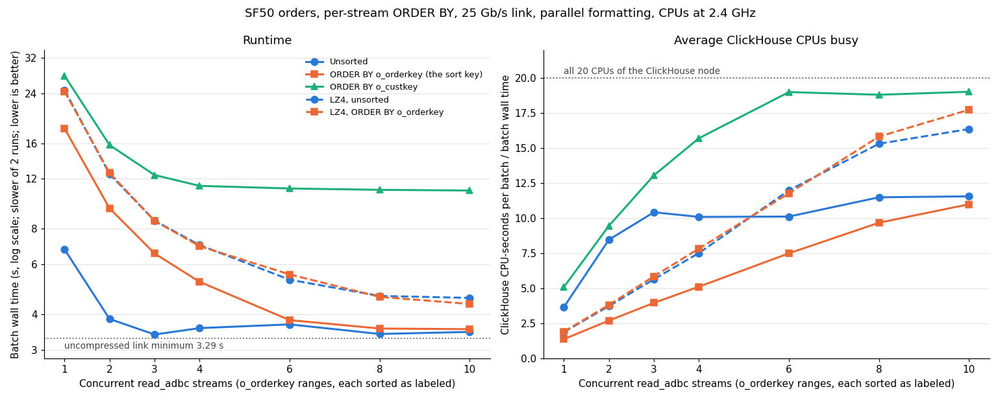
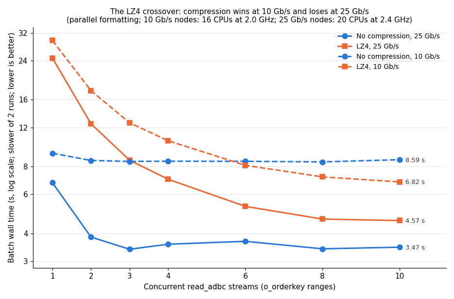

# Parallel and sorted streams across a 25 Gb/s link

Measured 2026-11-12 on two CloudLab Utah nodes, connected by a 25 Gb/s link. This report repeats the
[10 Gb/s two-node experiment](../two-node-10gbe-20261111/README.md) and the
[10 Gb/s sorted-streams experiment](../two-node-sorted-streams-20261111/README.md) on faster hardware:
- ClickHouse on one node and DuckDB on the other;
- N parallel `read_adbc` streams over `o_orderkey` ranges;
- the ADBC driver with and without its LZ4 compression;
- ClickHouse's parallel `ArrowStream` formatting on and off;
- ranges sorted by ClickHouse.

**Summary.**

- **Without compression, 3 streams reach the link.** From 3 to 10 streams every batch takes 3.34–3.69 s, against
  a minimum of 3.29 s for 9.67 GB at the link's 2.94 GB/s. On the 10 Gb/s nodes the best batch was 8.40 s.
- **One stream can't fill this link, because one TCP connection can't.** iperf3 tops out at 2.14 GB/s on one
  connection and 2.94 GB/s on four. One `read_adbc` stream takes 5.48–6.76 s, and ClickHouse is blocked sending for
  almost all of it. curl over one connection takes 4.7–5.3 s. So unlike at 10 Gb/s, where one stream nearly
  filled the link, two or more streams are needed here.
- **Parallel formatting only helps a single stream.** Over one connection, curl takes 4.7–4.9 s with it and 6.4 s
  without, and ClickHouse's median single-stream `read_adbc` query takes 5.45 s against 6.69 s. From 2 streams up,
  serial and parallel formatting are within run-to-run noise.
- **The driver's LZ4 compression is now slower than no compression at every stream count.** Its best batch is
  4.21–4.24 s, against 3.34–3.47 s uncompressed. One stream takes 24.5 s, about 4× slower than uncompressed,
  because ClickHouse compresses each response on one thread. At 10 Gb/s, LZ4 with 10 streams was the fastest
  configuration (6.8 s against 8.4 s). Here the link is fast enough that halving the bytes no longer pays for the
  compression.
- **Sorting each range by the table's key (`o_orderkey`) costs 2–5% from 8 streams up.** One in-order read delivers
  about 0.54 GB/s, so it takes 5–6 of them to fill this link, against 3 at 10 Gb/s.
- **Sorting each range by another column (`o_custkey`) is limited by ClickHouse's CPU.** The batch stays at
  10.8–11.3 s from 4 streams up, with 19 of ClickHouse's 20 CPUs busy on average.

## Setup

- **Nodes:** two identical CloudLab Utah machines: Intel Xeon E5-2640 v4 (Broadwell, 10 cores, 20 hardware
  threads, one socket), 62 GB RAM, SATA SSD, Ubuntu 24.04.
  - `hp034` runs ClickHouse.
  - `hp036` runs DuckDB.
  - The 25 Gb/s experiment link connects `10.10.1.1` (hp034) and `10.10.1.2` (hp036), MTU 1500.
- **Resources:** each side gets the whole machine (20 CPUs, all memory), with no cgroup slices.
- **Clocks:** fixed at the 2.4 GHz base frequency on both nodes: `performance` governor, turbo off, minimum
  frequency raised to the maximum. Under load both measured 2.39 GHz ([data/frequency.txt](./data/frequency.txt)).
  The 10 Gb/s nodes ran at 2.0 GHz.
- **ClickHouse:** the same custom 26.11.1.1 binary as the 10 Gb/s report (commit `c933d005d`: parallel `ArrowStream`
  formatting and direct send; sha256 `330901bd…`), copied from the project share, with the same
  [config](../two-node-10gbe-20261111/scripts/clickhouse-config-network.xml).
  - **"Serial formatting"** means `output_format_parallel_formatting=0`: one thread per query encodes and sends.
- **DuckDB side:**
  - `duckdb-adbc-client` at `f0bf5c0`, with the reader-thread patch and the DuckDB Arrow-conversion patch from the
    [stream-limits report](../stream-limits-20261110/patches/), as in every multi-stream report since then.
  - DuckDB `threads=20`; it was 16 on the 10 Gb/s nodes.
- **ADBC connector:** the same two builds as the 10 Gb/s report: upstream `v0.1.1` plus
  [connector.diff](../parallel-streams-20261110/connector.diff). They differ only in compression:
  - none (`profile://myclickhouse`);
  - the driver's default LZ4 (`profile://myclickhouse-lz4`). With LZ4, ClickHouse compresses the HTTP response
    and the driver decompresses it.
- **Data:** TPC-H SF50, generated with the DuckDB 2.0.0 CLI and loaded with the repo's loader
  ([data/load.txt](./data/load.txt)).
  - `orders` has 75,000,000 rows, 1.85 GiB on disk, in 2 parts
    ([data/sorted/parts.txt](./data/sorted/parts.txt)): `all_1_36_2` holds keys 1–167,647,713 (39.7 million
    rows) and `all_37_68_2` holds 154,413,696–300,000,000 (35.3 million rows). Unlike on the 10 Gb/s nodes, the two
    parts overlap slightly in key.
  - The row-hash sum matches every earlier run.
- **Experiment** ([scripts/run_all.sh](./scripts/run_all.sh)): the 10 Gb/s reports' `utah_streams.sh` and
  `utah_sorted.sh`, unchanged except for DuckDB's thread count.
  - [`bench/parallel_read_adbc`](../../bench/parallel_read_adbc.cpp) runs N `o_orderkey` ranges with ClickHouse
    `max_threads` = floor(32 / N) per query and `ADBC_READER_THREAD=1`.
  - N = 1, 2, 3, 4, 6, 8, 10, with one warm-up batch and then 2 measured runs per N.
  - curl downloads use one connection and `max_threads=32`.
  - [scripts/setup_nodes.sh](./scripts/setup_nodes.sh) records the setup commands, and
    [scripts/link_and_scan.sh](./scripts/link_and_scan.sh) the link and scan measurements.

Terms used below:

- **Batch time:** wall time until all N streams finish.
- **Send-blocked time:** time a ClickHouse query spent inside socket writes (`NetworkSendElapsedMicroseconds` in
  `system.query_log`). Close to the query's whole duration means it was waiting on the network.
- **CPUs busy:** ClickHouse CPU-seconds for a batch (`OSCPUVirtualTimeMicroseconds`, summed over its queries)
  divided by the batch time. The maximum is 20.

## 1. The link and the scan

| Measurement | Result |
|---|---|
| iperf3, hp034 → hp036, 1 connection | 2.135 GB/s (17.1 Gb/s), 377 retransmits; the receiving side used 93% of a CPU |
| iperf3, hp034 → hp036, 4 connections | **2.938 GB/s** (23.5 Gb/s), no retransmits |
| ClickHouse full scan, `Null` format, `max_threads=32` | 1.77–1.81 s, 34.5 CPU-seconds |

[iperf3](./data/iperf3.txt), [Null scan](./data/null-format.txt). The other direction gives the same rates.

- **The link minimum for the uncompressed table is 3.29 s** (9.67 GB / 2.94 GB/s). Over one TCP connection it is
  4.53 s.
- **Reading the table takes ClickHouse 1.8 s,** so its reads are not the limit.
- **One connection reaches only 73% of the link.** The receiver used most of one CPU in iperf3. At 10 Gb/s, one
  connection reached the full link rate.

## 2. Correctness

All six checks match: one full read against 4 and 10 range reads, without compression, with LZ4, and with each
sort. Every one returned 75,000,000 rows and row-hash sum 691747052758391932685914880
([unsorted](./data/checksum.txt), [LZ4](./data/lz4/checksum.txt),
[o_orderkey](./data/sorted/checksum-o_orderkey.txt), [o_custkey](./data/sorted/checksum-o_custkey.txt)).

## 3. The stream sweep

[Vector version](./streams.svg); plotted values and CPUs busy in [streams.tsv](./streams.tsv). Batch times, both
runs:

| Streams | No compression, parallel fmt | No compression, serial fmt | LZ4, parallel fmt | LZ4, serial fmt |
|---:|---:|---:|---:|---:|
| 1 | 5.48–6.76 s | 6.68–6.72 s | 24.46–24.62 s | 26.72–26.87 s |
| 2 | 3.64–3.85 s | 3.80–3.96 s | 12.33–12.46 s | 13.51–13.52 s |
| 3 | 3.37–3.39 s | **3.34**–3.42 s | 8.49–8.54 s | 9.10–9.19 s |
| 4 | 3.37–3.58 s | 3.39–3.58 s | 6.70–7.01 s | 6.96 s |
| 6 | 3.60–3.69 s | **3.34**–3.47 s | 5.18–5.29 s | 5.48–5.49 s |
| 8 | 3.36–3.41 s | 3.37–3.47 s | 4.56–4.64 s | 4.54–4.56 s |
| 10 | 3.40–3.47 s | 3.36–3.40 s | 4.47–4.57 s | **4.21–4.24 s** |
| curl, 1 connection | 4.71–4.90 s | 6.37–6.38 s | 24.23–24.28 s | 26.48–26.65 s |

ClickHouse's side, from `system.query_log` (medians per query, including the warm-up; full tables in
[data/](./data/), `streams-par*-clickhouse.txt` and `lz4/streams-par*-clickhouse.txt`):

| Configuration, streams | Query time | Send-blocked | CPU-seconds per batch |
|---|---:|---:|---:|
| No compression, parallel fmt, 1 | 5.45 s | 5.38 s | 24.7 |
| No compression, serial fmt, 1 | 6.69 s | 3.45 s | 25.7 |
| No compression, parallel fmt, 10 | 2.95 s | 2.88 s | 40.1 |
| LZ4, parallel fmt, 1 | 24.42 s | 1.17 s | 46.0 |
| LZ4, parallel fmt, 10 | 4.40 s | 0.29 s | 74.8 |
| LZ4, serial fmt, 10 | 4.15 s | 0.26 s | 71.4 |

### Without compression

- **The link is the limit from 3 streams up.**
  - Batches take 3.34–3.69 s, within 1–12% of the 3.29 s minimum, and deliver up to 2.9 GB/s.
  - At 10 streams each query is send-blocked for 2.88 s of its 2.95 s.
- **One stream is limited by its one TCP connection.**
  - With parallel formatting, the single query is send-blocked for 5.38 s of 5.45 s.
  - curl over one connection takes 4.71–4.90 s (about 2.0 GB/s) in this sweep and 5.28–5.33 s in the sorted run's
    downloads (section 4). That is near iperf3's one-connection rate of 2.14 GB/s.
  - `read_adbc` is slower than curl (5.45 s for ClickHouse's median query). The DuckDB side receives one connection
    more slowly than curl does. Where that time goes on this link was not profiled.
- **Two streams nearly reach the link:** 3.64–3.96 s.
- **Serial formatting only matters for one stream.**
  - With one thread per query encoding and sending, the single query takes 6.69 s and is send-blocked for only
    3.45 s of it, so encoding takes the rest.
  - From 2 streams up, each query sends less and the link becomes the limit, so serial and parallel formatting
    match. On the 10 Gb/s nodes, serial formatting needed 3 streams to reach the link.
- **The second single-stream run with parallel formatting is an outlier:** 6.76 s, against 5.48 s for the first.
  ClickHouse's median query was 5.45 s, so the warm-up and the first run were both near 5.5 s. The chart's range
  bars show this, and the line follows the slower run.

### With the driver's LZ4 compression

- **ClickHouse compresses each response on one thread.**
  - One stream takes 24.5 s: 4.56 GB of LZ4 output at about 0.19 GB/s, from 9.67 GB of Arrow at about 0.40 GB/s.
  - The query is send-blocked for only 1.2 s of it.
- **Batch time falls almost in proportion to N up to 3 streams** (24.5 → 12.4 → 8.5 s), then more slowly (6.9 s
  at 4, 5.2 s at 6), and flattens at 4.2–4.6 s from 8 streams.
  - At 10 streams, ClickHouse keeps 16.4–16.8 of its 20 CPUs busy (71–75 CPU-seconds per batch).
  - The wire carries 4.56 GB in about 4.4 s, about 1.0 GB/s, which is a third of the link.
  - DuckDB-side decompression was not measured, so whether the DuckDB node also limits this is open.
- **LZ4 is 25–36% slower than no compression at its best** (4.21–4.57 s at 10 streams against 3.36–3.47 s).
- **Serial formatting with LZ4 is now close to parallel formatting** (26.7–26.9 s against 24.5–24.6 s for one
  stream). On the 10 Gb/s nodes it was 78.3 s against 29.5 s, which that report could not explain. It did not
  reproduce on this hardware.

## 4. Sorted streams

[Vector version](./sorted_streams.svg); plotted values in [sorted_streams.tsv](./sorted_streams.tsv). Parallel
formatting throughout; batch times, both runs:

| Streams | Unsorted | `ORDER BY o_orderkey` | `ORDER BY o_custkey` | LZ4, unsorted | LZ4, `ORDER BY o_orderkey` |
|---:|---:|---:|---:|---:|---:|
| 1 | 5.48–6.76 s | 17.97–18.02 s | 27.56–27.64 s | 24.46–24.62 s | 24.34–24.36 s |
| 2 | 3.64–3.85 s | 9.38–9.44 s | 15.69–15.76 s | 12.33–12.46 s | 12.49–12.57 s |
| 3 | 3.37–3.39 s | 6.48–6.55 s | 12.34–12.36 s | 8.49–8.54 s | 8.51–8.53 s |
| 4 | 3.37–3.58 s | 5.20 s | 11.08–11.33 s | 6.70–7.01 s | 6.89–6.95 s |
| 6 | 3.60–3.69 s | 3.74–3.82 s | 11.08–11.09 s | 5.18–5.29 s | 5.46–5.53 s |
| 8 | 3.36–3.41 s | 3.46–3.56 s | **10.83**–10.97 s | 4.56–4.64 s | 4.58–4.61 s |
| 10 | 3.40–3.47 s | **3.54–3.55 s** | **10.83**–10.91 s | 4.47–4.57 s | **4.33–4.35 s** |
| curl, 1 connection | 5.28–5.33 s | 17.88–18.18 s | 28.05–28.45 s | 24.24–24.34 s | 24.36–24.56 s |

The curl row comes from the sorted run's own downloads ([data/sorted/curl.txt](./data/sorted/curl.txt)). ClickHouse's
side ([data/sorted/](./data/sorted/), `streams-*-clickhouse.txt`):

| Sort, streams | Query time | Send-blocked | CPU-seconds per batch | Peak memory per query |
|---|---:|---:|---:|---:|
| `o_orderkey`, 1 | 17.99 s | 2.80 s | 24.6 | 714 MiB |
| `o_orderkey`, 10 | 3.32 s | 2.32 s | 39.0 | 95 MiB |
| `o_custkey`, 1 | 27.61 s | 3.47 s | 140.6 | 11.0 GiB |
| `o_custkey`, 10 | 10.46 s | 0.99 s | 207.6 | 1.20 GiB |

- **Sorted by the sort key (`o_orderkey`):**
  - **ClickHouse reads the parts in key order instead of sorting.** Peak memory is 714 MiB, against 11 GiB for a
    real sort.
  - **That read runs almost serially.** One sorted query keeps 1.4 CPUs busy and delivers about 0.54 GB/s (9.67 GB
    in 18 s).
  - **Filling the 2.94 GB/s link takes 5–6 such reads.** The batch time halves with each doubling of N up to 4
    streams (18.0 → 9.4 → 5.2 s), then reaches 3.7–3.8 s at 6 and 3.5–3.6 s at 8–10.
  - **At 8–10 streams the sort costs 2–5% over unsorted.** Queries are then send-blocked for most of their time
    (2.32 s of 3.32 s at 10 streams).
  - **The result is globally sorted.** The ranges are disjoint and contiguous, so reading the streams in range
    order gives the table in `o_orderkey` order. Whether DuckDB keeps each stream's order was not checked.
- **Sorted by another column (`o_custkey`):**
  - **One query takes 27.6 s.** The final merge of a full sort runs on one thread; the one-machine report traced
    this.
  - **From 4 streams up, ClickHouse's CPUs are full.** 18.8–19.0 of 20 CPUs are busy on average at 6–10 streams,
    and the batch stays at 10.8–11.3 s, 3.2× the unsorted time.
  - **Each stream is sorted only within itself,** so DuckDB would still need an N-way merge.
- **LZ4 with `ORDER BY o_orderkey` matches LZ4 unsorted within 0.35 s at every N.** The single compression thread
  per query is slower than the in-order read (24.4 s against 18.0 s for one stream), so it hides the sort.

## 5. Compared with the 10 Gb/s nodes

[Vector version](./link_comparison.svg); values in [link_comparison.tsv](./link_comparison.tsv).

| | 10 Gb/s nodes (ms1011, ms1006) | 25 Gb/s nodes (hp034, hp036) |
|---|---:|---:|
| CPUs, clock | 16 (Xeon D-1548), 2.0 GHz | 20 (Xeon E5-2640 v4), 2.4 GHz |
| Link: 1 connection / 4 connections | 1.17 / 1.18 GB/s | 2.14 / 2.94 GB/s |
| `Null` scan | 2.73–2.84 s, 43 CPU-s | 1.77–1.81 s, 34.5 CPU-s |
| No compression, 1 stream (parallel fmt) | 8.95–9.18 s | 5.48–6.76 s |
| No compression, best batch | 8.40 s | 3.34 s |
| LZ4, 1 stream (parallel fmt) | 29.5 s | 24.5–24.6 s |
| LZ4, best batch | 6.81–6.90 s | 4.21–4.24 s |
| `ORDER BY o_orderkey`, 10 streams | 8.60–8.72 s | 3.54–3.55 s |
| `ORDER BY o_custkey`, best batch | 18.51–18.74 s | 10.83–10.97 s |

- **Uncompressed transfers scale with the link:** the best batch is 2.5× faster on a 2.5× faster link.
- **LZ4 scales with the CPUs:** its best batch is 1.6× faster, about what 20 CPUs at 2.4 GHz give over 16 at
  2.0 GHz (1.5×).
  - So the two configurations cross: LZ4 wins when the link is slow relative to ClickHouse's compression rate,
    and loses when it isn't.
  - On this hardware, LZ4's best batch (4.2–4.6 s) would beat an uncompressed transfer only below about
    2.1–2.3 GB/s (17–18 Gb/s). That estimate assumes the LZ4 time stays CPU-bound; it was not measured.
- **ClickHouse uses far less CPU per uncompressed batch here:** 25–40 CPU-seconds, against 96–106 on the 10 Gb/s
  nodes. The `Null` scan differs by only 1.25× (34.5 against 43).
  - This fits the earlier guess that the extra CPU on the 10 Gb/s nodes was spent while queries waited on the
    slower link.
  - The hardware differs too, and neither run was profiled.

## What this suggests

- **On a fast link, don't compress.** Use enough uncompressed streams to cover the per-connection limit: 3 here.
  LZ4 only helps when the link is slower than about 2 GB/s on hardware like this.
- **Per-connection TCP throughput, not the link, now limits a single stream.** Parallel formatting and direct send
  removed ClickHouse's serial bottleneck. What is left for one stream is one connection's rate (2.1 GB/s) and the
  DuckDB side's receive path, which runs a little slower than curl.
- **A sorted read by the table's key is free with enough streams.** "Enough" grows with link speed: 3 at
  10 Gb/s, 6–8 at 25 Gb/s.

## Caveats

- Two measured runs per point, after a warm-up batch. They differ by at most 0.35 s, except the single
  uncompressed parallel-formatting stream (5.48 s and 6.76 s). The charts plot the slower run, and the sweep chart
  shows both.
- Different CPUs and clocks from the 10 Gb/s nodes, so section 5 compares setups, not just link speeds.
- Not profiled: where DuckDB spends time receiving one stream, DuckDB-side LZ4 decompression, and ClickHouse's
  CPU differences.
- The checksums compare rows, not order.
- The `o_custkey` downloads are about 5 MB smaller than the others, as at 10 Gb/s; the row checks match.
- The single-connection curl download without sorting took 4.71–4.90 s in the sweep and 5.28–5.33 s about 10
  minutes later in the sorted run, with the same query and settings. The cause of that difference was not
  investigated.

## Files

- **[scripts/](./scripts/):**
  - `setup_nodes.sh`: setup commands for both nodes, as run.
  - `link_and_scan.sh`: iperf3 and the `Null` scan.
  - `run_all.sh`: the full experiment, run on hp036.
- **[data/](./data/):**
  - `streams-par{0,1}.tsv`, `curl.txt`, `checksum.txt` and `*-clickhouse.txt`: the uncompressed sweep.
  - `lz4/`: the same for LZ4.
  - `sorted/`: the sorted runs, their checksums, and the table's parts.
  - `iperf3.txt`, `null-format.txt`, `frequency.txt`, `load.txt`, and the full `run-log.txt`.
- **[plot_25gbe.py](./plot_25gbe.py)** draws all three charts:
  `python3 plot_25gbe.py data ../two-node-10gbe-20261111/data .`
