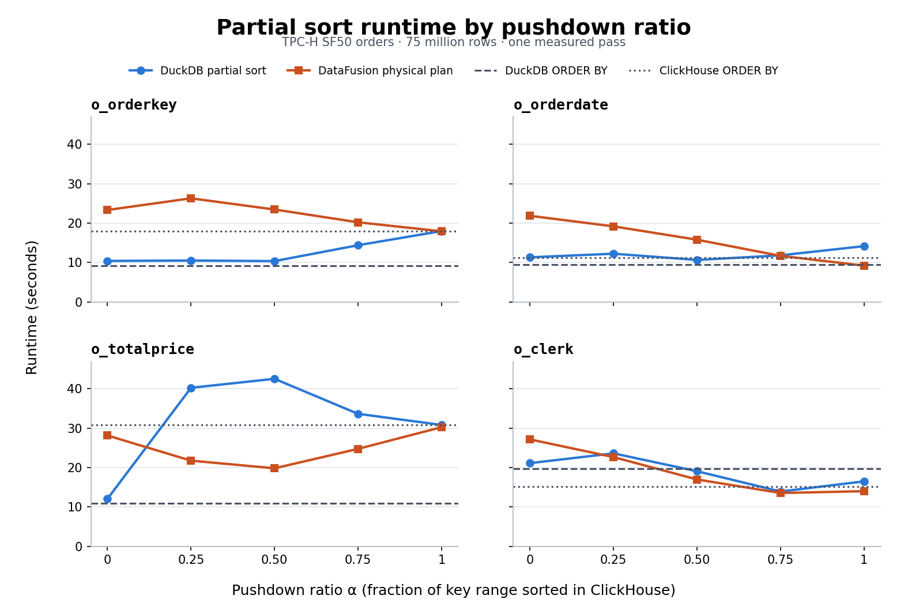

# DuckDB and DataFusion partial sort across two CloudLab nodes

Measured November 13, 2026 on TPC-H SF50 `orders` (75 million rows, all nine columns). Both clients read from the same ClickHouse server over ADBC and return globally ordered output. DataFusion's fastest partial-sort setting for `o_totalprice` took 19.83 s versus 42.53 s for DuckDB's partial sort at the same ratio. DuckDB's plain `ORDER BY` on an unsorted ADBC read took 11.00 s and was the fastest tested path for that key.

## Setup

- **Server:** ClickHouse 26.11.1.1 on `hp034`. **Client:** DuckDB or DataFusion on `hp036`. The ADBC profile used HTTP over the private 25 Gb/s link with driver compression off. Both used the existing [connector build](../parallel-streams-20261110/connector.diff). ClickHouse used its default thread budget of 20 per query and parallel output formatting.
- **Client resources:** 20 threads and a 56 GiB engine memory limit. The DuckDB run used the existing CloudLab build at [`f0bf5c0`](https://github.com/awitten1/duckdb-adbc-client/commit/f0bf5c071ea4002ca387608bc58b89e4c1c64cd1) with the [benchmark scan and Arrow conversion patches](../stream-limits-20261110/README.md). The DataFusion prototype uses DataFusion 55.2.0 and Arrow 59.3.2.
- **Workload:** partition on `o_orderkey`, then sort one column ascending with nulls last. For mixed ratios, ClickHouse sorts the highest fraction α of the integer key range and the client sorts the rest. The fraction applies to key values. Row counts can vary with key distribution.
- **Measurement:** one ascending pass over α=0, .25, .5, .75, 1 for each key after warmup. The two engines ran in separate passes. DuckDB times are `EXPLAIN ANALYZE` query totals. DataFusion times run from physical plan setup and ADBC reader startup through draining the final stream and joining the reader threads. DataFusion discovers the key bounds and expected count once per invocation, before its per-alpha timers. DuckDB performs bounds discovery within mixed-ratio queries. The saved DuckDB data includes outer process elapsed time as a second reference.

## Execution paths

DuckDB's `read_adbc_partial_sort` reads and converts Arrow batches into DuckDB vectors. It constructs and merges local sort runs in parallel. In the measured build, the remote producer writes sorted rows to a buffer-managed spool so it can keep draining while the local sort runs. A single output thread merges the two ordered inputs. Contiguous output spans can reference their input chunks. Highly interleaved output requires packing rows into output chunks. This benchmark used the existing CloudLab binary and predates the working-tree changes to batch those copies and stream the fully remote path directly.

The [DataFusion implementation](../../bench/datafusion/src/partial_sort.rs) uses a bounded channel of four Arrow batches per ADBC reader. It builds the plan directly and calls `ExecutionPlan::execute`. The local input is distributed by batch across 20 sort partitions and merged locally. The remote input advertises the ordering enforced by ClickHouse. The outer merge consumes both ordered branches. At α=0 only the local sort and its merge run. At α=1 the remote stream feeds the output directly.

```text
SortPreservingMergeExec
  UnionExec
    SortPreservingMergeExec
      SortExec (preserve partitioning)
        RepartitionExec (round robin, 20 partitions)
          StreamingTableExec (unsorted local range)
    StreamingTableExec (ClickHouse-sorted remote range)
```

[Captured plans for all five o_totalprice cases](data/o_totalprice.plan)

## Results



[Vector chart](alpha_sweep.svg) · [Plot script](plot_alpha.py)

Seconds to consume all 75 million rows. The fastest alpha per engine and key is bold. The two rightmost columns are baselines measured in the DuckDB pass, with plain DuckDB `ORDER BY` over an unsorted ADBC read or plain `read_adbc` over a ClickHouse `ORDER BY`.

| Sort key | Client | α=0 | α=.25 | α=.5 | α=.75 | α=1 | DuckDB baseline | ClickHouse baseline |
|---|---|---:|---:|---:|---:|---:|---:|---:|
| `o_orderkey` | DuckDB | 10.40 | 10.50 | **10.35** | 14.38 | 17.97 | 9.20 | 17.92 |
| | DataFusion | 23.32 | 26.28 | 23.45 | 20.21 | **17.92** | | |
| `o_orderdate` | DuckDB | 11.32 | 12.23 | **10.65** | 11.82 | 14.15 | 9.41 | 11.21 |
| | DataFusion | 21.84 | 19.17 | 15.78 | 11.68 | **9.21** | | |
| `o_totalprice` | DuckDB | **12.10** | 40.26 | 42.53 | 33.65 | 30.83 | 11.00 | 30.79 |
| | DataFusion | 28.15 | 21.77 | **19.83** | 24.76 | 30.26 | | |
| `o_clerk` | DuckDB | 21.14 | 23.62 | 19.08 | **13.94** | 16.51 | 19.78 | 15.25 |
| | DataFusion | 27.15 | 22.67 | 16.99 | **13.56** | 14.02 | | |

- **Price is the clearest difference in the mixed-ratio paths.** DuckDB copied all 75 million output rows at every mixed ratio. At α=.5 its profile attributed 32.86 s to the merge loop out of 42.53 s of query time. DataFusion finished the α=.5 query in 19.83 s. The measurements show a large cost in the measured DuckDB merge path. They do not isolate the cost of DataFusion's merge or the contribution of its Arrow representation.
- **DuckDB was faster at α=0 for all four keys.** Its plain `ORDER BY` baseline also beat both engines' best alpha for `o_orderkey` and `o_totalprice`.
- **Clerk favored a mixed ratio in both engines.** Both reached their minimum at α=.75. The 0.38 s difference between the engines comes from one pass, so the run provides no estimate of run-to-run variation.

All 28 timed DuckDB cases and all 20 timed DataFusion cases returned 75 million rows. DuckDB profiles recorded zero temporary-directory spill. DataFusion spill metrics were not collected. In a separate DataFusion check for `o_totalprice`, α=0, .5, and 1 all passed a global order check and returned the same order-independent checksum over all columns.

[DuckDB timings and merge metrics](data/duckdb.tsv) · [DataFusion timings](data/datafusion.tsv) · [DataFusion warmup](data/warmup.tsv) · [DataFusion correctness](data/correctness.tsv)

## Reproduce

Use an ADBC profile that points to ClickHouse over the private link and has compression disabled. Run the client commands sequentially.

```sh
# DuckDB, from the repository root with the extension already built.
out=build/experiments/two-node-sf50-alpha
python3 scripts/experiments/run_cases.py --root "$out" --tag warmup \
  --profile profile://myclickhouse --database tpch_sf50 --table orders \
  --partition-key o_orderkey --sort-columns o_orderdate --expected-rows 75000000 \
  --threads 20 --memory-limit 56GiB --no-server-metrics --cases read partial0.5
for key in o_orderkey o_orderdate o_totalprice o_clerk; do
  python3 scripts/experiments/run_cases.py --root "$out" --tag "${key#o_}-r1" \
    --profile profile://myclickhouse --database tpch_sf50 --table orders \
    --partition-key o_orderkey --sort-columns "$key" --expected-rows 75000000 \
    --threads 20 --memory-limit 56GiB --no-server-metrics \
    --cases partial0 partial0.25 partial0.5 partial0.75 partial1 native read_sorted
done
```

```sh
# DataFusion, from bench/datafusion.
cargo build --locked --release
run_df() {
  target/release/parallel_read_datafusion \
    --profile=profile://myclickhouse --database=tpch_sf50 --table=orders \
    --key=o_orderkey --threads=20 --memory-limit=56GiB --repeats=1 "$@"
}
run_df --order-by=o_orderdate --alpha=0.5
for key in o_orderkey o_orderdate o_totalprice o_clerk; do
  run_df --order-by="$key" --alpha=0,0.25,0.5,0.75,1 > "$key.tsv" 2> "$key.plan"
done
run_df --order-by=o_totalprice --alpha=1,0.5,0 --checksum
```
