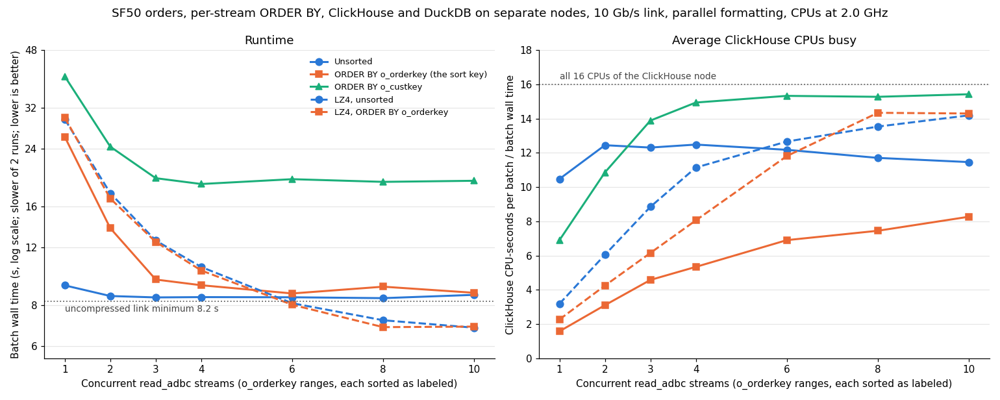

# Sorted streams across a 10 Gb/s link

Measured 2026-11-11 on the two CloudLab Utah nodes of
[parallel streams across a 10 Gb/s link](../two-node-10gbe-20261111/README.md). It repeats the one-machine
[sorting experiment](../sorted-streams-20261111/README.md) with ClickHouse and DuckDB on separate nodes: each of N
parallel `read_adbc` streams reads one `o_orderkey` range, and ClickHouse sorts that range before sending it.

**Summary.**

- **Sorting each stream by the table's sort key is free from 4 streams up.** With `ORDER BY o_orderkey` on every
  range, 4–10 streams take 8.5–9.2 s, against 8.4–8.6 s unsorted, and both are limited by the link. Because the
  ranges are contiguous, the streams together form one result sorted by `o_orderkey`.
- **One query sorted by the sort key is 2.8× slower than unsorted** (25.6–26.1 s against 8.95–9.18 s). ClickHouse
  reads the table in key order almost one thread at a time: about 1.6 CPUs busy on average. That read delivers
  about 0.38 GB/s, so it takes 3–4 of them in parallel to fill the 1.17 GB/s link.
- **With the driver's LZ4 compression, sorting by the sort key changes nothing at any stream count.** Sorted and
  unsorted batches are within 0.7 s of each other from 1 to 10 streams (29.9 s for one stream, 6.8–6.9 s for
  ten). The limit is ClickHouse compressing each query's response on one thread, which is slower than the sorted
  read.
- **Sorting each stream by another column (`o_custkey`) is limited by ClickHouse's CPU.** The batch stops
  improving at 18.7–19.5 s from 4 streams up, with ClickHouse's CPUs full (14.9–15.4 of 16 busy on average). That
  is more than twice the unsorted time, and the N sorted streams still need a merge to be one sorted result.

## Setup

Everything is as in the [two-node report](../two-node-10gbe-20261111/README.md#setup):

- ClickHouse (the custom 26.11.1.1 build with parallel `ArrowStream` formatting and direct send) on `ms1011`;
  DuckDB on `ms1006`; a 10 Gb/s link between them (iperf3: 1.17 GB/s); each side has the whole machine (16 CPUs,
  62 GB); clocks fixed at 2.0 GHz on both.
- TPC-H SF50 `orders`: 75,000,000 rows, 9.67 GB as uncompressed Arrow. Its sort key and primary key are
  `o_orderkey`.
- Two connector builds: no compression (`profile://myclickhouse`) and the driver's default LZ4 compression
  (`profile://myclickhouse-lz4`).

What differs ([script](./scripts/utah_sorted.sh)):

- Every query carries an `ORDER BY`. For N streams, stream i runs

  ```sql
  SELECT * FROM tpch_sf50.orders WHERE o_orderkey BETWEEN lo_i AND hi_i ORDER BY <key>
  SETTINGS max_threads = floor(32 / N), output_format_parallel_formatting = 1
  ```

  using [`bench/parallel_read_adbc`](../../bench/parallel_read_adbc.cpp)'s `--order-by` option. DuckDB runs with
  `threads=16` and `ADBC_READER_THREAD=1`.
- Parallel formatting is always on; serial formatting was not rerun.
- Three configurations, each with N = 1, 2, 3, 4, 6, 8, 10 and 2 runs per N:
  - uncompressed, `ORDER BY o_orderkey` (the table's sort key, and the key the ranges split);
  - uncompressed, `ORDER BY o_custkey` (another column);
  - LZ4, `ORDER BY o_orderkey`.
- The unsorted numbers come from the two-node report's runs with parallel formatting, from the same day, on the same
  nodes and the same ClickHouse server.
- **The table's two parts don't overlap in key** ([data/parts.txt](./data/parts.txt)): `all_1_36_2` holds keys
  1–158,824,134 (39.7 million rows) and `all_37_68_2` holds 158,824,135–300,000,000 (35.3 million rows). Merges
  had produced these before the experiment.

Terms used below:

- **Batch time:** wall time for all N streams to finish, measured by `parallel_read_adbc`.
- **CPUs busy:** ClickHouse's CPU-seconds for a batch (`OSCPUVirtualTimeMicroseconds`, summed over the batch's
  queries in `system.query_log`) divided by the batch time. The node has 16 logical CPUs (8 cores with
  hyperthreading), so 16 means every logical CPU was busy the whole time.
- **Send-blocked time:** time a query spent inside socket writes (`NetworkSendElapsedMicroseconds`). When it is
  close to the query's whole duration, the query is waiting on the network.

## 1. Correctness

With each sort, one full `read_adbc` and 4 and 10 range reads return the same 75,000,000 rows and the same
row-hash sum as the unsorted runs (691747052758391932685914880): [o_orderkey](./data/checksum-o_orderkey.txt),
[o_custkey](./data/checksum-o_custkey.txt). This checks which rows arrive, not their order.

## 2. One query

Raw curl downloads of the whole table, one connection, `max_threads=32`
([data/curl.txt](./data/curl.txt), 2 runs each):

| Query | Uncompressed | LZ4 (`compress=1`) |
|---|---:|---:|
| No `ORDER BY` | 8.63, 8.96 s | 30.22, 29.45 s |
| `ORDER BY o_orderkey` | 26.29, 25.01 s | 29.79, 29.45 s |
| `ORDER BY o_custkey` | 39.34, 40.85 s | not run |

These match the one-stream `read_adbc` numbers below.

## 3. N streams



[Vector version](./sorted_streams.svg); plotted values in [sorted_streams.tsv](./sorted_streams.tsv). Batch
times, both runs:

| Streams | Unsorted | `ORDER BY o_orderkey` | `ORDER BY o_custkey` | LZ4, unsorted | LZ4, `ORDER BY o_orderkey` |
|---:|---:|---:|---:|---:|---:|
| 1 | 8.95–9.18 s | 25.60–26.10 s | 38.85–39.94 s | 29.43–29.55 s | 29.75–29.88 s |
| 2 | 8.49–8.52 s | 13.56–13.74 s | 23.89–24.36 s | 16.60–17.56 s | 16.30–16.91 s |
| 3 | 8.39–8.44 s | 9.55–9.57 s | 19.40–19.52 s | 12.51–12.59 s | 12.03–12.46 s |
| 4 | 8.43–8.46 s | 8.63–9.19 s | **18.51–18.74 s** | 9.86–10.45 s | 10.14–10.20 s |
| 6 | 8.42–8.45 s | **8.53–8.68 s** | 19.02–19.38 s | 8.02–8.10 s | 7.73–8.01 s |
| 8 | **8.37–8.39 s** | 9.04–9.10 s | 18.85–19.02 s | 6.81–7.19 s | 6.80–6.85 s |
| 10 | 8.48–8.59 s | 8.60–8.72 s | 19.15–19.17 s | **6.81–6.82 s** | **6.77–6.87 s** |

ClickHouse's side of the sorted runs, from `system.query_log` (medians per query; CPU summed per batch):

| Sort, streams | Query time | Send-blocked | CPU-seconds per batch | Peak memory per query |
|---|---:|---:|---:|---:|
| `o_orderkey`, 1 | 25.52 s | 7.09 s | 41.1 | 702 MiB |
| `o_orderkey`, 4 | 8.47 s | 5.85 s | 49.1 | 183 MiB |
| `o_orderkey`, 10 | 8.02 s | 7.72 s | 72.1 | 96 MiB |
| `o_custkey`, 1 | 39.21 s | 8.47 s | 275.5 | 11.0 GiB |
| `o_custkey`, 4 | 18.28 s | 3.46 s | 280.0 | 2.85 GiB |
| `o_custkey`, 10 | 18.60 s | 1.79 s | 295.7 | 1.21 GiB |
| LZ4 `o_orderkey`, 1 | 29.78 s | 1.40 s | 67.7 | 721 MiB |
| LZ4 `o_orderkey`, 10 | 6.52 s | 0.35 s | 98.3 | 96 MiB |

Every N is in [data/](./data/) (`streams-*-clickhouse.txt`).

## 4. Sorted by the sort key: one slow reader per query, hidden by 4 streams

- **ClickHouse doesn't sort for `ORDER BY o_orderkey`; it reads the parts in key order.** Peak memory is about
  700 MiB, against 11 GiB for a real sort by `o_custkey`.
- **That in-order read runs almost serially.** One sorted query keeps only 1.6 CPUs busy (41 CPU-seconds in
  25.5 s), against 10.5 for the unsorted query. The two parts hold disjoint key ranges, so the whole first part
  comes out before any of the second.
  - The one-machine report traced the same behavior in `processors_profile_log`: in-order readers feed one merge
    that can only take from the reader holding the smallest key, so the others wait.
  - That trace was not repeated on these nodes.
- **One serial in-order read delivers about 0.38 GB/s** (9.67 GB in 25.5 s). Filling the 1.17 GB/s link takes
  about 3 of them side by side. The batch times agree:
  - 2 streams: 13.6–13.7 s, about half the one-stream time.
  - 3 streams: 9.6 s, near the link.
  - 4 streams and more: 8.5–9.2 s. Each query is now send-blocked for 5.9–7.7 s of its 7.4–8.5 s, so the link is
    the limit, as it is unsorted.
- **The result is globally sorted.** The ranges are disjoint and contiguous, so reading the streams in range order
  gives the whole table in `o_orderkey` order.
  - This is a property of the queries ClickHouse runs.
  - Whether DuckDB keeps each stream's order through `read_adbc` was not checked here (see Caveats).

## 5. With LZ4: the compression thread is slower than the sorted read

- **With the driver's LZ4 compression, ClickHouse compresses each query's response on one thread.** One unsorted
  stream already takes 29.5 s (two-node report, section 5).
- **That thread is slower than the in-order read** (25.6 s for one uncompressed sorted stream), so it hides the
  sort:
  - one stream: 29.75–29.88 s sorted, 29.43–29.55 s unsorted;
  - from 3 streams up, sorted and unsorted differ by at most 0.5 s;
  - 10 streams: 6.77–6.87 s sorted, 6.81–6.82 s unsorted.
- **Sorted LZ4 is the fastest way found so far to get the table sorted by its key into DuckDB:** 6.8–6.9 s at 8–10
  streams, against 8.6–9.2 s uncompressed. ClickHouse keeps 14.3 CPUs busy there. The link carries 4.56 GB in that
  time, about 57% of its rate.

## 6. Sorted by another column: limited by ClickHouse's CPU

- **One query sorted by `o_custkey` takes 39–40 s.** On the one-machine host, 34 s of that was a single-threaded
  final merge of 32 sorted runs. Here ClickHouse averages 6.9 CPUs busy, and the query is send-blocked for only
  8.5 s of 39 s.
- **N streams split it into N smaller sorts.** That helps up to 4 streams: 39.9 → 24.4 → 19.5 → 18.7 s.
- **From 4 streams up, ClickHouse's CPUs are full.** On average 14.9 of 16 CPUs are busy at 4 streams and
  15.3–15.4 at 6–10, and the batch stays at 18.7–19.5 s. Send-blocked time falls to 1.8 s per query at 10
  streams, so the link is not the limit.
- **Total sort work grows with N:** 265–297 CPU-seconds per batch, against 148–256 on the one-machine host.
- **Each stream is sorted only within itself.** A sorted result needs an N-way merge in DuckDB.

## 7. Compared with one machine

The [one-machine report](../sorted-streams-20261111/README.md) ran the same sorts over loopback on a Wisconsin
host. There, ClickHouse had a 16-CPU slice at 2.6 GHz, and the table had 5 overlapping parts.

| Batch time | One machine (loopback, 2.6 GHz) | Two nodes (10 Gb/s, 2.0 GHz) |
|---|---:|---:|
| 1 stream, unsorted | 9.69 s | 8.95–9.18 s |
| 1 stream, `ORDER BY o_orderkey` | 17.44 s | 25.60–26.10 s |
| 1 stream, `ORDER BY o_custkey` | 40.49 s | 38.85–39.94 s |
| 10 streams, unsorted | 3.28 s | 8.48–8.59 s |
| 10 streams, `ORDER BY o_orderkey` | 3.54 s | 8.60–8.72 s |
| Best, `ORDER BY o_custkey` | 16.03 s (6 streams) | 18.51–18.74 s (4 streams) |

- **The conclusions carry over.** Sorting by the partition key is nearly free with enough streams. Sorting by
  another column is CPU-bound in ClickHouse at roughly twice (two nodes) to five times (one machine) the unsorted
  time.
- **The single sorted-by-key query is slower here** (26 s against 17 s). The part layout differs as well as the
  clocks, so the two numbers are not directly comparable.
- **On the link, unsorted streams lose most of their advantage.** At 10 streams, sorting by `o_orderkey` costs
  1.5% here, against 8% on one machine.

## 8. Side observation: unsorted reads use more ClickHouse CPU than sorted ones

- **Same batch time, different CPU:**
  - At 4 streams, unsorted and `ORDER BY o_orderkey` batches take about the same time (8.4–8.5 s and 8.6–9.2 s)
    and send the same 9.67 GB.
  - Unsorted keeps 12.5 CPUs busy; sorted keeps 5.3.
  - At 10 streams it is 11.5 against 8.3.
- **The unsorted reads also cost more than the scan itself.** The two-node report measured the scan alone, with
  the `Null` output format, at 43 CPU-seconds; the unsorted streaming batches use 96–106.
- **The extra CPU appears when the unsorted read is waiting on the network**, where up to 32 reader threads per
  query are blocked behind the output.
  - One possibility is that idle or waiting pipeline threads burn CPU.
  - That is a hypothesis; it was not profiled.
  - It is a lead on the high ClickHouse CPU that the two-node report left unexplained.

## What this suggests

- **To get the table sorted by its key, partition on that key, sort each range in ClickHouse, and use 4 or more
  streams.** Over the link the sort costs 2–9% uncompressed and nothing with LZ4. With LZ4 and 8–10 streams the
  sorted read takes 6.8–6.9 s, faster than any uncompressed read, sorted or not.
- **For another sort column, ClickHouse's CPU is the limit** at about 19 s on these nodes, more than twice an
  unsorted read. Not measured: streaming unsorted (8.4 s, or 6.8 s with LZ4) and sorting in DuckDB on the other
  node, which uses a second machine's CPUs.

## Caveats

- **Order of delivery into DuckDB was not checked.** The checksums compare rows, not order. ClickHouse sends each
  range sorted; whether a `read_adbc` scan, which converts batches in parallel, keeps that order in DuckDB was not
  tested.
- Two runs per point. They differ by at most 1.1 s (`o_custkey`, 1 stream) and usually by under 0.5 s. The chart
  plots the slower run.
- **The single sorted-by-key query depends on the part layout.** With 2 disjoint parts, the in-order read is
  almost serial. A table with other parts would read in order differently.
- **The `o_custkey` downloads are about 5 MB smaller** (9,668,276,992 and 9,668,276,968 bytes, against
  9,673,331,016) and differ between runs. Row counts and hashes match (section 1), so this is most likely the
  sorted output being cut into Arrow record batches at different places, which changes per-batch metadata. Not
  confirmed.
- CPUs busy counts logical CPUs: two busy hyperthreads on one core count as 2.
- Ranges are equal-width in `o_orderkey`, which gives nearly equal row counts because TPC-H order keys are spread
  evenly.

## Files

- **[scripts/utah_sorted.sh](./scripts/utah_sorted.sh):** sections 2 and 3, run on the DuckDB node. The correctness
  checks and the parts query, run afterwards, are recorded at the end of the script. Setup scripts (frequency
  pinning, ClickHouse config, data load, connector builds) are in the
  [two-node report](../two-node-10gbe-20261111/scripts/).
- **[data/](./data/):**
  - `streams-*.tsv`: raw `parallel_read_adbc` output per configuration.
  - `streams-*-clickhouse.txt`: `query_log` summaries.
  - `curl.txt`, `checksum-*.txt`, `parts.txt`, and the full `run-log.txt`.
- **[plot_sorted.py](./plot_sorted.py)** draws the chart, using the two-node report's data for the unsorted lines:
  `python3 plot_sorted.py data ../two-node-10gbe-20261111/data .`
